# 原版伙伴招募路线图册

<!-- Generated from the pinned source companion catalog. -->

收录65个角色形态、80条加入/随行指令。图为原资料分支，普通连续流程目前验证14名，不能将图中路径视为已逐条通关。

每条图的条件独立阅读；更早结果分支、入口概率、地图解锁和离队事件须同时核对。游戏内伙伴图鉴可以查看当前条件。

## 令狐冲 · 令狐冲

### 路线1 · 加入

原剧情：`笑傲江湖_令狐冲加入`。

入口1：华山后山 · 令狐冲；概率100%。

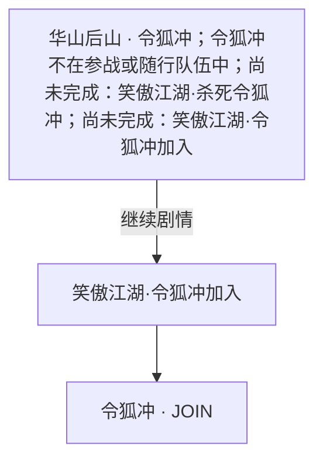

- 更早结果须不先命中：道德 ≥ 65 → 笑傲江湖·令狐冲不加入太正
- 更早结果须不先命中：道德 < 35 → 笑傲江湖·令狐冲不加入太邪
- 地图剧情入口：碧血剑·何红药1 → 华山后山。
  - 华山山洞 · 何红药：尚未完成：碧血剑·何红药胜；概率100%。
- 地图剧情入口：碧血剑·何红药2 → 华山后山。
  - 华山山洞 · 何红药：尚未完成：碧血剑·何红药胜；概率100%。
- 地图剧情入口：碧血剑·何红药胜 → 华山后山。
  - 华山山洞 · 何红药：尚未完成：碧血剑·何红药胜；概率100%。
- 地图剧情入口：华山选择 → 华山派 → 华山 → 华山后山1 → 华山后山3 → 华山后山4 → 华山后山。
  - 华山 · 华山派：；概率100%。
- 地图剧情入口：笑傲江湖·岳灵珊1胜 → 华山派 → 华山 → 华山后山1 → 华山后山3 → 华山后山4 → 华山后山。
  - 华山派 · 岳灵珊：令狐冲不在参战或随行队伍中；尚未完成：笑傲江湖·岳灵珊3胜；概率100%。
- 地图剧情入口：笑傲江湖·岳灵珊2胜 → 华山派 → 华山 → 华山后山1 → 华山后山3 → 华山后山4 → 华山后山。
  - 华山派 · 岳灵珊：令狐冲不在参战或随行队伍中；尚未完成：笑傲江湖·岳灵珊3胜；已完成：笑傲江湖·岳灵珊1胜；概率50%。
- 地图剧情入口：笑傲江湖·岳灵珊3胜 → 华山派 → 华山 → 华山后山1 → 华山后山3 → 华山后山4 → 华山后山。
  - 华山派 · 岳灵珊：令狐冲在参战或随行队伍中；概率50%。

- 离队依据：`笑傲江湖_黑木崖.辟邪剑谱不交` · LEAVE。

## 平一指 · 平一指

### 路线1 · 加入

原剧情：`笑傲江湖_平一指2`。

入口1：平一指居 · 平一指；概率100%。

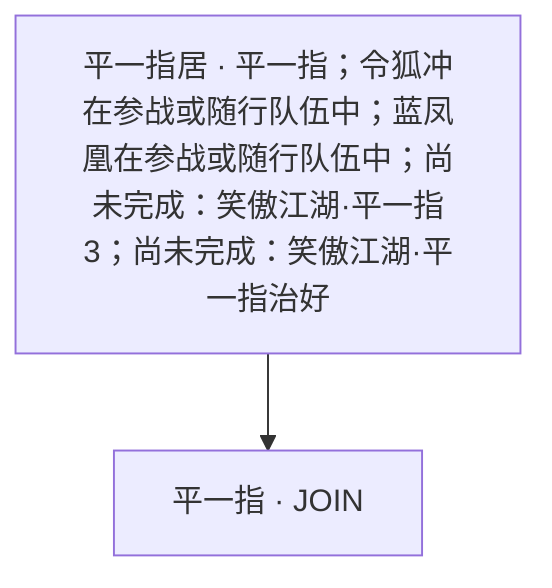

- 更早入口：笑傲江湖·平一指治疗；令狐冲在参战或随行队伍中；蓝凤凰在参战或随行队伍中；平一指在参战或随行队伍中；持有物品：雪莲花；持有物品：万年醉；持有物品：长白人参；概率100%。
- 更早入口：笑傲江湖·平一指3；已完成：笑傲江湖·平一指2；尚未完成：笑傲江湖·平一指治好；概率100%。
- 地图剧情入口：笑傲江湖·平一指2 → 平一指居。
  - 平一指居 · 平一指：令狐冲在参战或随行队伍中；蓝凤凰在参战或随行队伍中；尚未完成：笑傲江湖·平一指3；尚未完成：笑傲江湖·平一指治好；概率100%。
- 地图剧情入口：test·多重选择测试 → 洛阳 → 平一指居。

- 离队依据：`笑傲江湖_黑木崖.辟邪剑谱不交平一指` · LEAVE。

## 曲非烟 · 曲非烟

### 路线1 · 加入

原剧情：`笑傲江湖_曲非烟胜`。

入口1：衡阳郊外 · 曲非烟；概率100%。

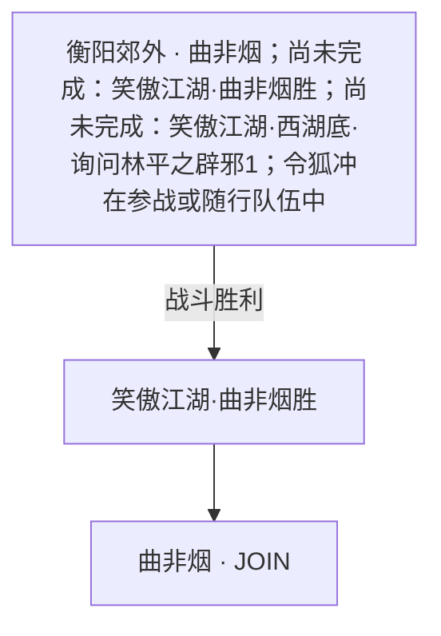

- 地图剧情入口：笑傲江湖·曲非烟胜 → 衡阳郊外。
  - 衡阳郊外 · 曲非烟：尚未完成：笑傲江湖·曲非烟胜；尚未完成：笑傲江湖·西湖底·询问林平之辟邪1；令狐冲在参战或随行队伍中；概率100%。
- 地图剧情入口：雪山飞狐·湘妃庙·胡斐单挑田归农·胜利 → 湘妃庙 → 衡阳 → 潇湘古林1 → 衡阳郊外。
  - 湘妃庙 · 田归农：已完成：雪山飞狐·苗人凤居·田归农来战·胜利·2；已完成：雪山飞狐·阎基居·七星海棠·胜利·杀；概率100%。
- 地图剧情入口：雪山飞狐·药王庄·毒手药王·胜利 → 药王庄 → 衡阳 → 潇湘古林1 → 衡阳郊外。
  - 药王庄 · 毒手药王：程灵素在参战或随行队伍中；已完成：mainStory·黑暗的阴影1；尚未完成：雪山飞狐·药王庄·毒手药王·胜利；概率50%。
- 地图剧情入口：雪山飞狐·药王庄·毒手药王·失败 → 药王庄 → 衡阳 → 潇湘古林1 → 衡阳郊外。
  - 药王庄 · 毒手药王：程灵素在参战或随行队伍中；已完成：mainStory·黑暗的阴影1；尚未完成：雪山飞狐·药王庄·毒手药王·胜利；概率50%。
- 地图剧情入口：雪山飞狐·药王庄·毒手药王·单挑战·胜利 → 药王庄 → 衡阳 → 潇湘古林1 → 衡阳郊外。
  - 药王庄 · 毒手药王：程灵素在参战或随行队伍中；已完成：雪山飞狐·药王庄·毒手药王；已完成：mainStory·组织1；尚未完成：雪山飞狐·药王庄·毒手药王·单挑战·胜利；概率50%。
- 地图剧情入口：雪山飞狐·药王庄·毒手药王·单挑战·失败 → 药王庄 → 衡阳 → 潇湘古林1 → 衡阳郊外。
  - 药王庄 · 毒手药王：程灵素在参战或随行队伍中；已完成：雪山飞狐·药王庄·毒手药王；已完成：mainStory·组织1；尚未完成：雪山飞狐·药王庄·毒手药王·单挑战·胜利；概率50%。

- 离队依据：`笑傲江湖_黑木崖.辟邪剑谱不交曲非烟` · LEAVE。
- 离队依据：`笑傲江湖_嵩山.不阻止1` · LEAVE。

## 田伯光 · 田伯光

### 路线1 · 加入

原剧情：`笑傲江湖_田伯光居.胜田伯光`。

入口1：大地图 · 田伯光居；概率100%。

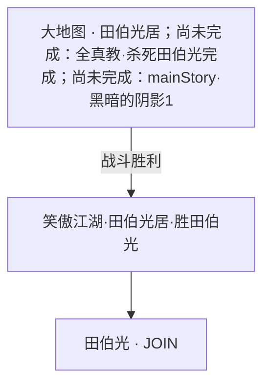

- 更早入口：全真教·杀死田伯光；已完成：全真教·孙不二是；概率100%。

### 路线2 · 加入

原剧情：`笑傲江湖_田伯光居.负田伯光`。

入口1：大地图 · 田伯光居；概率100%。

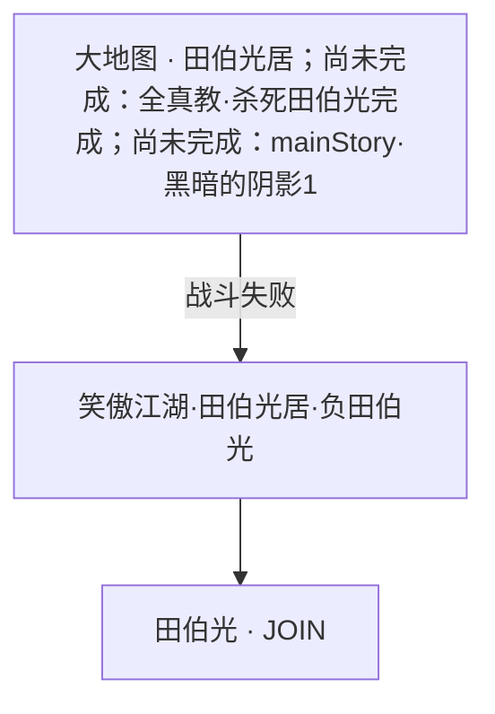

- 更早入口：全真教·杀死田伯光；已完成：全真教·孙不二是；概率100%。


## 程灵素 · 程灵素

### 路线1 · 加入

原剧情：`雪山飞狐_药王庄.程灵素.求药`。

入口1：药王庄 · 程灵素；概率100%。

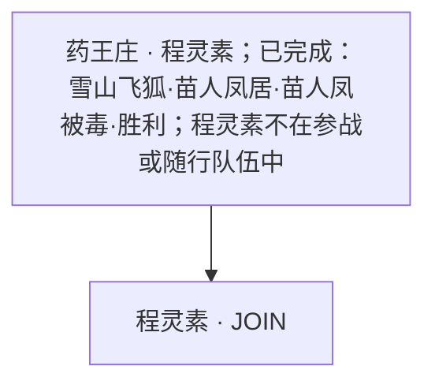

- 地图剧情入口：雪山飞狐·药王庄·毒手药王·胜利 → 药王庄。
  - 药王庄 · 毒手药王：程灵素在参战或随行队伍中；已完成：mainStory·黑暗的阴影1；尚未完成：雪山飞狐·药王庄·毒手药王·胜利；概率50%。
- 地图剧情入口：雪山飞狐·药王庄·毒手药王·失败 → 药王庄。
  - 药王庄 · 毒手药王：程灵素在参战或随行队伍中；已完成：mainStory·黑暗的阴影1；尚未完成：雪山飞狐·药王庄·毒手药王·胜利；概率50%。
- 地图剧情入口：雪山飞狐·药王庄·毒手药王·单挑战·胜利 → 药王庄。
  - 药王庄 · 毒手药王：程灵素在参战或随行队伍中；已完成：雪山飞狐·药王庄·毒手药王；已完成：mainStory·组织1；尚未完成：雪山飞狐·药王庄·毒手药王·单挑战·胜利；概率50%。
- 地图剧情入口：雪山飞狐·药王庄·毒手药王·单挑战·失败 → 药王庄。
  - 药王庄 · 毒手药王：程灵素在参战或随行队伍中；已完成：雪山飞狐·药王庄·毒手药王；已完成：mainStory·组织1；尚未完成：雪山飞狐·药王庄·毒手药王·单挑战·胜利；概率50%。
- 地图剧情入口：笑傲江湖·曲非烟胜 → 衡阳郊外 → 潇湘古林1 → 潇湘古林3 → 潇湘古林4 → 潇湘古林5 → 药王庄。
  - 衡阳郊外 · 曲非烟：尚未完成：笑傲江湖·曲非烟胜；尚未完成：笑傲江湖·西湖底·询问林平之辟邪1；令狐冲在参战或随行队伍中；概率100%。
- 地图剧情入口：雪山飞狐·湘妃庙·胡斐单挑田归农·胜利 → 湘妃庙 → 衡阳 → 潇湘古林1 → 潇湘古林3 → 潇湘古林4 → 潇湘古林5 → 药王庄。
  - 湘妃庙 · 田归农：已完成：雪山飞狐·苗人凤居·田归农来战·胜利·2；已完成：雪山飞狐·阎基居·七星海棠·胜利·杀；概率100%。


## 胡斐 · 胡斐

### 路线1 · 加入

原剧情：`雪山飞狐_胡斐居.胜利`。

入口1：大地图 · 胡斐居；概率100%。

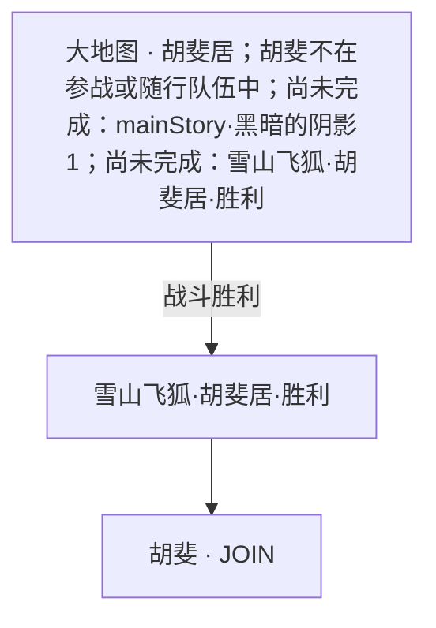


入口2：大地图 · 胡斐居；概率100%。


- 更早入口：雪山飞狐·胡斐居；胡斐不在参战或随行队伍中；尚未完成：mainStory·黑暗的阴影1；尚未完成：雪山飞狐·胡斐居·胜利；概率100%。


## 蓝凤凰 · 蓝凤凰

### 路线1 · 加入

原剧情：`笑傲江湖_蓝凤凰2`。

入口1：五毒教 · 蓝凤凰；概率100%。

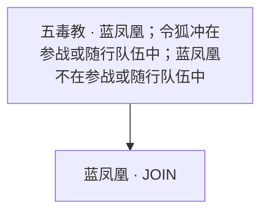

- 地图剧情入口：天龙八部·木婉清身世·胜段正淳 → 大理 → 五毒教山中1 → 五毒教山中2 → 五毒教山中3 → 五毒教山中4 → 五毒教。
  - 大理 · 镇南王府：已完成：天龙八部·童姥使者3；已完成：天龙八部·无量山洞3；木婉清不在参战或随行队伍中；段誉不在参战或随行队伍中；已完成：天龙八部·对话·再见木婉清2；概率100%。
- 地图剧情入口：天龙八部·木婉清身世·负段正淳 → 大理 → 五毒教山中1 → 五毒教山中2 → 五毒教山中3 → 五毒教山中4 → 五毒教。
  - 大理 · 镇南王府：已完成：天龙八部·童姥使者3；已完成：天龙八部·无量山洞3；木婉清不在参战或随行队伍中；段誉不在参战或随行队伍中；已完成：天龙八部·对话·再见木婉清2；概率100%。
- 地图剧情入口：天龙八部·镇南王府·救木婉清·胜利 → 大理 → 五毒教山中1 → 五毒教山中2 → 五毒教山中3 → 五毒教山中4 → 五毒教。
  - 大理 · 镇南王府：已完成：天龙八部·万劫谷地牢·上；木婉清不在参战或随行队伍中；段誉不在参战或随行队伍中；概率100%。
- 地图剧情入口：鹿鼎记·吴三桂4 → 大理 → 五毒教山中1 → 五毒教山中2 → 五毒教山中3 → 五毒教山中4 → 五毒教。
  - 大地图 · 大理：已完成：鹿鼎记·阿九3；概率50%。

- 离队依据：`笑傲江湖_黑木崖.辟邪剑谱不交蓝凤凰` · LEAVE。

## 袁承志 · 袁承志

### 路线1 · 加入

原剧情：`bixuejianShyou_接黄金2`。

入口1：风陵渡口 · 袁承志；概率50%。

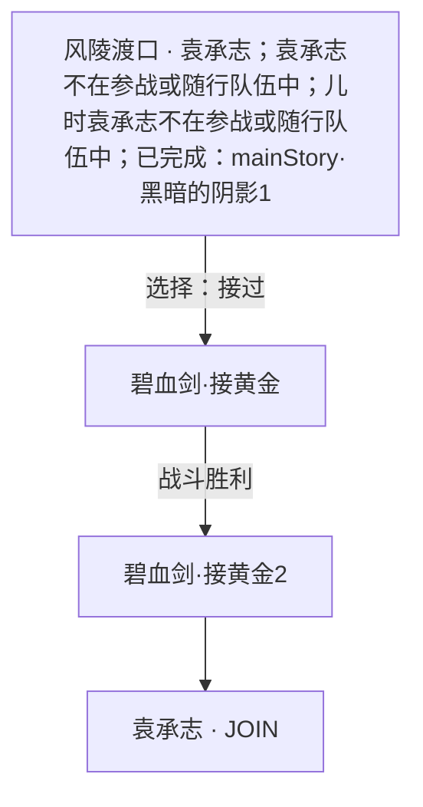

- 地图剧情入口：碧血剑·龙游帮VIP传送2 → 风陵渡口。
  - 风陵渡口 · 船老大：袁承志在参战或随行队伍中；温青青不在参战或随行队伍中；已完成：碧血剑·接黄金3；已完成：鹿鼎记·皇宫太后7；概率80%。

### 路线2 · 加入

原剧情：`bixuejianShyou_不接黄金`。

入口1：风陵渡口 · 袁承志；概率50%。

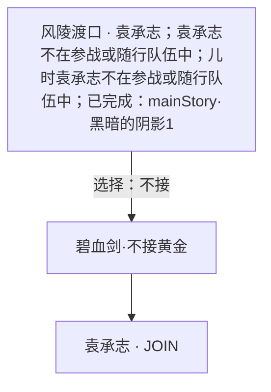

- 地图剧情入口：碧血剑·龙游帮VIP传送2 → 风陵渡口。
  - 风陵渡口 · 船老大：袁承志在参战或随行队伍中；温青青不在参战或随行队伍中；已完成：碧血剑·接黄金3；已完成：鹿鼎记·皇宫太后7；概率80%。

### 路线3 · 加入

原剧情：`bixuejianShyou_接金败石梁派3`。

入口1：石梁派 · 石梁派大殿；概率100%。

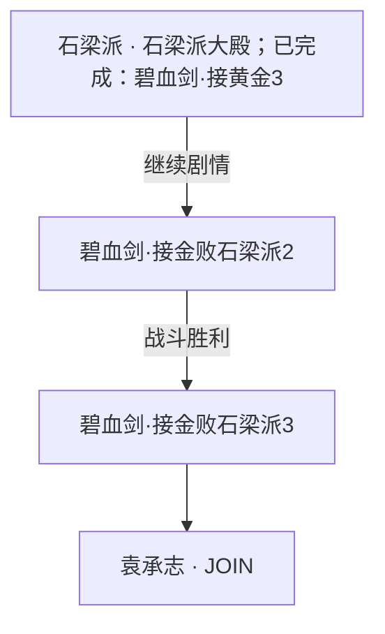

- 更早入口：碧血剑·打开包裹石梁派；已完成：碧血剑·得黄金；概率100%。
- 更早入口：碧血剑·不接黄金石梁派1；已完成：碧血剑·不接黄金；概率100%。
- 更早入口：碧血剑·接金胜不开包裹石梁派1；已完成：碧血剑·接黄金2；尚未完成：碧血剑·得黄金；概率100%。

- 离队依据：`鹿鼎记_阿九.邀请` · LEAVE。
- 离队依据：`bixuejianShyou_打开包裹石梁派` · LEAVE。

## 郭襄 · 郭襄

### 路线1 · 加入

原剧情：`sdxl_郭襄.风陵渡口.战斗胜利`。

入口1：大地图 · 风陵渡口；概率20%。

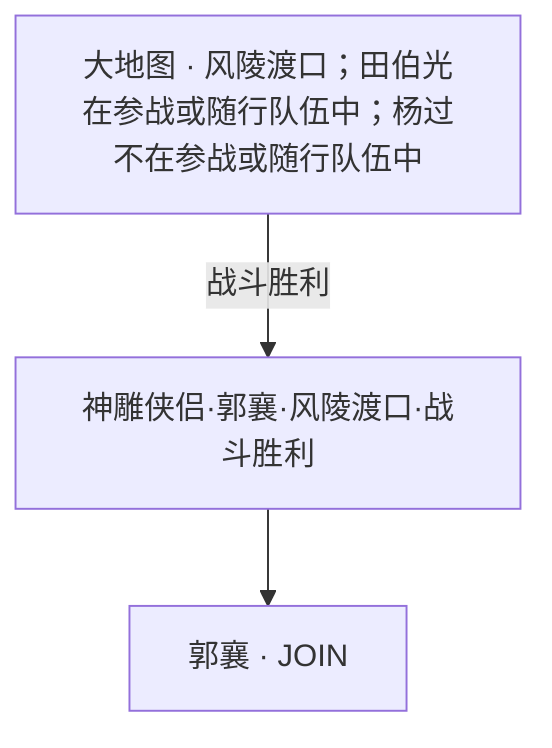

- 更早入口：鸳鸯刀·太岳四侠；当前时辰属于：子、丑、寅、卯、亥；尚未完成：鸳鸯刀·风陵渡胜2；概率100%。
- 更早入口：神雕侠侣·程英·风陵渡口；杨过在参战或随行队伍中；程英不在参战或随行队伍中；概率100%。
- 更早入口：笑傲江湖·风陵渡黑衣人；令狐冲在参战或随行队伍中；任盈盈在参战或随行队伍中；已完成：笑傲江湖·琴居东方胜；概率100%。

- 离队依据：`original_灭门古墓郭襄离开` · LEAVE。

## 郭靖 · 郭靖

### 路线1 · 加入

原剧情：`射雕英雄传_塞外郭靖`。

入口1：大地图 · 帐篷；概率50%。

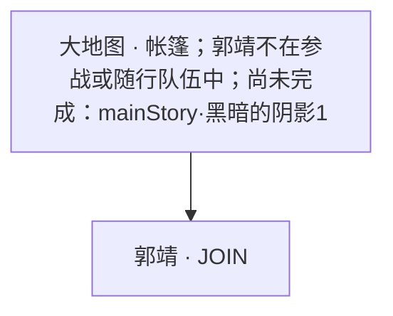


- 离队依据：`original_灭门全真郭靖离开` · LEAVE。

## 钟灵 · 钟灵

### 路线1 · 加入

原剧情：`tlbb.dy_钟灵找`。

入口1：万劫谷 · 钟灵；概率100%。

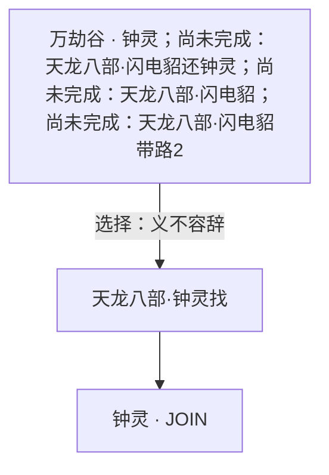

- 更早入口：天龙八部·闪电貂还钟灵；已完成：天龙八部·闪电貂带路2；木婉清在参战或随行队伍中；概率100%。


## 阎基 · 阎基

### 路线1 · 加入

原剧情：`雪山飞狐_阎基居.七星海棠.胜利.不杀`。

入口1：大地图 · 阎基居；概率50%。

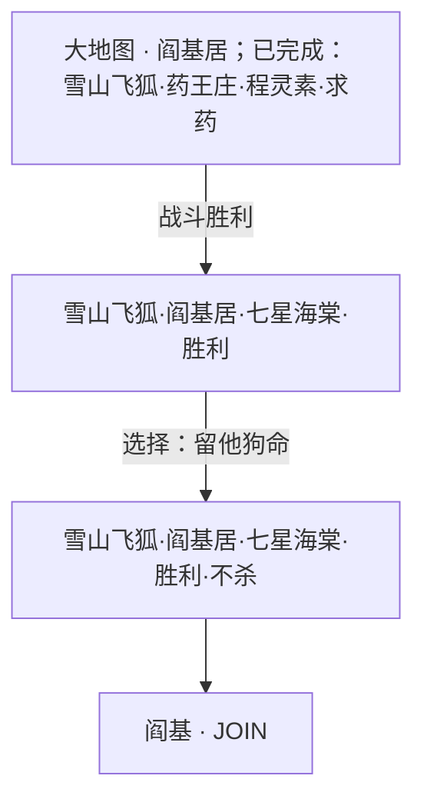

- 更早入口：雪山飞狐·阎基居·两页刀法；胡斐在参战或随行队伍中；概率100%。

- 离队依据：`雪山飞狐_湘妃庙.田归农.阎基.胜利` · LEAVE。

## 阿朱 · 阿朱

### 路线1 · 加入

原剧情：`tlbb.dy_阿朱阿碧.阿朱`。

入口1：大地图 · 太湖；概率50%。

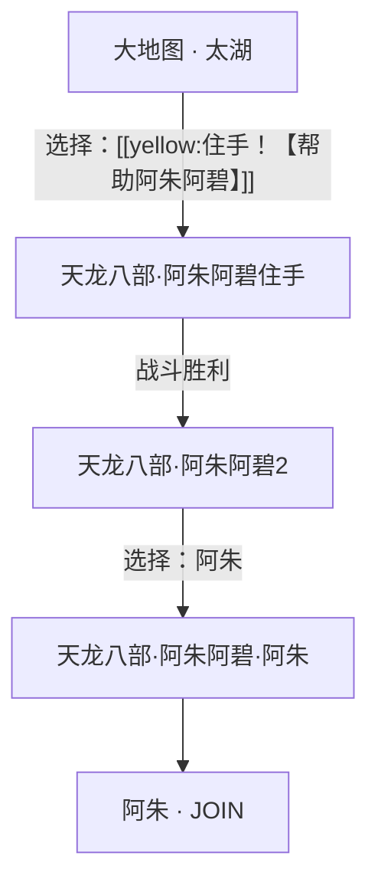


入口2：大地图 · 太湖；概率50%。

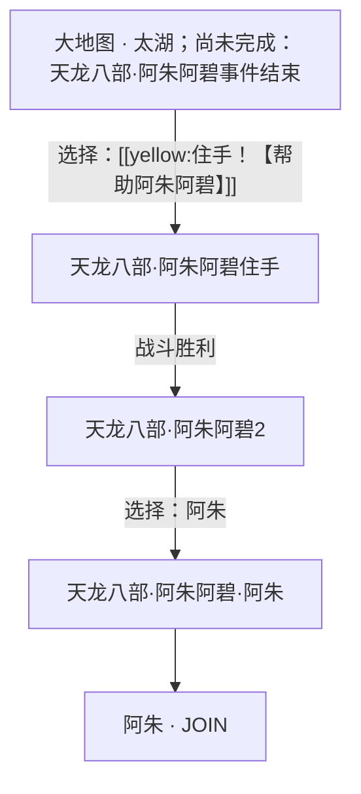

- 更早入口：天龙八部·阿朱阿碧；；概率50%。


## 韦小宝 · 韦小宝

### 路线1 · 加入

原剧情：`鹿鼎记_北京韦小宝加入`。

入口1：北京 · 韦小宝；概率50%。

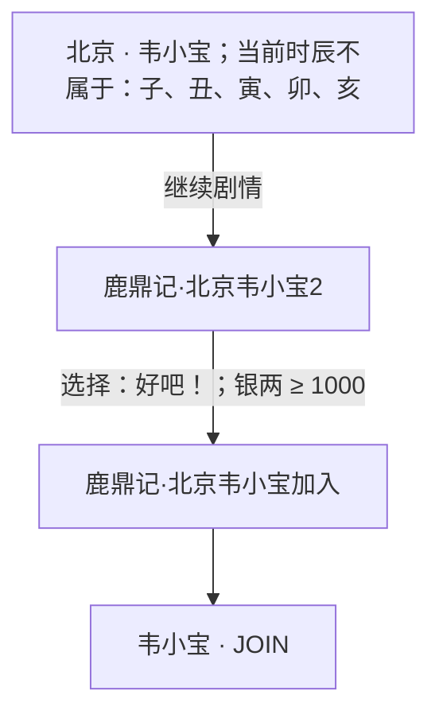

- 地图剧情入口：鹿鼎记·皇宫鳌拜结束 → 北京。
  - 大地图 · 北京：韦小宝在参战或随行队伍中；已完成：鹿鼎记·北京韦小宝加入；概率30%。
- 地图剧情入口：鹿鼎记·皇宫太后7 → 北京。
  - 大地图 · 北京：韦小宝在参战或随行队伍中；已完成：鹿鼎记·皇宫鳌拜1；概率30%。
- 地图剧情入口：碧血剑·龙游帮VIP传送1 → 天安门 → 北京。
  - 风陵渡口 · 船老大：袁承志在参战或随行队伍中；温青青不在参战或随行队伍中；已完成：碧血剑·接黄金3；已完成：鹿鼎记·皇宫太后7；概率80%。

入口2：北京 · 韦小宝；概率100%。

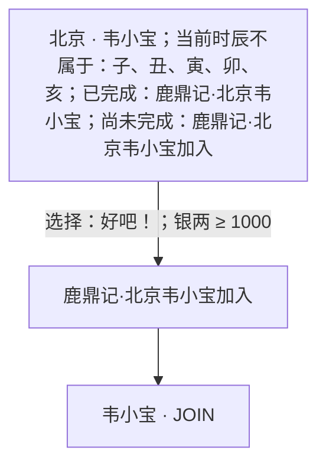

- 更早入口：鹿鼎记·北京韦小宝；当前时辰不属于：子、丑、寅、卯、亥；概率50%。
- 地图剧情入口：鹿鼎记·皇宫鳌拜结束 → 北京。
  - 大地图 · 北京：韦小宝在参战或随行队伍中；已完成：鹿鼎记·北京韦小宝加入；概率30%。
- 地图剧情入口：鹿鼎记·皇宫太后7 → 北京。
  - 大地图 · 北京：韦小宝在参战或随行队伍中；已完成：鹿鼎记·皇宫鳌拜1；概率30%。
- 地图剧情入口：碧血剑·龙游帮VIP传送1 → 天安门 → 北京。
  - 风陵渡口 · 船老大：袁承志在参战或随行队伍中；温青青不在参战或随行队伍中；已完成：碧血剑·接黄金3；已完成：鹿鼎记·皇宫太后7；概率80%。


## 一灯大师 · 一灯大师

### 路线1 · 加入

原剧情：`original_松鼠旅馆一灯大师`。

入口1：松鼠旅馆 · 汉家松鼠；概率100%。

```mermaid
flowchart TD
  r1p1n0["松鼠旅馆 · 汉家松鼠；当前不是第1周目"]
  r1p1n1["松鼠旅馆周目三"]
  r1p1n0 -->|"继续剧情；当前为第3周目"| r1p1n1
  r1p1n2["battle·松鼠旅馆一灯大师"]
  r1p1n1 -->|"选择：一灯大师"| r1p1n2
  r1p1n3["松鼠旅馆一灯大师"]
  r1p1n2 -->|"战斗胜利"| r1p1n3
  r1p1n3 --> r1p1njoin["一灯大师 · JOIN"]
```

- 更早入口：松鼠旅馆结束后；已完成：松鼠旅馆结束；概率100%。
- 更早入口：松鼠旅馆周目四；当前不是第1周目；当前不是第2周目；当前不是第3周目；已完成：松鼠旅馆事件启动；尚未完成：松鼠旅馆结束；概率100%。
- 更早入口：松鼠旅馆周目三；当前为第3周目；已完成：松鼠旅馆事件启动；尚未完成：松鼠旅馆结束；概率100%。
- 更早入口：松鼠旅馆周目二；当前为第2周目；已完成：松鼠旅馆事件启动；尚未完成：松鼠旅馆结束；概率100%。
- 更早结果须不先命中：当前为第2周目 → 松鼠旅馆周目二

入口2：松鼠旅馆 · 汉家松鼠；概率100%。

```mermaid
flowchart TD
  r1p2n0["松鼠旅馆 · 汉家松鼠；当前为第3周目；已完成：松鼠旅馆事件启动；尚未完成：松鼠旅馆结束"]
  r1p2n1["battle·松鼠旅馆一灯大师"]
  r1p2n0 -->|"选择：一灯大师"| r1p2n1
  r1p2n2["松鼠旅馆一灯大师"]
  r1p2n1 -->|"战斗胜利"| r1p2n2
  r1p2n2 --> r1p2njoin["一灯大师 · JOIN"]
```

- 更早入口：松鼠旅馆结束后；已完成：松鼠旅馆结束；概率100%。
- 更早入口：松鼠旅馆周目四；当前不是第1周目；当前不是第2周目；当前不是第3周目；已完成：松鼠旅馆事件启动；尚未完成：松鼠旅馆结束；概率100%。


## 丁春秋 · 丁春秋

### 路线1 · 加入

原剧情：`tlbb.xz_星宿派投降`。

入口1：大地图 · 星宿海；概率100%。

```mermaid
flowchart TD
  r1p1n0["大地图 · 星宿海；已完成：天龙八部·擂鼓山4"]
  r1p1n1["天龙八部·星宿派胜"]
  r1p1n0 -->|"战斗胜利"| r1p1n1
  r1p1n2["天龙八部·星宿派投降"]
  r1p1n1 -->|"选择：接受他的投降"| r1p1n2
  r1p1n2 --> r1p1njoin["丁春秋 · JOIN"]
```


## 东方不败 · 东方不败

### 路线1 · 加入

原剧情：`original_松鼠旅馆东方不败`。

入口1：松鼠旅馆 · 汉家松鼠；概率100%。

```mermaid
flowchart TD
  r1p1n0["松鼠旅馆 · 汉家松鼠；当前不是第1周目"]
  r1p1n1["松鼠旅馆周目四"]
  r1p1n0 -->|"继续剧情"| r1p1n1
  r1p1n2["battle·松鼠旅馆东方不败"]
  r1p1n1 -->|"选择：东方不败"| r1p1n2
  r1p1n3["松鼠旅馆东方不败"]
  r1p1n2 -->|"战斗胜利"| r1p1n3
  r1p1n3 --> r1p1njoin["东方不败 · JOIN"]
```

- 更早入口：松鼠旅馆结束后；已完成：松鼠旅馆结束；概率100%。
- 更早入口：松鼠旅馆周目四；当前不是第1周目；当前不是第2周目；当前不是第3周目；已完成：松鼠旅馆事件启动；尚未完成：松鼠旅馆结束；概率100%。
- 更早入口：松鼠旅馆周目三；当前为第3周目；已完成：松鼠旅馆事件启动；尚未完成：松鼠旅馆结束；概率100%。
- 更早入口：松鼠旅馆周目二；当前为第2周目；已完成：松鼠旅馆事件启动；尚未完成：松鼠旅馆结束；概率100%。
- 更早结果须不先命中：当前为第2周目 → 松鼠旅馆周目二
- 更早结果须不先命中：当前为第3周目 → 松鼠旅馆周目三

入口2：松鼠旅馆 · 汉家松鼠；概率100%。

```mermaid
flowchart TD
  r1p2n0["松鼠旅馆 · 汉家松鼠；当前不是第1周目；当前不是第2周目；当前不是第3周目；已完成：松鼠旅馆事件启动；尚未完成：松鼠旅馆结束"]
  r1p2n1["battle·松鼠旅馆东方不败"]
  r1p2n0 -->|"选择：东方不败"| r1p2n1
  r1p2n2["松鼠旅馆东方不败"]
  r1p2n1 -->|"战斗胜利"| r1p2n2
  r1p2n2 --> r1p2njoin["东方不败 · JOIN"]
```

- 更早入口：松鼠旅馆结束后；已完成：松鼠旅馆结束；概率100%。


## 乔峰 · 乔峰

### 路线1 · 加入

原剧情：`tlbb.dy_雁门关有阿朱`。

入口1：雁门关 · 乔峰；概率100%。

```mermaid
flowchart TD
  r1p1n0["雁门关 · 乔峰；已完成：天龙八部·聚贤庄3；段誉在参战或随行队伍中"]
  r1p1n1["天龙八部·雁门关有阿朱"]
  r1p1n0 -->|"战斗胜利"| r1p1n1
  r1p1n1 --> r1p1njoin["乔峰 · JOIN"]
```

- 更早结果须不先命中：阿朱不在参战或随行队伍中 → 天龙八部·雁门关无阿朱


## 九难 · 九难

### 路线1 · 加入

原剧情：`鹿鼎记_阿九.邀请2`。

入口1：大理 · 阿珂；概率100%。

```mermaid
flowchart TD
  r1p1n0["大理 · 阿珂；已完成：鹿鼎记·皇宫太后7；袁承志在参战或随行队伍中；温青青在参战或随行队伍中；韦小宝在参战或随行队伍中"]
  r1p1n1["鹿鼎记·阿九2"]
  r1p1n0 -->|"继续剧情"| r1p1n1
  r1p1n2["鹿鼎记·阿九3"]
  r1p1n1 -->|"战斗胜利"| r1p1n2
  r1p1n3["鹿鼎记·阿九·邀请"]
  r1p1n2 -->|"选择：邀请"| r1p1n3
  r1p1n4["鹿鼎记·阿九·邀请2"]
  r1p1n3 -->|"继续剧情"| r1p1n4
  r1p1n4 --> r1p1njoin["九难 · JOIN"]
```

- 地图剧情入口：天龙八部·木婉清身世·胜段正淳 → 大理。
  - 大理 · 镇南王府：已完成：天龙八部·童姥使者3；已完成：天龙八部·无量山洞3；木婉清不在参战或随行队伍中；段誉不在参战或随行队伍中；已完成：天龙八部·对话·再见木婉清2；概率100%。
- 地图剧情入口：天龙八部·木婉清身世·负段正淳 → 大理。
  - 大理 · 镇南王府：已完成：天龙八部·童姥使者3；已完成：天龙八部·无量山洞3；木婉清不在参战或随行队伍中；段誉不在参战或随行队伍中；已完成：天龙八部·对话·再见木婉清2；概率100%。
- 地图剧情入口：天龙八部·镇南王府·救木婉清·胜利 → 大理。
  - 大理 · 镇南王府：已完成：天龙八部·万劫谷地牢·上；木婉清不在参战或随行队伍中；段誉不在参战或随行队伍中；概率100%。
- 地图剧情入口：鹿鼎记·吴三桂4 → 大理。
  - 大地图 · 大理：已完成：鹿鼎记·阿九3；概率50%。

### 路线2 · 加入

原剧情：`bixuejianShyou_铁剑门0`。

入口1：华山仙境 · 袁承志；概率100%。

```mermaid
flowchart TD
  r2p1n0["华山仙境 · 袁承志；袁承志在参战或随行队伍中；阿九不在参战或随行队伍中；已完成：碧血剑·华山派；已完成：mainStory·神秘剑客1"]
  r2p1n0 --> r2p1njoin["九难 · JOIN"]
```

- 地图剧情入口：华山选择 → 华山派 → 华山 → 华山后山1 → 华山后山3 → 华山后山4 → 华山仙境。
  - 华山 · 华山派：；概率100%。
- 地图剧情入口：笑傲江湖·岳灵珊1胜 → 华山派 → 华山 → 华山后山1 → 华山后山3 → 华山后山4 → 华山仙境。
  - 华山派 · 岳灵珊：令狐冲不在参战或随行队伍中；尚未完成：笑傲江湖·岳灵珊3胜；概率100%。
- 地图剧情入口：笑傲江湖·岳灵珊2胜 → 华山派 → 华山 → 华山后山1 → 华山后山3 → 华山后山4 → 华山仙境。
  - 华山派 · 岳灵珊：令狐冲不在参战或随行队伍中；尚未完成：笑傲江湖·岳灵珊3胜；已完成：笑傲江湖·岳灵珊1胜；概率50%。
- 地图剧情入口：笑傲江湖·岳灵珊3胜 → 华山派 → 华山 → 华山后山1 → 华山后山3 → 华山后山4 → 华山仙境。
  - 华山派 · 岳灵珊：令狐冲在参战或随行队伍中；概率50%。
- 地图剧情入口：碧血剑·何红药1 → 华山后山 → 华山 → 华山后山1 → 华山后山3 → 华山后山4 → 华山仙境。
  - 华山山洞 · 何红药：尚未完成：碧血剑·何红药胜；概率100%。
- 地图剧情入口：碧血剑·何红药2 → 华山后山 → 华山 → 华山后山1 → 华山后山3 → 华山后山4 → 华山仙境。
  - 华山山洞 · 何红药：尚未完成：碧血剑·何红药胜；概率100%。
- 地图剧情入口：碧血剑·何红药胜 → 华山后山 → 华山 → 华山后山1 → 华山后山3 → 华山后山4 → 华山仙境。
  - 华山山洞 · 何红药：尚未完成：碧血剑·何红药胜；概率100%。


## 任盈盈 · 任盈盈

### 路线1 · 加入

原剧情：`笑傲江湖_平一指治好`。

入口1：平一指居 · 平一指；概率100%。

```mermaid
flowchart TD
  r1p1n0["平一指居 · 平一指；令狐冲在参战或随行队伍中；蓝凤凰在参战或随行队伍中；平一指在参战或随行队伍中；持有物品：雪莲花；持有物品：万年醉；持有物品：长白人参"]
  r1p1n1["笑傲江湖·平一指治好"]
  r1p1n0 -->|"继续剧情"| r1p1n1
  r1p1n1 --> r1p1njoin["任盈盈 · JOIN"]
```

- 地图剧情入口：笑傲江湖·平一指2 → 平一指居。
  - 平一指居 · 平一指：令狐冲在参战或随行队伍中；蓝凤凰在参战或随行队伍中；尚未完成：笑傲江湖·平一指3；尚未完成：笑傲江湖·平一指治好；概率100%。
- 地图剧情入口：test·多重选择测试 → 洛阳 → 平一指居。

- 离队依据：`笑傲江湖_黑木崖.辟邪剑谱不交任盈盈` · LEAVE。

## 公孙谷主 · 公孙谷主

### 路线1 · 加入

原剧情：`original_松鼠旅馆公孙谷主`。

入口1：松鼠旅馆 · 汉家松鼠；概率100%。

```mermaid
flowchart TD
  r1p1n0["松鼠旅馆 · 汉家松鼠；当前不是第1周目"]
  r1p1n1["松鼠旅馆周目二"]
  r1p1n0 -->|"继续剧情；当前为第2周目"| r1p1n1
  r1p1n2["battle·松鼠旅馆公孙谷主"]
  r1p1n1 -->|"选择：公孙谷主"| r1p1n2
  r1p1n3["松鼠旅馆公孙谷主"]
  r1p1n2 -->|"战斗胜利"| r1p1n3
  r1p1n3 --> r1p1njoin["公孙谷主 · JOIN"]
```

- 更早入口：松鼠旅馆结束后；已完成：松鼠旅馆结束；概率100%。
- 更早入口：松鼠旅馆周目四；当前不是第1周目；当前不是第2周目；当前不是第3周目；已完成：松鼠旅馆事件启动；尚未完成：松鼠旅馆结束；概率100%。
- 更早入口：松鼠旅馆周目三；当前为第3周目；已完成：松鼠旅馆事件启动；尚未完成：松鼠旅馆结束；概率100%。
- 更早入口：松鼠旅馆周目二；当前为第2周目；已完成：松鼠旅馆事件启动；尚未完成：松鼠旅馆结束；概率100%。

入口2：松鼠旅馆 · 汉家松鼠；概率100%。

```mermaid
flowchart TD
  r1p2n0["松鼠旅馆 · 汉家松鼠；当前为第2周目；已完成：松鼠旅馆事件启动；尚未完成：松鼠旅馆结束"]
  r1p2n1["battle·松鼠旅馆公孙谷主"]
  r1p2n0 -->|"选择：公孙谷主"| r1p2n1
  r1p2n2["松鼠旅馆公孙谷主"]
  r1p2n1 -->|"战斗胜利"| r1p2n2
  r1p2n2 --> r1p2njoin["公孙谷主 · JOIN"]
```

- 更早入口：松鼠旅馆结束后；已完成：松鼠旅馆结束；概率100%。
- 更早入口：松鼠旅馆周目四；当前不是第1周目；当前不是第2周目；当前不是第3周目；已完成：松鼠旅馆事件启动；尚未完成：松鼠旅馆结束；概率100%。
- 更早入口：松鼠旅馆周目三；当前为第3周目；已完成：松鼠旅馆事件启动；尚未完成：松鼠旅馆结束；概率100%。


## 周伯通 · 周伯通

### 路线1 · 加入

原剧情：`original_松鼠旅馆周伯通`。

入口1：松鼠旅馆 · 汉家松鼠；概率100%。

```mermaid
flowchart TD
  r1p1n0["松鼠旅馆 · 汉家松鼠；当前不是第1周目"]
  r1p1n1["松鼠旅馆周目三"]
  r1p1n0 -->|"继续剧情；当前为第3周目"| r1p1n1
  r1p1n2["battle·松鼠旅馆周伯通"]
  r1p1n1 -->|"选择：周伯通"| r1p1n2
  r1p1n3["松鼠旅馆周伯通"]
  r1p1n2 -->|"战斗胜利"| r1p1n3
  r1p1n3 --> r1p1njoin["周伯通 · JOIN"]
```

- 更早入口：松鼠旅馆结束后；已完成：松鼠旅馆结束；概率100%。
- 更早入口：松鼠旅馆周目四；当前不是第1周目；当前不是第2周目；当前不是第3周目；已完成：松鼠旅馆事件启动；尚未完成：松鼠旅馆结束；概率100%。
- 更早入口：松鼠旅馆周目三；当前为第3周目；已完成：松鼠旅馆事件启动；尚未完成：松鼠旅馆结束；概率100%。
- 更早入口：松鼠旅馆周目二；当前为第2周目；已完成：松鼠旅馆事件启动；尚未完成：松鼠旅馆结束；概率100%。
- 更早结果须不先命中：当前为第2周目 → 松鼠旅馆周目二

入口2：松鼠旅馆 · 汉家松鼠；概率100%。

```mermaid
flowchart TD
  r1p2n0["松鼠旅馆 · 汉家松鼠；当前为第3周目；已完成：松鼠旅馆事件启动；尚未完成：松鼠旅馆结束"]
  r1p2n1["battle·松鼠旅馆周伯通"]
  r1p2n0 -->|"选择：周伯通"| r1p2n1
  r1p2n2["松鼠旅馆周伯通"]
  r1p2n1 -->|"战斗胜利"| r1p2n2
  r1p2n2 --> r1p2njoin["周伯通 · JOIN"]
```

- 更早入口：松鼠旅馆结束后；已完成：松鼠旅馆结束；概率100%。
- 更早入口：松鼠旅馆周目四；当前不是第1周目；当前不是第2周目；当前不是第3周目；已完成：松鼠旅馆事件启动；尚未完成：松鼠旅馆结束；概率100%。


## 女主 · 女主

### 路线1 · 随行

原剧情：`original_女主出场.结束`。

入口1：大地图 · 沙漠；概率100%。

```mermaid
flowchart TD
  r1p1n0["大地图 · 沙漠；指定角色女主不在参战或随行队伍中；尚未完成：女主出场·结束"]
  r1p1n1["女主出场2"]
  r1p1n0 -->|"继续剧情"| r1p1n1
  r1p1n2["女主出场·仙丽雅"]
  r1p1n1 -->|"选择：去；已完成：长安一梦·民女12"| r1p1n2
  r1p1n3["女主出场·仙丽雅2"]
  r1p1n2 -->|"继续剧情"| r1p1n3
  r1p1n4["女主出场·仙丽雅3"]
  r1p1n3 -->|"战斗胜利"| r1p1n4
  r1p1n5["女主出场·结束"]
  r1p1n4 -->|"继续剧情"| r1p1n5
  r1p1n5 --> r1p1njoin["女主 · FOLLOW"]
```


入口2：大地图 · 沙漠；概率100%。

```mermaid
flowchart TD
  r1p2n0["大地图 · 沙漠；指定角色女主不在参战或随行队伍中；尚未完成：女主出场·结束"]
  r1p2n1["女主出场2"]
  r1p2n0 -->|"继续剧情"| r1p2n1
  r1p2n2["女主出场·普通"]
  r1p2n1 -->|"选择：去；尚未完成：长安一梦·民女12"| r1p2n2
  r1p2n3["女主出场·普通2"]
  r1p2n2 -->|"战斗胜利"| r1p2n3
  r1p2n4["女主出场·结束"]
  r1p2n3 -->|"继续剧情"| r1p2n4
  r1p2n4 --> r1p2njoin["女主 · FOLLOW"]
```

- 更早结果须不先命中：已完成：长安一梦·民女12 → 女主出场·仙丽雅

入口3：大地图 · 沙漠；概率30%。

```mermaid
flowchart TD
  r1p3n0["大地图 · 沙漠；指定角色女主不在参战或随行队伍中；尚未完成：女主出场·结束"]
  r1p3n1["女主出场2"]
  r1p3n0 -->|"继续剧情"| r1p3n1
  r1p3n2["女主出场·仙丽雅"]
  r1p3n1 -->|"选择：去；已完成：长安一梦·民女12"| r1p3n2
  r1p3n3["女主出场·仙丽雅2"]
  r1p3n2 -->|"继续剧情"| r1p3n3
  r1p3n4["女主出场·仙丽雅3"]
  r1p3n3 -->|"战斗胜利"| r1p3n4
  r1p3n5["女主出场·结束"]
  r1p3n4 -->|"继续剧情"| r1p3n5
  r1p3n5 --> r1p3njoin["女主 · FOLLOW"]
```

- 更早入口：女主出场1；指定角色女主不在参战或随行队伍中；尚未完成：女主出场·结束；概率100%。

入口4：大地图 · 沙漠；概率30%。

```mermaid
flowchart TD
  r1p4n0["大地图 · 沙漠；指定角色女主不在参战或随行队伍中；尚未完成：女主出场·结束"]
  r1p4n1["女主出场2"]
  r1p4n0 -->|"继续剧情"| r1p4n1
  r1p4n2["女主出场·普通"]
  r1p4n1 -->|"选择：去；尚未完成：长安一梦·民女12"| r1p4n2
  r1p4n3["女主出场·普通2"]
  r1p4n2 -->|"战斗胜利"| r1p4n3
  r1p4n4["女主出场·结束"]
  r1p4n3 -->|"继续剧情"| r1p4n4
  r1p4n4 --> r1p4njoin["女主 · FOLLOW"]
```

- 更早入口：女主出场1；指定角色女主不在参战或随行队伍中；尚未完成：女主出场·结束；概率100%。
- 更早结果须不先命中：已完成：长安一梦·民女12 → 女主出场·仙丽雅

### 路线2 · 加入

原剧情：`original_女主长安加入队伍`。

入口1：司马府 · 女主；概率100%。

```mermaid
flowchart TD
  r2p1n0["司马府 · 女主；已完成：长安·出发；尚未完成：女主长安加入队伍；指定角色女主不在参战或随行队伍中"]
  r2p1n1["女主长安加入队伍判断"]
  r2p1n0 -->|"选择：要不要和我一起闯江湖？"| r2p1n1
  r2p1n2["女主长安加入队伍"]
  r2p1n1 -->|"继续剧情；女主好感 ≥ 60"| r2p1n2
  r2p1n2 --> r2p1njoin["女主 · JOIN"]
```

- 更早入口：长安深夜怪事·女主的提议；已完成：长安深夜怪事·三遇夜间人·不杀；指定角色女主不在参战或随行队伍中；概率100%。
- 更早入口：长安深夜怪事·再遇夜间人·回复任务；已完成：长安深夜怪事·再遇夜间人；尚未完成：长安深夜怪事·三遇夜间人；指定角色女主不在参战或随行队伍中；概率100%。
- 地图剧情入口：山庄风云·金盆洗手·回家 → 长安城中心 → 司马府。
  - 长安城郊 · 鸣凤山庄：已完成：山庄风云·出发；指定角色女主在参战或随行队伍中；概率100%。
- 地图剧情入口：长安·出发 → 长安 → 长安城中心 → 司马府。
  - 长安城中心 · 司马府：已完成：大唐军营·父亲大人；概率100%。
- 地图剧情入口：长安一梦·民女12 → 长安西市 → 长安 → 长安城中心 → 司马府。
  - 长安西市 · 民女1：已完成：长安一梦·民女C1；尚未完成：长安一梦·民女3；概率100%。
  - 长安一梦 · 返回：；概率100%。

### 路线3 · 随行

原剧情：`original_长安深夜怪事.女主的提议`。

入口1：司马府 · 女主；概率100%。

```mermaid
flowchart TD
  r3p1n0["司马府 · 女主；已完成：长安深夜怪事·三遇夜间人·不杀；指定角色女主不在参战或随行队伍中"]
  r3p1n0 --> r3p1njoin["女主 · FOLLOW"]
```

- 地图剧情入口：山庄风云·金盆洗手·回家 → 长安城中心 → 司马府。
  - 长安城郊 · 鸣凤山庄：已完成：山庄风云·出发；指定角色女主在参战或随行队伍中；概率100%。
- 地图剧情入口：长安·出发 → 长安 → 长安城中心 → 司马府。
  - 长安城中心 · 司马府：已完成：大唐军营·父亲大人；概率100%。
- 地图剧情入口：长安一梦·民女12 → 长安西市 → 长安 → 长安城中心 → 司马府。
  - 长安西市 · 民女1：已完成：长安一梦·民女C1；尚未完成：长安一梦·民女3；概率100%。
  - 长安一梦 · 返回：；概率100%。

### 路线4 · 随行

原剧情：`original_山庄风云.出发`。

入口1：司马府 · 女主；概率100%。

```mermaid
flowchart TD
  r4p1n0["司马府 · 女主；已完成：长安·出发；尚未完成：女主长安加入队伍；指定角色女主不在参战或随行队伍中"]
  r4p1n1["女主长安接任务"]
  r4p1n0 -->|"选择：最近还好吗？"| r4p1n1
  r4p1n2["山庄风云·开篇"]
  r4p1n1 -->|"继续剧情；尚未完成：山庄风云·出发"| r4p1n2
  r4p1n3["山庄风云·出发"]
  r4p1n2 -->|"选择：去吧。"| r4p1n3
  r4p1n3 --> r4p1njoin["女主 · FOLLOW"]
```

- 更早入口：长安深夜怪事·女主的提议；已完成：长安深夜怪事·三遇夜间人·不杀；指定角色女主不在参战或随行队伍中；概率100%。
- 更早入口：长安深夜怪事·再遇夜间人·回复任务；已完成：长安深夜怪事·再遇夜间人；尚未完成：长安深夜怪事·三遇夜间人；指定角色女主不在参战或随行队伍中；概率100%。
- 更早结果须不先命中：尚未完成：长安深夜怪事·开篇 → 长安深夜怪事·开篇
- 地图剧情入口：山庄风云·金盆洗手·回家 → 长安城中心 → 司马府。
  - 长安城郊 · 鸣凤山庄：已完成：山庄风云·出发；指定角色女主在参战或随行队伍中；概率100%。
- 地图剧情入口：长安·出发 → 长安 → 长安城中心 → 司马府。
  - 长安城中心 · 司马府：已完成：大唐军营·父亲大人；概率100%。
- 地图剧情入口：长安一梦·民女12 → 长安西市 → 长安 → 长安城中心 → 司马府。
  - 长安西市 · 民女1：已完成：长安一梦·民女C1；尚未完成：长安一梦·民女3；概率100%。
  - 长安一梦 · 返回：；概率100%。

- 离队依据：`original_长安.出发` · LEAVE_FOLLOW。
- 离队依据：`original_长安深夜怪事.重阳宫3` · LEAVE_FOLLOW。
- 离队依据：`original_山庄风云.金盆洗手.回家` · LEAVE_FOLLOW。

## 小龙女 · 小龙女

### 路线1 · 加入

原剧情：`sdxl_绝情谷底.小龙女加入`。

入口1：大地图 · 绝情谷；概率100%。

```mermaid
flowchart TD
  r1p1n0["大地图 · 绝情谷；杨过在参战或随行队伍中；小龙女不在参战或随行队伍中；郭襄不在参战或随行队伍中；已完成：mainStory·黑暗的阴影1"]
  r1p1n1["神雕侠侣·断肠崖·杨过跳崖2"]
  r1p1n0 -->|"继续剧情"| r1p1n1
  r1p1n2["神雕侠侣·绝情谷底·小龙女"]
  r1p1n1 -->|"继续剧情"| r1p1n2
  r1p1n3["神雕侠侣·绝情谷底·小龙女2"]
  r1p1n2 -->|"继续剧情"| r1p1n3
  r1p1n4["神雕侠侣·绝情谷底·小龙女3"]
  r1p1n3 -->|"继续剧情"| r1p1n4
  r1p1n5["神雕侠侣·绝情谷底·小龙女加入"]
  r1p1n4 -->|"战斗胜利"| r1p1n5
  r1p1n5 --> r1p1njoin["小龙女 · JOIN"]
```


入口2：大地图 · 绝情谷；概率100%。

```mermaid
flowchart TD
  r1p2n0["大地图 · 绝情谷；杨过在参战或随行队伍中；小龙女不在参战或随行队伍中；郭襄不在参战或随行队伍中；已完成：mainStory·黑暗的阴影1"]
  r1p2n1["神雕侠侣·断肠崖·杨过跳崖2"]
  r1p2n0 -->|"继续剧情"| r1p2n1
  r1p2n2["神雕侠侣·绝情谷底·小龙女"]
  r1p2n1 -->|"继续剧情"| r1p2n2
  r1p2n3["神雕侠侣·绝情谷底·小龙女2"]
  r1p2n2 -->|"继续剧情"| r1p2n3
  r1p2n4["神雕侠侣·绝情谷底·小龙女3"]
  r1p2n3 -->|"继续剧情"| r1p2n4
  r1p2n5["神雕侠侣·绝情谷底·小龙女加入"]
  r1p2n4 -->|"战斗失败"| r1p2n5
  r1p2n5 --> r1p2njoin["小龙女 · JOIN"]
```


- 离队依据：`original_灭门古墓小龙女离开` · LEAVE。

## 岳不群 · 岳不群

### 路线1 · 加入

原剧情：`original_松鼠旅馆岳不群`。

入口1：松鼠旅馆 · 汉家松鼠；概率100%。

```mermaid
flowchart TD
  r1p1n0["松鼠旅馆 · 汉家松鼠；当前不是第1周目"]
  r1p1n1["松鼠旅馆周目二"]
  r1p1n0 -->|"继续剧情；当前为第2周目"| r1p1n1
  r1p1n2["battle·松鼠旅馆岳不群"]
  r1p1n1 -->|"选择：岳不群"| r1p1n2
  r1p1n3["松鼠旅馆岳不群"]
  r1p1n2 -->|"战斗胜利"| r1p1n3
  r1p1n3 --> r1p1njoin["岳不群 · JOIN"]
```

- 更早入口：松鼠旅馆结束后；已完成：松鼠旅馆结束；概率100%。
- 更早入口：松鼠旅馆周目四；当前不是第1周目；当前不是第2周目；当前不是第3周目；已完成：松鼠旅馆事件启动；尚未完成：松鼠旅馆结束；概率100%。
- 更早入口：松鼠旅馆周目三；当前为第3周目；已完成：松鼠旅馆事件启动；尚未完成：松鼠旅馆结束；概率100%。
- 更早入口：松鼠旅馆周目二；当前为第2周目；已完成：松鼠旅馆事件启动；尚未完成：松鼠旅馆结束；概率100%。

入口2：松鼠旅馆 · 汉家松鼠；概率100%。

```mermaid
flowchart TD
  r1p2n0["松鼠旅馆 · 汉家松鼠；当前为第2周目；已完成：松鼠旅馆事件启动；尚未完成：松鼠旅馆结束"]
  r1p2n1["battle·松鼠旅馆岳不群"]
  r1p2n0 -->|"选择：岳不群"| r1p2n1
  r1p2n2["松鼠旅馆岳不群"]
  r1p2n1 -->|"战斗胜利"| r1p2n2
  r1p2n2 --> r1p2njoin["岳不群 · JOIN"]
```

- 更早入口：松鼠旅馆结束后；已完成：松鼠旅馆结束；概率100%。
- 更早入口：松鼠旅馆周目四；当前不是第1周目；当前不是第2周目；当前不是第3周目；已完成：松鼠旅馆事件启动；尚未完成：松鼠旅馆结束；概率100%。
- 更早入口：松鼠旅馆周目三；当前为第3周目；已完成：松鼠旅馆事件启动；尚未完成：松鼠旅馆结束；概率100%。


## 崔秋山 · 崔秋山

### 路线1 · 加入

原剧情：`bixuejianShyou_脱险`。

未找到静态地图到加入段的完整引用路径；其他触发方式待核对。

- 离队依据：`bixuejianShyou_华山收徒2` · LEAVE。

## 庄聚贤 · 庄聚贤

### 路线1 · 加入

原剧情：`original_松鼠旅馆庄聚贤`。

入口1：松鼠旅馆 · 汉家松鼠；概率100%。

```mermaid
flowchart TD
  r1p1n0["松鼠旅馆 · 汉家松鼠；当前不是第1周目"]
  r1p1n1["松鼠旅馆周目二"]
  r1p1n0 -->|"继续剧情；当前为第2周目"| r1p1n1
  r1p1n2["battle·松鼠旅馆庄聚贤"]
  r1p1n1 -->|"选择：庄聚贤"| r1p1n2
  r1p1n3["松鼠旅馆庄聚贤"]
  r1p1n2 -->|"战斗胜利"| r1p1n3
  r1p1n3 --> r1p1njoin["庄聚贤 · JOIN"]
```

- 更早入口：松鼠旅馆结束后；已完成：松鼠旅馆结束；概率100%。
- 更早入口：松鼠旅馆周目四；当前不是第1周目；当前不是第2周目；当前不是第3周目；已完成：松鼠旅馆事件启动；尚未完成：松鼠旅馆结束；概率100%。
- 更早入口：松鼠旅馆周目三；当前为第3周目；已完成：松鼠旅馆事件启动；尚未完成：松鼠旅馆结束；概率100%。
- 更早入口：松鼠旅馆周目二；当前为第2周目；已完成：松鼠旅馆事件启动；尚未完成：松鼠旅馆结束；概率100%。

入口2：松鼠旅馆 · 汉家松鼠；概率100%。

```mermaid
flowchart TD
  r1p2n0["松鼠旅馆 · 汉家松鼠；当前为第2周目；已完成：松鼠旅馆事件启动；尚未完成：松鼠旅馆结束"]
  r1p2n1["battle·松鼠旅馆庄聚贤"]
  r1p2n0 -->|"选择：庄聚贤"| r1p2n1
  r1p2n2["松鼠旅馆庄聚贤"]
  r1p2n1 -->|"战斗胜利"| r1p2n2
  r1p2n2 --> r1p2njoin["庄聚贤 · JOIN"]
```

- 更早入口：松鼠旅馆结束后；已完成：松鼠旅馆结束；概率100%。
- 更早入口：松鼠旅馆周目四；当前不是第1周目；当前不是第2周目；当前不是第3周目；已完成：松鼠旅馆事件启动；尚未完成：松鼠旅馆结束；概率100%。
- 更早入口：松鼠旅馆周目三；当前为第3周目；已完成：松鼠旅馆事件启动；尚未完成：松鼠旅馆结束；概率100%。


## 张无忌 · 张无忌

### 路线1 · 加入

原剧情：`test_是`。

测试剧情，不作为普通招募入口。

未找到静态地图到加入段的完整引用路径；其他触发方式待核对。

### 路线2 · 加入

原剧情：`yttlj_昆仑仙境`。

未找到静态地图到加入段的完整引用路径；其他触发方式待核对。

### 路线3 · 加入

原剧情：`倚天屠龙_张无忌入队`。

入口1：大地图 · 北京；概率100%。

```mermaid
flowchart TD
  r3p1n0["大地图 · 北京；已完成：倚天屠龙·张无忌2"]
  r3p1n1["倚天屠龙·北京救赵敏2"]
  r3p1n0 -->|"继续剧情"| r3p1n1
  r3p1n2["倚天屠龙·张无忌入队"]
  r3p1n1 -->|"战斗胜利"| r3p1n2
  r3p1n2 --> r3p1njoin["张无忌 · JOIN"]
```

- 更早入口：少林寺·南北之争1；已完成：少林寺·南北之争；概率100%。
- 更早入口：鹿鼎记·皇宫太后1；韦小宝在参战或随行队伍中；已完成：鹿鼎记·皇宫鳌拜1；概率30%。
- 更早入口：鹿鼎记·皇宫鳌拜1；韦小宝在参战或随行队伍中；已完成：鹿鼎记·北京韦小宝加入；概率30%。


## 慕容博 · 慕容博

### 路线1 · 加入

原剧情：`original_松鼠旅馆慕容博`。

入口1：松鼠旅馆 · 汉家松鼠；概率100%。

```mermaid
flowchart TD
  r1p1n0["松鼠旅馆 · 汉家松鼠；当前不是第1周目"]
  r1p1n1["松鼠旅馆周目四"]
  r1p1n0 -->|"继续剧情"| r1p1n1
  r1p1n2["battle·松鼠旅馆慕容博"]
  r1p1n1 -->|"选择：慕容博"| r1p1n2
  r1p1n3["松鼠旅馆慕容博"]
  r1p1n2 -->|"战斗胜利"| r1p1n3
  r1p1n3 --> r1p1njoin["慕容博 · JOIN"]
```

- 更早入口：松鼠旅馆结束后；已完成：松鼠旅馆结束；概率100%。
- 更早入口：松鼠旅馆周目四；当前不是第1周目；当前不是第2周目；当前不是第3周目；已完成：松鼠旅馆事件启动；尚未完成：松鼠旅馆结束；概率100%。
- 更早入口：松鼠旅馆周目三；当前为第3周目；已完成：松鼠旅馆事件启动；尚未完成：松鼠旅馆结束；概率100%。
- 更早入口：松鼠旅馆周目二；当前为第2周目；已完成：松鼠旅馆事件启动；尚未完成：松鼠旅馆结束；概率100%。
- 更早结果须不先命中：当前为第2周目 → 松鼠旅馆周目二
- 更早结果须不先命中：当前为第3周目 → 松鼠旅馆周目三

入口2：松鼠旅馆 · 汉家松鼠；概率100%。

```mermaid
flowchart TD
  r1p2n0["松鼠旅馆 · 汉家松鼠；当前不是第1周目；当前不是第2周目；当前不是第3周目；已完成：松鼠旅馆事件启动；尚未完成：松鼠旅馆结束"]
  r1p2n1["battle·松鼠旅馆慕容博"]
  r1p2n0 -->|"选择：慕容博"| r1p2n1
  r1p2n2["松鼠旅馆慕容博"]
  r1p2n1 -->|"战斗胜利"| r1p2n2
  r1p2n2 --> r1p2njoin["慕容博 · JOIN"]
```

- 更早入口：松鼠旅馆结束后；已完成：松鼠旅馆结束；概率100%。


## 慕容复 · 慕容复

### 路线1 · 加入

原剧情：`tlbb.dy_燕子坞慕容复`。

入口1：大地图 · 太湖；概率50%。

```mermaid
flowchart TD
  r1p1n0["大地图 · 太湖；已完成：天龙八部·少林寺帮助慕容复；段誉在参战或随行队伍中；阿碧在参战或随行队伍中"]
  r1p1n0 --> r1p1njoin["慕容复 · JOIN"]
```

- 更早入口：天龙八部·阿朱阿碧；；概率50%。
- 更早入口：天龙八部·阿朱阿碧；尚未完成：天龙八部·阿朱阿碧事件结束；概率50%。
- 更早入口：天龙八部·曼陀山庄1；已完成：天龙八部·天龙寺·战鸠摩智；概率50%。


## 无崖子 · 无崖子

### 路线1 · 加入

原剧情：`original_松鼠旅馆无崖子`。

入口1：松鼠旅馆 · 汉家松鼠；概率100%。

```mermaid
flowchart TD
  r1p1n0["松鼠旅馆 · 汉家松鼠；当前不是第1周目"]
  r1p1n1["松鼠旅馆周目四"]
  r1p1n0 -->|"继续剧情"| r1p1n1
  r1p1n2["battle·松鼠旅馆无崖子"]
  r1p1n1 -->|"选择：无崖子"| r1p1n2
  r1p1n3["松鼠旅馆无崖子"]
  r1p1n2 -->|"战斗胜利"| r1p1n3
  r1p1n3 --> r1p1njoin["无崖子 · JOIN"]
```

- 更早入口：松鼠旅馆结束后；已完成：松鼠旅馆结束；概率100%。
- 更早入口：松鼠旅馆周目四；当前不是第1周目；当前不是第2周目；当前不是第3周目；已完成：松鼠旅馆事件启动；尚未完成：松鼠旅馆结束；概率100%。
- 更早入口：松鼠旅馆周目三；当前为第3周目；已完成：松鼠旅馆事件启动；尚未完成：松鼠旅馆结束；概率100%。
- 更早入口：松鼠旅馆周目二；当前为第2周目；已完成：松鼠旅馆事件启动；尚未完成：松鼠旅馆结束；概率100%。
- 更早结果须不先命中：当前为第2周目 → 松鼠旅馆周目二
- 更早结果须不先命中：当前为第3周目 → 松鼠旅馆周目三

入口2：松鼠旅馆 · 汉家松鼠；概率100%。

```mermaid
flowchart TD
  r1p2n0["松鼠旅馆 · 汉家松鼠；当前不是第1周目；当前不是第2周目；当前不是第3周目；已完成：松鼠旅馆事件启动；尚未完成：松鼠旅馆结束"]
  r1p2n1["battle·松鼠旅馆无崖子"]
  r1p2n0 -->|"选择：无崖子"| r1p2n1
  r1p2n2["松鼠旅馆无崖子"]
  r1p2n1 -->|"战斗胜利"| r1p2n2
  r1p2n2 --> r1p2njoin["无崖子 · JOIN"]
```

- 更早入口：松鼠旅馆结束后；已完成：松鼠旅馆结束；概率100%。


## 木婉清 · 木婉清

### 路线1 · 加入

原剧情：`tlbb.dy_镇南王府.救木婉清1`。

入口1：大理 · 镇南王府；概率100%。

```mermaid
flowchart TD
  r1p1n0["大理 · 镇南王府；已完成：天龙八部·万劫谷地牢·上；木婉清不在参战或随行队伍中；段誉不在参战或随行队伍中"]
  r1p1n0 --> r1p1njoin["木婉清 · JOIN"]
```

- 更早入口：天龙八部·木婉清身世1；已完成：天龙八部·童姥使者3；已完成：天龙八部·无量山洞3；木婉清不在参战或随行队伍中；段誉不在参战或随行队伍中；已完成：天龙八部·对话·再见木婉清2；概率100%。
- 地图剧情入口：天龙八部·木婉清身世·胜段正淳 → 大理。
  - 大理 · 镇南王府：已完成：天龙八部·童姥使者3；已完成：天龙八部·无量山洞3；木婉清不在参战或随行队伍中；段誉不在参战或随行队伍中；已完成：天龙八部·对话·再见木婉清2；概率100%。
- 地图剧情入口：天龙八部·木婉清身世·负段正淳 → 大理。
  - 大理 · 镇南王府：已完成：天龙八部·童姥使者3；已完成：天龙八部·无量山洞3；木婉清不在参战或随行队伍中；段誉不在参战或随行队伍中；已完成：天龙八部·对话·再见木婉清2；概率100%。
- 地图剧情入口：天龙八部·镇南王府·救木婉清·胜利 → 大理。
  - 大理 · 镇南王府：已完成：天龙八部·万劫谷地牢·上；木婉清不在参战或随行队伍中；段誉不在参战或随行队伍中；概率100%。
- 地图剧情入口：鹿鼎记·吴三桂4 → 大理。
  - 大地图 · 大理：已完成：鹿鼎记·阿九3；概率50%。

### 路线2 · 加入

原剧情：`tlbb.dy_木婉清.攻略成功`。

入口1：大地图 · 秦红棉居；概率10%。

```mermaid
flowchart TD
  r2p1n0["大地图 · 秦红棉居；已完成：天龙八部·木婉清·touch·成功；木婉清不在参战或随行队伍中"]
  r2p1n0 --> r2p1njoin["木婉清 · JOIN"]
```

- 更早入口：天龙八部·秦红棉居秦红棉1；已完成：天龙八部·马夫人3；段誉在参战或随行队伍中；木婉清在参战或随行队伍中；段正淳在参战或随行队伍中；尚未完成：天龙八部·木婉清·攻略成功；概率100%。
- 更早入口：天龙八部·秦红棉居段誉；已完成：天龙八部·小镜湖阮星竹6；段正淳在参战或随行队伍中；阿朱在参战或随行队伍中；尚未完成：天龙八部·木婉清·攻略成功；概率100%。

- 离队依据：`tlbb.dy_小镜湖阮星竹6` · LEAVE。

## 木桑道长 · 木桑道长

### 路线1 · 加入

原剧情：`original_松鼠旅馆木桑道长`。

入口1：松鼠旅馆 · 汉家松鼠；概率100%。

```mermaid
flowchart TD
  r1p1n0["松鼠旅馆 · 汉家松鼠；当前不是第1周目"]
  r1p1n1["松鼠旅馆周目二"]
  r1p1n0 -->|"继续剧情；当前为第2周目"| r1p1n1
  r1p1n2["battle·松鼠旅馆木桑道长"]
  r1p1n1 -->|"选择：木桑道长"| r1p1n2
  r1p1n3["松鼠旅馆木桑道长"]
  r1p1n2 -->|"战斗胜利"| r1p1n3
  r1p1n3 --> r1p1njoin["木桑道长 · JOIN"]
```

- 更早入口：松鼠旅馆结束后；已完成：松鼠旅馆结束；概率100%。
- 更早入口：松鼠旅馆周目四；当前不是第1周目；当前不是第2周目；当前不是第3周目；已完成：松鼠旅馆事件启动；尚未完成：松鼠旅馆结束；概率100%。
- 更早入口：松鼠旅馆周目三；当前为第3周目；已完成：松鼠旅馆事件启动；尚未完成：松鼠旅馆结束；概率100%。
- 更早入口：松鼠旅馆周目二；当前为第2周目；已完成：松鼠旅馆事件启动；尚未完成：松鼠旅馆结束；概率100%。

入口2：松鼠旅馆 · 汉家松鼠；概率100%。

```mermaid
flowchart TD
  r1p2n0["松鼠旅馆 · 汉家松鼠；当前为第2周目；已完成：松鼠旅馆事件启动；尚未完成：松鼠旅馆结束"]
  r1p2n1["battle·松鼠旅馆木桑道长"]
  r1p2n0 -->|"选择：木桑道长"| r1p2n1
  r1p2n2["松鼠旅馆木桑道长"]
  r1p2n1 -->|"战斗胜利"| r1p2n2
  r1p2n2 --> r1p2njoin["木桑道长 · JOIN"]
```

- 更早入口：松鼠旅馆结束后；已完成：松鼠旅馆结束；概率100%。
- 更早入口：松鼠旅馆周目四；当前不是第1周目；当前不是第2周目；当前不是第3周目；已完成：松鼠旅馆事件启动；尚未完成：松鼠旅馆结束；概率100%。
- 更早入口：松鼠旅馆周目三；当前为第3周目；已完成：松鼠旅馆事件启动；尚未完成：松鼠旅馆结束；概率100%。


## 李文秀 · 李文秀

### 路线1 · 加入

原剧情：`白马啸西风_李文秀加入`。

入口1：大地图 · 哈萨克部落；概率30%。

```mermaid
flowchart TD
  r1p1n0["大地图 · 哈萨克部落；李文秀不在参战或随行队伍中；已完成：白马啸西风·初次见面"]
  r1p1n1["白马啸西风·陈达海战斗"]
  r1p1n0 -->|"选择：李姑娘，我帮你教训这些恶人！"| r1p1n1
  r1p1n2["白马啸西风·再见李文秀"]
  r1p1n1 -->|"战斗胜利"| r1p1n2
  r1p1n3["白马啸西风·李文秀加入"]
  r1p1n2 -->|"继续剧情；李文秀好感 ≥ 60"| r1p1n3
  r1p1n3 --> r1p1njoin["李文秀 · JOIN"]
```


入口2：大地图 · 哈萨克部落；概率30%。

```mermaid
flowchart TD
  r1p2n0["大地图 · 哈萨克部落；李文秀不在参战或随行队伍中；已完成：白马啸西风·初次见面"]
  r1p2n1["白马啸西风·陈达海和事佬"]
  r1p2n0 -->|"选择：李姑娘，这里头是不是有误会……"| r1p2n1
  r1p2n2["白马啸西风·再见李文秀"]
  r1p2n1 -->|"战斗胜利"| r1p2n2
  r1p2n3["白马啸西风·李文秀加入"]
  r1p2n2 -->|"继续剧情；李文秀好感 ≥ 60"| r1p2n3
  r1p2n3 --> r1p2njoin["李文秀 · JOIN"]
```


## 杨冰儿 · 杨冰儿

### 路线1 · 加入

原剧情：`门派古墓_古墓出师`。

入口1：门派古墓 · 天罗地网之间；概率100%。

```mermaid
flowchart TD
  r1p1n0["门派古墓 · 天罗地网之间；尚未完成：门派古墓·古墓出师"]
  r1p1n1["门派古墓·古墓出师"]
  r1p1n0 -->|"继续剧情；已度过天数 &gt; 60"| r1p1n1
  r1p1n1 --> r1p1njoin["杨冰儿 · JOIN"]
```

- 地图剧情入口：门派古墓·练功 → 门派古墓。
- 地图剧情入口：门派古墓·古墓叛徒2否 → 门派古墓。
  - 门派古墓 · 天罗地网之间：尚未完成：门派古墓·古墓出师；概率100%。
  - 门派古墓 · 寒玉之间：尚未完成：门派古墓·古墓出师；概率100%。
  - 杨冰儿房间 · 杨冰儿：已完成：门派古墓·杨冰儿初登场；尚未完成：门派古墓·古墓出师；概率100%。
  - 古墓侧室 · 玉蜂之间：尚未完成：门派古墓·古墓出师；概率100%。
  - 门派古墓 · 祖师之间：尚未完成：门派古墓·古墓出师；概率100%。
  - 古墓侧室 · 绳床之间：尚未完成：门派古墓·古墓出师；概率100%。
- 地图剧情入口：门派古墓·古墓世仇2否 → 门派古墓。
  - 门派古墓 · 天罗地网之间：尚未完成：门派古墓·古墓出师；概率100%。
  - 门派古墓 · 寒玉之间：尚未完成：门派古墓·古墓出师；概率100%。
  - 杨冰儿房间 · 杨冰儿：已完成：门派古墓·杨冰儿初登场；尚未完成：门派古墓·古墓出师；概率100%。
  - 古墓侧室 · 玉蜂之间：尚未完成：门派古墓·古墓出师；概率100%。
  - 门派古墓 · 祖师之间：尚未完成：门派古墓·古墓出师；概率100%。
  - 古墓侧室 · 绳床之间：尚未完成：门派古墓·古墓出师；概率100%。
- 地图剧情入口：门派古墓·古墓故友2否 → 门派古墓。
  - 门派古墓 · 天罗地网之间：尚未完成：门派古墓·古墓出师；概率100%。
  - 门派古墓 · 寒玉之间：尚未完成：门派古墓·古墓出师；概率100%。
  - 杨冰儿房间 · 杨冰儿：已完成：门派古墓·杨冰儿初登场；尚未完成：门派古墓·古墓出师；概率100%。
  - 古墓侧室 · 玉蜂之间：尚未完成：门派古墓·古墓出师；概率100%。
  - 门派古墓 · 祖师之间：尚未完成：门派古墓·古墓出师；概率100%。
  - 古墓侧室 · 绳床之间：尚未完成：门派古墓·古墓出师；概率100%。
- 地图剧情入口：门派古墓·回古墓·玄铁剑法3胜 → 门派古墓。
  - 门派古墓 · 黄衫女子：已完成：门派古墓·古墓出师；已完成：mainStory·神秘剑客1；概率100%。
  - 门派古墓 · 黄衫女子：已完成：门派古墓·古墓出师；已完成：mainStory·神秘剑客1；已完成：门派古墓·回古墓·玄铁剑法；尚未完成：门派古墓·回古墓·玄铁剑法练习；概率100%。
- 地图剧情入口：门派古墓·回古墓·玄铁剑法负 → 门派古墓。
  - 门派古墓 · 黄衫女子：已完成：门派古墓·古墓出师；已完成：mainStory·神秘剑客1；概率100%。
  - 门派古墓 · 黄衫女子：已完成：门派古墓·古墓出师；已完成：mainStory·神秘剑客1；已完成：门派古墓·回古墓·玄铁剑法；尚未完成：门派古墓·回古墓·玄铁剑法练习；概率100%。

入口2：门派古墓 · 天罗地网之间；概率100%。

```mermaid
flowchart TD
  r1p2n0["门派古墓 · 天罗地网之间；尚未完成：门派古墓·古墓出师"]
  r1p2n1["门派古墓·古墓叛徒1"]
  r1p2n0 -->|"继续剧情；尚未完成：门派古墓·古墓叛徒3；本次随机条件：5%"| r1p2n1
  r1p2n2["门派古墓·古墓叛徒2"]
  r1p2n1 -->|"选择：接受！"| r1p2n2
  r1p2n3["门派古墓·古墓叛徒3"]
  r1p2n2 -->|"继续剧情"| r1p2n3
  r1p2n4["门派古墓·古墓叛徒胜"]
  r1p2n3 -->|"战斗胜利"| r1p2n4
  r1p2n5["门派古墓·新的一天"]
  r1p2n4 -->|"继续剧情"| r1p2n5
  r1p2n6["门派古墓·古墓出师"]
  r1p2n5 -->|"继续剧情；已度过天数 &gt; 60"| r1p2n6
  r1p2n6 --> r1p2njoin["杨冰儿 · JOIN"]
```

- 更早结果须不先命中：已度过天数 > 60 → 门派古墓·古墓出师
- 地图剧情入口：门派古墓·练功 → 门派古墓。
- 地图剧情入口：门派古墓·古墓叛徒2否 → 门派古墓。
  - 门派古墓 · 天罗地网之间：尚未完成：门派古墓·古墓出师；概率100%。
  - 门派古墓 · 寒玉之间：尚未完成：门派古墓·古墓出师；概率100%。
  - 杨冰儿房间 · 杨冰儿：已完成：门派古墓·杨冰儿初登场；尚未完成：门派古墓·古墓出师；概率100%。
  - 古墓侧室 · 玉蜂之间：尚未完成：门派古墓·古墓出师；概率100%。
  - 门派古墓 · 祖师之间：尚未完成：门派古墓·古墓出师；概率100%。
  - 古墓侧室 · 绳床之间：尚未完成：门派古墓·古墓出师；概率100%。
- 地图剧情入口：门派古墓·古墓世仇2否 → 门派古墓。
  - 门派古墓 · 天罗地网之间：尚未完成：门派古墓·古墓出师；概率100%。
  - 门派古墓 · 寒玉之间：尚未完成：门派古墓·古墓出师；概率100%。
  - 杨冰儿房间 · 杨冰儿：已完成：门派古墓·杨冰儿初登场；尚未完成：门派古墓·古墓出师；概率100%。
  - 古墓侧室 · 玉蜂之间：尚未完成：门派古墓·古墓出师；概率100%。
  - 门派古墓 · 祖师之间：尚未完成：门派古墓·古墓出师；概率100%。
  - 古墓侧室 · 绳床之间：尚未完成：门派古墓·古墓出师；概率100%。
- 地图剧情入口：门派古墓·古墓故友2否 → 门派古墓。
  - 门派古墓 · 天罗地网之间：尚未完成：门派古墓·古墓出师；概率100%。
  - 门派古墓 · 寒玉之间：尚未完成：门派古墓·古墓出师；概率100%。
  - 杨冰儿房间 · 杨冰儿：已完成：门派古墓·杨冰儿初登场；尚未完成：门派古墓·古墓出师；概率100%。
  - 古墓侧室 · 玉蜂之间：尚未完成：门派古墓·古墓出师；概率100%。
  - 门派古墓 · 祖师之间：尚未完成：门派古墓·古墓出师；概率100%。
  - 古墓侧室 · 绳床之间：尚未完成：门派古墓·古墓出师；概率100%。
- 地图剧情入口：门派古墓·回古墓·玄铁剑法3胜 → 门派古墓。
  - 门派古墓 · 黄衫女子：已完成：门派古墓·古墓出师；已完成：mainStory·神秘剑客1；概率100%。
  - 门派古墓 · 黄衫女子：已完成：门派古墓·古墓出师；已完成：mainStory·神秘剑客1；已完成：门派古墓·回古墓·玄铁剑法；尚未完成：门派古墓·回古墓·玄铁剑法练习；概率100%。
- 地图剧情入口：门派古墓·回古墓·玄铁剑法负 → 门派古墓。
  - 门派古墓 · 黄衫女子：已完成：门派古墓·古墓出师；已完成：mainStory·神秘剑客1；概率100%。
  - 门派古墓 · 黄衫女子：已完成：门派古墓·古墓出师；已完成：mainStory·神秘剑客1；已完成：门派古墓·回古墓·玄铁剑法；尚未完成：门派古墓·回古墓·玄铁剑法练习；概率100%。

入口3：门派古墓 · 天罗地网之间；概率100%。

```mermaid
flowchart TD
  r1p3n0["门派古墓 · 天罗地网之间；尚未完成：门派古墓·古墓出师"]
  r1p3n1["门派古墓·古墓叛徒1"]
  r1p3n0 -->|"继续剧情；尚未完成：门派古墓·古墓叛徒3；本次随机条件：5%"| r1p3n1
  r1p3n2["门派古墓·古墓叛徒2"]
  r1p3n1 -->|"选择：接受！"| r1p3n2
  r1p3n3["门派古墓·古墓叛徒3"]
  r1p3n2 -->|"继续剧情"| r1p3n3
  r1p3n4["门派古墓·古墓叛徒负"]
  r1p3n3 -->|"战斗失败"| r1p3n4
  r1p3n5["门派古墓·新的一天"]
  r1p3n4 -->|"继续剧情"| r1p3n5
  r1p3n6["门派古墓·古墓出师"]
  r1p3n5 -->|"继续剧情；已度过天数 &gt; 60"| r1p3n6
  r1p3n6 --> r1p3njoin["杨冰儿 · JOIN"]
```

- 更早结果须不先命中：已度过天数 > 60 → 门派古墓·古墓出师
- 地图剧情入口：门派古墓·练功 → 门派古墓。
- 地图剧情入口：门派古墓·古墓叛徒2否 → 门派古墓。
  - 门派古墓 · 天罗地网之间：尚未完成：门派古墓·古墓出师；概率100%。
  - 门派古墓 · 寒玉之间：尚未完成：门派古墓·古墓出师；概率100%。
  - 杨冰儿房间 · 杨冰儿：已完成：门派古墓·杨冰儿初登场；尚未完成：门派古墓·古墓出师；概率100%。
  - 古墓侧室 · 玉蜂之间：尚未完成：门派古墓·古墓出师；概率100%。
  - 门派古墓 · 祖师之间：尚未完成：门派古墓·古墓出师；概率100%。
  - 古墓侧室 · 绳床之间：尚未完成：门派古墓·古墓出师；概率100%。
- 地图剧情入口：门派古墓·古墓世仇2否 → 门派古墓。
  - 门派古墓 · 天罗地网之间：尚未完成：门派古墓·古墓出师；概率100%。
  - 门派古墓 · 寒玉之间：尚未完成：门派古墓·古墓出师；概率100%。
  - 杨冰儿房间 · 杨冰儿：已完成：门派古墓·杨冰儿初登场；尚未完成：门派古墓·古墓出师；概率100%。
  - 古墓侧室 · 玉蜂之间：尚未完成：门派古墓·古墓出师；概率100%。
  - 门派古墓 · 祖师之间：尚未完成：门派古墓·古墓出师；概率100%。
  - 古墓侧室 · 绳床之间：尚未完成：门派古墓·古墓出师；概率100%。
- 地图剧情入口：门派古墓·古墓故友2否 → 门派古墓。
  - 门派古墓 · 天罗地网之间：尚未完成：门派古墓·古墓出师；概率100%。
  - 门派古墓 · 寒玉之间：尚未完成：门派古墓·古墓出师；概率100%。
  - 杨冰儿房间 · 杨冰儿：已完成：门派古墓·杨冰儿初登场；尚未完成：门派古墓·古墓出师；概率100%。
  - 古墓侧室 · 玉蜂之间：尚未完成：门派古墓·古墓出师；概率100%。
  - 门派古墓 · 祖师之间：尚未完成：门派古墓·古墓出师；概率100%。
  - 古墓侧室 · 绳床之间：尚未完成：门派古墓·古墓出师；概率100%。
- 地图剧情入口：门派古墓·回古墓·玄铁剑法3胜 → 门派古墓。
  - 门派古墓 · 黄衫女子：已完成：门派古墓·古墓出师；已完成：mainStory·神秘剑客1；概率100%。
  - 门派古墓 · 黄衫女子：已完成：门派古墓·古墓出师；已完成：mainStory·神秘剑客1；已完成：门派古墓·回古墓·玄铁剑法；尚未完成：门派古墓·回古墓·玄铁剑法练习；概率100%。
- 地图剧情入口：门派古墓·回古墓·玄铁剑法负 → 门派古墓。
  - 门派古墓 · 黄衫女子：已完成：门派古墓·古墓出师；已完成：mainStory·神秘剑客1；概率100%。
  - 门派古墓 · 黄衫女子：已完成：门派古墓·古墓出师；已完成：mainStory·神秘剑客1；已完成：门派古墓·回古墓·玄铁剑法；尚未完成：门派古墓·回古墓·玄铁剑法练习；概率100%。

入口4：门派古墓 · 天罗地网之间；概率100%。

```mermaid
flowchart TD
  r1p4n0["门派古墓 · 天罗地网之间；尚未完成：门派古墓·古墓出师"]
  r1p4n1["门派古墓·古墓世仇1"]
  r1p4n0 -->|"继续剧情；尚未完成：门派古墓·古墓世仇3；本次随机条件：5%"| r1p4n1
  r1p4n2["门派古墓·古墓世仇2"]
  r1p4n1 -->|"选择：接受！"| r1p4n2
  r1p4n3["门派古墓·古墓世仇3"]
  r1p4n2 -->|"继续剧情"| r1p4n3
  r1p4n4["门派古墓·古墓世仇胜"]
  r1p4n3 -->|"战斗胜利"| r1p4n4
  r1p4n5["门派古墓·新的一天"]
  r1p4n4 -->|"继续剧情"| r1p4n5
  r1p4n6["门派古墓·古墓出师"]
  r1p4n5 -->|"继续剧情；已度过天数 &gt; 60"| r1p4n6
  r1p4n6 --> r1p4njoin["杨冰儿 · JOIN"]
```

- 更早结果须不先命中：已度过天数 > 60 → 门派古墓·古墓出师
- 更早结果须不先命中：尚未完成：门派古墓·古墓叛徒3且本次随机条件：5% → 门派古墓·古墓叛徒1
- 地图剧情入口：门派古墓·练功 → 门派古墓。
- 地图剧情入口：门派古墓·古墓叛徒2否 → 门派古墓。
  - 门派古墓 · 天罗地网之间：尚未完成：门派古墓·古墓出师；概率100%。
  - 门派古墓 · 寒玉之间：尚未完成：门派古墓·古墓出师；概率100%。
  - 杨冰儿房间 · 杨冰儿：已完成：门派古墓·杨冰儿初登场；尚未完成：门派古墓·古墓出师；概率100%。
  - 古墓侧室 · 玉蜂之间：尚未完成：门派古墓·古墓出师；概率100%。
  - 门派古墓 · 祖师之间：尚未完成：门派古墓·古墓出师；概率100%。
  - 古墓侧室 · 绳床之间：尚未完成：门派古墓·古墓出师；概率100%。
- 地图剧情入口：门派古墓·古墓世仇2否 → 门派古墓。
  - 门派古墓 · 天罗地网之间：尚未完成：门派古墓·古墓出师；概率100%。
  - 门派古墓 · 寒玉之间：尚未完成：门派古墓·古墓出师；概率100%。
  - 杨冰儿房间 · 杨冰儿：已完成：门派古墓·杨冰儿初登场；尚未完成：门派古墓·古墓出师；概率100%。
  - 古墓侧室 · 玉蜂之间：尚未完成：门派古墓·古墓出师；概率100%。
  - 门派古墓 · 祖师之间：尚未完成：门派古墓·古墓出师；概率100%。
  - 古墓侧室 · 绳床之间：尚未完成：门派古墓·古墓出师；概率100%。
- 地图剧情入口：门派古墓·古墓故友2否 → 门派古墓。
  - 门派古墓 · 天罗地网之间：尚未完成：门派古墓·古墓出师；概率100%。
  - 门派古墓 · 寒玉之间：尚未完成：门派古墓·古墓出师；概率100%。
  - 杨冰儿房间 · 杨冰儿：已完成：门派古墓·杨冰儿初登场；尚未完成：门派古墓·古墓出师；概率100%。
  - 古墓侧室 · 玉蜂之间：尚未完成：门派古墓·古墓出师；概率100%。
  - 门派古墓 · 祖师之间：尚未完成：门派古墓·古墓出师；概率100%。
  - 古墓侧室 · 绳床之间：尚未完成：门派古墓·古墓出师；概率100%。
- 地图剧情入口：门派古墓·回古墓·玄铁剑法3胜 → 门派古墓。
  - 门派古墓 · 黄衫女子：已完成：门派古墓·古墓出师；已完成：mainStory·神秘剑客1；概率100%。
  - 门派古墓 · 黄衫女子：已完成：门派古墓·古墓出师；已完成：mainStory·神秘剑客1；已完成：门派古墓·回古墓·玄铁剑法；尚未完成：门派古墓·回古墓·玄铁剑法练习；概率100%。
- 地图剧情入口：门派古墓·回古墓·玄铁剑法负 → 门派古墓。
  - 门派古墓 · 黄衫女子：已完成：门派古墓·古墓出师；已完成：mainStory·神秘剑客1；概率100%。
  - 门派古墓 · 黄衫女子：已完成：门派古墓·古墓出师；已完成：mainStory·神秘剑客1；已完成：门派古墓·回古墓·玄铁剑法；尚未完成：门派古墓·回古墓·玄铁剑法练习；概率100%。

入口5：门派古墓 · 天罗地网之间；概率100%。

```mermaid
flowchart TD
  r1p5n0["门派古墓 · 天罗地网之间；尚未完成：门派古墓·古墓出师"]
  r1p5n1["门派古墓·古墓世仇1"]
  r1p5n0 -->|"继续剧情；尚未完成：门派古墓·古墓世仇3；本次随机条件：5%"| r1p5n1
  r1p5n2["门派古墓·古墓世仇2"]
  r1p5n1 -->|"选择：接受！"| r1p5n2
  r1p5n3["门派古墓·古墓世仇3"]
  r1p5n2 -->|"继续剧情"| r1p5n3
  r1p5n4["门派古墓·古墓世仇负"]
  r1p5n3 -->|"战斗失败"| r1p5n4
  r1p5n5["门派古墓·新的一天"]
  r1p5n4 -->|"继续剧情"| r1p5n5
  r1p5n6["门派古墓·古墓出师"]
  r1p5n5 -->|"继续剧情；已度过天数 &gt; 60"| r1p5n6
  r1p5n6 --> r1p5njoin["杨冰儿 · JOIN"]
```

- 更早结果须不先命中：已度过天数 > 60 → 门派古墓·古墓出师
- 更早结果须不先命中：尚未完成：门派古墓·古墓叛徒3且本次随机条件：5% → 门派古墓·古墓叛徒1
- 地图剧情入口：门派古墓·练功 → 门派古墓。
- 地图剧情入口：门派古墓·古墓叛徒2否 → 门派古墓。
  - 门派古墓 · 天罗地网之间：尚未完成：门派古墓·古墓出师；概率100%。
  - 门派古墓 · 寒玉之间：尚未完成：门派古墓·古墓出师；概率100%。
  - 杨冰儿房间 · 杨冰儿：已完成：门派古墓·杨冰儿初登场；尚未完成：门派古墓·古墓出师；概率100%。
  - 古墓侧室 · 玉蜂之间：尚未完成：门派古墓·古墓出师；概率100%。
  - 门派古墓 · 祖师之间：尚未完成：门派古墓·古墓出师；概率100%。
  - 古墓侧室 · 绳床之间：尚未完成：门派古墓·古墓出师；概率100%。
- 地图剧情入口：门派古墓·古墓世仇2否 → 门派古墓。
  - 门派古墓 · 天罗地网之间：尚未完成：门派古墓·古墓出师；概率100%。
  - 门派古墓 · 寒玉之间：尚未完成：门派古墓·古墓出师；概率100%。
  - 杨冰儿房间 · 杨冰儿：已完成：门派古墓·杨冰儿初登场；尚未完成：门派古墓·古墓出师；概率100%。
  - 古墓侧室 · 玉蜂之间：尚未完成：门派古墓·古墓出师；概率100%。
  - 门派古墓 · 祖师之间：尚未完成：门派古墓·古墓出师；概率100%。
  - 古墓侧室 · 绳床之间：尚未完成：门派古墓·古墓出师；概率100%。
- 地图剧情入口：门派古墓·古墓故友2否 → 门派古墓。
  - 门派古墓 · 天罗地网之间：尚未完成：门派古墓·古墓出师；概率100%。
  - 门派古墓 · 寒玉之间：尚未完成：门派古墓·古墓出师；概率100%。
  - 杨冰儿房间 · 杨冰儿：已完成：门派古墓·杨冰儿初登场；尚未完成：门派古墓·古墓出师；概率100%。
  - 古墓侧室 · 玉蜂之间：尚未完成：门派古墓·古墓出师；概率100%。
  - 门派古墓 · 祖师之间：尚未完成：门派古墓·古墓出师；概率100%。
  - 古墓侧室 · 绳床之间：尚未完成：门派古墓·古墓出师；概率100%。
- 地图剧情入口：门派古墓·回古墓·玄铁剑法3胜 → 门派古墓。
  - 门派古墓 · 黄衫女子：已完成：门派古墓·古墓出师；已完成：mainStory·神秘剑客1；概率100%。
  - 门派古墓 · 黄衫女子：已完成：门派古墓·古墓出师；已完成：mainStory·神秘剑客1；已完成：门派古墓·回古墓·玄铁剑法；尚未完成：门派古墓·回古墓·玄铁剑法练习；概率100%。
- 地图剧情入口：门派古墓·回古墓·玄铁剑法负 → 门派古墓。
  - 门派古墓 · 黄衫女子：已完成：门派古墓·古墓出师；已完成：mainStory·神秘剑客1；概率100%。
  - 门派古墓 · 黄衫女子：已完成：门派古墓·古墓出师；已完成：mainStory·神秘剑客1；已完成：门派古墓·回古墓·玄铁剑法；尚未完成：门派古墓·回古墓·玄铁剑法练习；概率100%。

入口6：门派古墓 · 天罗地网之间；概率100%。

```mermaid
flowchart TD
  r1p6n0["门派古墓 · 天罗地网之间；尚未完成：门派古墓·古墓出师"]
  r1p6n1["门派古墓·古墓故友1"]
  r1p6n0 -->|"继续剧情；尚未完成：门派古墓·古墓故友3；本次随机条件：5%"| r1p6n1
  r1p6n2["门派古墓·古墓故友2"]
  r1p6n1 -->|"选择：接受！"| r1p6n2
  r1p6n3["门派古墓·古墓故友3"]
  r1p6n2 -->|"继续剧情"| r1p6n3
  r1p6n4["门派古墓·古墓故友胜"]
  r1p6n3 -->|"战斗胜利"| r1p6n4
  r1p6n5["门派古墓·新的一天"]
  r1p6n4 -->|"继续剧情"| r1p6n5
  r1p6n6["门派古墓·古墓出师"]
  r1p6n5 -->|"继续剧情；已度过天数 &gt; 60"| r1p6n6
  r1p6n6 --> r1p6njoin["杨冰儿 · JOIN"]
```

- 更早结果须不先命中：已度过天数 > 60 → 门派古墓·古墓出师
- 更早结果须不先命中：尚未完成：门派古墓·古墓叛徒3且本次随机条件：5% → 门派古墓·古墓叛徒1
- 更早结果须不先命中：尚未完成：门派古墓·古墓世仇3且本次随机条件：5% → 门派古墓·古墓世仇1
- 地图剧情入口：门派古墓·练功 → 门派古墓。
- 地图剧情入口：门派古墓·古墓叛徒2否 → 门派古墓。
  - 门派古墓 · 天罗地网之间：尚未完成：门派古墓·古墓出师；概率100%。
  - 门派古墓 · 寒玉之间：尚未完成：门派古墓·古墓出师；概率100%。
  - 杨冰儿房间 · 杨冰儿：已完成：门派古墓·杨冰儿初登场；尚未完成：门派古墓·古墓出师；概率100%。
  - 古墓侧室 · 玉蜂之间：尚未完成：门派古墓·古墓出师；概率100%。
  - 门派古墓 · 祖师之间：尚未完成：门派古墓·古墓出师；概率100%。
  - 古墓侧室 · 绳床之间：尚未完成：门派古墓·古墓出师；概率100%。
- 地图剧情入口：门派古墓·古墓世仇2否 → 门派古墓。
  - 门派古墓 · 天罗地网之间：尚未完成：门派古墓·古墓出师；概率100%。
  - 门派古墓 · 寒玉之间：尚未完成：门派古墓·古墓出师；概率100%。
  - 杨冰儿房间 · 杨冰儿：已完成：门派古墓·杨冰儿初登场；尚未完成：门派古墓·古墓出师；概率100%。
  - 古墓侧室 · 玉蜂之间：尚未完成：门派古墓·古墓出师；概率100%。
  - 门派古墓 · 祖师之间：尚未完成：门派古墓·古墓出师；概率100%。
  - 古墓侧室 · 绳床之间：尚未完成：门派古墓·古墓出师；概率100%。
- 地图剧情入口：门派古墓·古墓故友2否 → 门派古墓。
  - 门派古墓 · 天罗地网之间：尚未完成：门派古墓·古墓出师；概率100%。
  - 门派古墓 · 寒玉之间：尚未完成：门派古墓·古墓出师；概率100%。
  - 杨冰儿房间 · 杨冰儿：已完成：门派古墓·杨冰儿初登场；尚未完成：门派古墓·古墓出师；概率100%。
  - 古墓侧室 · 玉蜂之间：尚未完成：门派古墓·古墓出师；概率100%。
  - 门派古墓 · 祖师之间：尚未完成：门派古墓·古墓出师；概率100%。
  - 古墓侧室 · 绳床之间：尚未完成：门派古墓·古墓出师；概率100%。
- 地图剧情入口：门派古墓·回古墓·玄铁剑法3胜 → 门派古墓。
  - 门派古墓 · 黄衫女子：已完成：门派古墓·古墓出师；已完成：mainStory·神秘剑客1；概率100%。
  - 门派古墓 · 黄衫女子：已完成：门派古墓·古墓出师；已完成：mainStory·神秘剑客1；已完成：门派古墓·回古墓·玄铁剑法；尚未完成：门派古墓·回古墓·玄铁剑法练习；概率100%。
- 地图剧情入口：门派古墓·回古墓·玄铁剑法负 → 门派古墓。
  - 门派古墓 · 黄衫女子：已完成：门派古墓·古墓出师；已完成：mainStory·神秘剑客1；概率100%。
  - 门派古墓 · 黄衫女子：已完成：门派古墓·古墓出师；已完成：mainStory·神秘剑客1；已完成：门派古墓·回古墓·玄铁剑法；尚未完成：门派古墓·回古墓·玄铁剑法练习；概率100%。

入口7：门派古墓 · 天罗地网之间；概率100%。

```mermaid
flowchart TD
  r1p7n0["门派古墓 · 天罗地网之间；尚未完成：门派古墓·古墓出师"]
  r1p7n1["门派古墓·古墓故友1"]
  r1p7n0 -->|"继续剧情；尚未完成：门派古墓·古墓故友3；本次随机条件：5%"| r1p7n1
  r1p7n2["门派古墓·古墓故友2"]
  r1p7n1 -->|"选择：接受！"| r1p7n2
  r1p7n3["门派古墓·古墓故友3"]
  r1p7n2 -->|"继续剧情"| r1p7n3
  r1p7n4["门派古墓·古墓故友负"]
  r1p7n3 -->|"战斗失败"| r1p7n4
  r1p7n5["门派古墓·新的一天"]
  r1p7n4 -->|"继续剧情"| r1p7n5
  r1p7n6["门派古墓·古墓出师"]
  r1p7n5 -->|"继续剧情；已度过天数 &gt; 60"| r1p7n6
  r1p7n6 --> r1p7njoin["杨冰儿 · JOIN"]
```

- 更早结果须不先命中：已度过天数 > 60 → 门派古墓·古墓出师
- 更早结果须不先命中：尚未完成：门派古墓·古墓叛徒3且本次随机条件：5% → 门派古墓·古墓叛徒1
- 更早结果须不先命中：尚未完成：门派古墓·古墓世仇3且本次随机条件：5% → 门派古墓·古墓世仇1
- 地图剧情入口：门派古墓·练功 → 门派古墓。
- 地图剧情入口：门派古墓·古墓叛徒2否 → 门派古墓。
  - 门派古墓 · 天罗地网之间：尚未完成：门派古墓·古墓出师；概率100%。
  - 门派古墓 · 寒玉之间：尚未完成：门派古墓·古墓出师；概率100%。
  - 杨冰儿房间 · 杨冰儿：已完成：门派古墓·杨冰儿初登场；尚未完成：门派古墓·古墓出师；概率100%。
  - 古墓侧室 · 玉蜂之间：尚未完成：门派古墓·古墓出师；概率100%。
  - 门派古墓 · 祖师之间：尚未完成：门派古墓·古墓出师；概率100%。
  - 古墓侧室 · 绳床之间：尚未完成：门派古墓·古墓出师；概率100%。
- 地图剧情入口：门派古墓·古墓世仇2否 → 门派古墓。
  - 门派古墓 · 天罗地网之间：尚未完成：门派古墓·古墓出师；概率100%。
  - 门派古墓 · 寒玉之间：尚未完成：门派古墓·古墓出师；概率100%。
  - 杨冰儿房间 · 杨冰儿：已完成：门派古墓·杨冰儿初登场；尚未完成：门派古墓·古墓出师；概率100%。
  - 古墓侧室 · 玉蜂之间：尚未完成：门派古墓·古墓出师；概率100%。
  - 门派古墓 · 祖师之间：尚未完成：门派古墓·古墓出师；概率100%。
  - 古墓侧室 · 绳床之间：尚未完成：门派古墓·古墓出师；概率100%。
- 地图剧情入口：门派古墓·古墓故友2否 → 门派古墓。
  - 门派古墓 · 天罗地网之间：尚未完成：门派古墓·古墓出师；概率100%。
  - 门派古墓 · 寒玉之间：尚未完成：门派古墓·古墓出师；概率100%。
  - 杨冰儿房间 · 杨冰儿：已完成：门派古墓·杨冰儿初登场；尚未完成：门派古墓·古墓出师；概率100%。
  - 古墓侧室 · 玉蜂之间：尚未完成：门派古墓·古墓出师；概率100%。
  - 门派古墓 · 祖师之间：尚未完成：门派古墓·古墓出师；概率100%。
  - 古墓侧室 · 绳床之间：尚未完成：门派古墓·古墓出师；概率100%。
- 地图剧情入口：门派古墓·回古墓·玄铁剑法3胜 → 门派古墓。
  - 门派古墓 · 黄衫女子：已完成：门派古墓·古墓出师；已完成：mainStory·神秘剑客1；概率100%。
  - 门派古墓 · 黄衫女子：已完成：门派古墓·古墓出师；已完成：mainStory·神秘剑客1；已完成：门派古墓·回古墓·玄铁剑法；尚未完成：门派古墓·回古墓·玄铁剑法练习；概率100%。
- 地图剧情入口：门派古墓·回古墓·玄铁剑法负 → 门派古墓。
  - 门派古墓 · 黄衫女子：已完成：门派古墓·古墓出师；已完成：mainStory·神秘剑客1；概率100%。
  - 门派古墓 · 黄衫女子：已完成：门派古墓·古墓出师；已完成：mainStory·神秘剑客1；已完成：门派古墓·回古墓·玄铁剑法；尚未完成：门派古墓·回古墓·玄铁剑法练习；概率100%。

入口8：门派古墓 · 寒玉之间；概率100%。

```mermaid
flowchart TD
  r1p8n0["门派古墓 · 寒玉之间；尚未完成：门派古墓·古墓出师"]
  r1p8n1["门派古墓·古墓出师"]
  r1p8n0 -->|"继续剧情；已度过天数 &gt; 60"| r1p8n1
  r1p8n1 --> r1p8njoin["杨冰儿 · JOIN"]
```

- 地图剧情入口：门派古墓·练功 → 门派古墓。
- 地图剧情入口：门派古墓·古墓叛徒2否 → 门派古墓。
  - 门派古墓 · 天罗地网之间：尚未完成：门派古墓·古墓出师；概率100%。
  - 门派古墓 · 寒玉之间：尚未完成：门派古墓·古墓出师；概率100%。
  - 杨冰儿房间 · 杨冰儿：已完成：门派古墓·杨冰儿初登场；尚未完成：门派古墓·古墓出师；概率100%。
  - 古墓侧室 · 玉蜂之间：尚未完成：门派古墓·古墓出师；概率100%。
  - 门派古墓 · 祖师之间：尚未完成：门派古墓·古墓出师；概率100%。
  - 古墓侧室 · 绳床之间：尚未完成：门派古墓·古墓出师；概率100%。
- 地图剧情入口：门派古墓·古墓世仇2否 → 门派古墓。
  - 门派古墓 · 天罗地网之间：尚未完成：门派古墓·古墓出师；概率100%。
  - 门派古墓 · 寒玉之间：尚未完成：门派古墓·古墓出师；概率100%。
  - 杨冰儿房间 · 杨冰儿：已完成：门派古墓·杨冰儿初登场；尚未完成：门派古墓·古墓出师；概率100%。
  - 古墓侧室 · 玉蜂之间：尚未完成：门派古墓·古墓出师；概率100%。
  - 门派古墓 · 祖师之间：尚未完成：门派古墓·古墓出师；概率100%。
  - 古墓侧室 · 绳床之间：尚未完成：门派古墓·古墓出师；概率100%。
- 地图剧情入口：门派古墓·古墓故友2否 → 门派古墓。
  - 门派古墓 · 天罗地网之间：尚未完成：门派古墓·古墓出师；概率100%。
  - 门派古墓 · 寒玉之间：尚未完成：门派古墓·古墓出师；概率100%。
  - 杨冰儿房间 · 杨冰儿：已完成：门派古墓·杨冰儿初登场；尚未完成：门派古墓·古墓出师；概率100%。
  - 古墓侧室 · 玉蜂之间：尚未完成：门派古墓·古墓出师；概率100%。
  - 门派古墓 · 祖师之间：尚未完成：门派古墓·古墓出师；概率100%。
  - 古墓侧室 · 绳床之间：尚未完成：门派古墓·古墓出师；概率100%。
- 地图剧情入口：门派古墓·回古墓·玄铁剑法3胜 → 门派古墓。
  - 门派古墓 · 黄衫女子：已完成：门派古墓·古墓出师；已完成：mainStory·神秘剑客1；概率100%。
  - 门派古墓 · 黄衫女子：已完成：门派古墓·古墓出师；已完成：mainStory·神秘剑客1；已完成：门派古墓·回古墓·玄铁剑法；尚未完成：门派古墓·回古墓·玄铁剑法练习；概率100%。
- 地图剧情入口：门派古墓·回古墓·玄铁剑法负 → 门派古墓。
  - 门派古墓 · 黄衫女子：已完成：门派古墓·古墓出师；已完成：mainStory·神秘剑客1；概率100%。
  - 门派古墓 · 黄衫女子：已完成：门派古墓·古墓出师；已完成：mainStory·神秘剑客1；已完成：门派古墓·回古墓·玄铁剑法；尚未完成：门派古墓·回古墓·玄铁剑法练习；概率100%。

入口9：门派古墓 · 寒玉之间；概率100%。

```mermaid
flowchart TD
  r1p9n0["门派古墓 · 寒玉之间；尚未完成：门派古墓·古墓出师"]
  r1p9n1["门派古墓·古墓叛徒1"]
  r1p9n0 -->|"继续剧情；尚未完成：门派古墓·古墓叛徒3；本次随机条件：5%"| r1p9n1
  r1p9n2["门派古墓·古墓叛徒2"]
  r1p9n1 -->|"选择：接受！"| r1p9n2
  r1p9n3["门派古墓·古墓叛徒3"]
  r1p9n2 -->|"继续剧情"| r1p9n3
  r1p9n4["门派古墓·古墓叛徒胜"]
  r1p9n3 -->|"战斗胜利"| r1p9n4
  r1p9n5["门派古墓·新的一天"]
  r1p9n4 -->|"继续剧情"| r1p9n5
  r1p9n6["门派古墓·古墓出师"]
  r1p9n5 -->|"继续剧情；已度过天数 &gt; 60"| r1p9n6
  r1p9n6 --> r1p9njoin["杨冰儿 · JOIN"]
```

- 更早结果须不先命中：已度过天数 > 60 → 门派古墓·古墓出师
- 地图剧情入口：门派古墓·练功 → 门派古墓。
- 地图剧情入口：门派古墓·古墓叛徒2否 → 门派古墓。
  - 门派古墓 · 天罗地网之间：尚未完成：门派古墓·古墓出师；概率100%。
  - 门派古墓 · 寒玉之间：尚未完成：门派古墓·古墓出师；概率100%。
  - 杨冰儿房间 · 杨冰儿：已完成：门派古墓·杨冰儿初登场；尚未完成：门派古墓·古墓出师；概率100%。
  - 古墓侧室 · 玉蜂之间：尚未完成：门派古墓·古墓出师；概率100%。
  - 门派古墓 · 祖师之间：尚未完成：门派古墓·古墓出师；概率100%。
  - 古墓侧室 · 绳床之间：尚未完成：门派古墓·古墓出师；概率100%。
- 地图剧情入口：门派古墓·古墓世仇2否 → 门派古墓。
  - 门派古墓 · 天罗地网之间：尚未完成：门派古墓·古墓出师；概率100%。
  - 门派古墓 · 寒玉之间：尚未完成：门派古墓·古墓出师；概率100%。
  - 杨冰儿房间 · 杨冰儿：已完成：门派古墓·杨冰儿初登场；尚未完成：门派古墓·古墓出师；概率100%。
  - 古墓侧室 · 玉蜂之间：尚未完成：门派古墓·古墓出师；概率100%。
  - 门派古墓 · 祖师之间：尚未完成：门派古墓·古墓出师；概率100%。
  - 古墓侧室 · 绳床之间：尚未完成：门派古墓·古墓出师；概率100%。
- 地图剧情入口：门派古墓·古墓故友2否 → 门派古墓。
  - 门派古墓 · 天罗地网之间：尚未完成：门派古墓·古墓出师；概率100%。
  - 门派古墓 · 寒玉之间：尚未完成：门派古墓·古墓出师；概率100%。
  - 杨冰儿房间 · 杨冰儿：已完成：门派古墓·杨冰儿初登场；尚未完成：门派古墓·古墓出师；概率100%。
  - 古墓侧室 · 玉蜂之间：尚未完成：门派古墓·古墓出师；概率100%。
  - 门派古墓 · 祖师之间：尚未完成：门派古墓·古墓出师；概率100%。
  - 古墓侧室 · 绳床之间：尚未完成：门派古墓·古墓出师；概率100%。
- 地图剧情入口：门派古墓·回古墓·玄铁剑法3胜 → 门派古墓。
  - 门派古墓 · 黄衫女子：已完成：门派古墓·古墓出师；已完成：mainStory·神秘剑客1；概率100%。
  - 门派古墓 · 黄衫女子：已完成：门派古墓·古墓出师；已完成：mainStory·神秘剑客1；已完成：门派古墓·回古墓·玄铁剑法；尚未完成：门派古墓·回古墓·玄铁剑法练习；概率100%。
- 地图剧情入口：门派古墓·回古墓·玄铁剑法负 → 门派古墓。
  - 门派古墓 · 黄衫女子：已完成：门派古墓·古墓出师；已完成：mainStory·神秘剑客1；概率100%。
  - 门派古墓 · 黄衫女子：已完成：门派古墓·古墓出师；已完成：mainStory·神秘剑客1；已完成：门派古墓·回古墓·玄铁剑法；尚未完成：门派古墓·回古墓·玄铁剑法练习；概率100%。

入口10：门派古墓 · 寒玉之间；概率100%。

```mermaid
flowchart TD
  r1p10n0["门派古墓 · 寒玉之间；尚未完成：门派古墓·古墓出师"]
  r1p10n1["门派古墓·古墓叛徒1"]
  r1p10n0 -->|"继续剧情；尚未完成：门派古墓·古墓叛徒3；本次随机条件：5%"| r1p10n1
  r1p10n2["门派古墓·古墓叛徒2"]
  r1p10n1 -->|"选择：接受！"| r1p10n2
  r1p10n3["门派古墓·古墓叛徒3"]
  r1p10n2 -->|"继续剧情"| r1p10n3
  r1p10n4["门派古墓·古墓叛徒负"]
  r1p10n3 -->|"战斗失败"| r1p10n4
  r1p10n5["门派古墓·新的一天"]
  r1p10n4 -->|"继续剧情"| r1p10n5
  r1p10n6["门派古墓·古墓出师"]
  r1p10n5 -->|"继续剧情；已度过天数 &gt; 60"| r1p10n6
  r1p10n6 --> r1p10njoin["杨冰儿 · JOIN"]
```

- 更早结果须不先命中：已度过天数 > 60 → 门派古墓·古墓出师
- 地图剧情入口：门派古墓·练功 → 门派古墓。
- 地图剧情入口：门派古墓·古墓叛徒2否 → 门派古墓。
  - 门派古墓 · 天罗地网之间：尚未完成：门派古墓·古墓出师；概率100%。
  - 门派古墓 · 寒玉之间：尚未完成：门派古墓·古墓出师；概率100%。
  - 杨冰儿房间 · 杨冰儿：已完成：门派古墓·杨冰儿初登场；尚未完成：门派古墓·古墓出师；概率100%。
  - 古墓侧室 · 玉蜂之间：尚未完成：门派古墓·古墓出师；概率100%。
  - 门派古墓 · 祖师之间：尚未完成：门派古墓·古墓出师；概率100%。
  - 古墓侧室 · 绳床之间：尚未完成：门派古墓·古墓出师；概率100%。
- 地图剧情入口：门派古墓·古墓世仇2否 → 门派古墓。
  - 门派古墓 · 天罗地网之间：尚未完成：门派古墓·古墓出师；概率100%。
  - 门派古墓 · 寒玉之间：尚未完成：门派古墓·古墓出师；概率100%。
  - 杨冰儿房间 · 杨冰儿：已完成：门派古墓·杨冰儿初登场；尚未完成：门派古墓·古墓出师；概率100%。
  - 古墓侧室 · 玉蜂之间：尚未完成：门派古墓·古墓出师；概率100%。
  - 门派古墓 · 祖师之间：尚未完成：门派古墓·古墓出师；概率100%。
  - 古墓侧室 · 绳床之间：尚未完成：门派古墓·古墓出师；概率100%。
- 地图剧情入口：门派古墓·古墓故友2否 → 门派古墓。
  - 门派古墓 · 天罗地网之间：尚未完成：门派古墓·古墓出师；概率100%。
  - 门派古墓 · 寒玉之间：尚未完成：门派古墓·古墓出师；概率100%。
  - 杨冰儿房间 · 杨冰儿：已完成：门派古墓·杨冰儿初登场；尚未完成：门派古墓·古墓出师；概率100%。
  - 古墓侧室 · 玉蜂之间：尚未完成：门派古墓·古墓出师；概率100%。
  - 门派古墓 · 祖师之间：尚未完成：门派古墓·古墓出师；概率100%。
  - 古墓侧室 · 绳床之间：尚未完成：门派古墓·古墓出师；概率100%。
- 地图剧情入口：门派古墓·回古墓·玄铁剑法3胜 → 门派古墓。
  - 门派古墓 · 黄衫女子：已完成：门派古墓·古墓出师；已完成：mainStory·神秘剑客1；概率100%。
  - 门派古墓 · 黄衫女子：已完成：门派古墓·古墓出师；已完成：mainStory·神秘剑客1；已完成：门派古墓·回古墓·玄铁剑法；尚未完成：门派古墓·回古墓·玄铁剑法练习；概率100%。
- 地图剧情入口：门派古墓·回古墓·玄铁剑法负 → 门派古墓。
  - 门派古墓 · 黄衫女子：已完成：门派古墓·古墓出师；已完成：mainStory·神秘剑客1；概率100%。
  - 门派古墓 · 黄衫女子：已完成：门派古墓·古墓出师；已完成：mainStory·神秘剑客1；已完成：门派古墓·回古墓·玄铁剑法；尚未完成：门派古墓·回古墓·玄铁剑法练习；概率100%。

入口11：门派古墓 · 寒玉之间；概率100%。

```mermaid
flowchart TD
  r1p11n0["门派古墓 · 寒玉之间；尚未完成：门派古墓·古墓出师"]
  r1p11n1["门派古墓·古墓世仇1"]
  r1p11n0 -->|"继续剧情；尚未完成：门派古墓·古墓世仇3；本次随机条件：5%"| r1p11n1
  r1p11n2["门派古墓·古墓世仇2"]
  r1p11n1 -->|"选择：接受！"| r1p11n2
  r1p11n3["门派古墓·古墓世仇3"]
  r1p11n2 -->|"继续剧情"| r1p11n3
  r1p11n4["门派古墓·古墓世仇胜"]
  r1p11n3 -->|"战斗胜利"| r1p11n4
  r1p11n5["门派古墓·新的一天"]
  r1p11n4 -->|"继续剧情"| r1p11n5
  r1p11n6["门派古墓·古墓出师"]
  r1p11n5 -->|"继续剧情；已度过天数 &gt; 60"| r1p11n6
  r1p11n6 --> r1p11njoin["杨冰儿 · JOIN"]
```

- 更早结果须不先命中：已度过天数 > 60 → 门派古墓·古墓出师
- 更早结果须不先命中：尚未完成：门派古墓·古墓叛徒3且本次随机条件：5% → 门派古墓·古墓叛徒1
- 地图剧情入口：门派古墓·练功 → 门派古墓。
- 地图剧情入口：门派古墓·古墓叛徒2否 → 门派古墓。
  - 门派古墓 · 天罗地网之间：尚未完成：门派古墓·古墓出师；概率100%。
  - 门派古墓 · 寒玉之间：尚未完成：门派古墓·古墓出师；概率100%。
  - 杨冰儿房间 · 杨冰儿：已完成：门派古墓·杨冰儿初登场；尚未完成：门派古墓·古墓出师；概率100%。
  - 古墓侧室 · 玉蜂之间：尚未完成：门派古墓·古墓出师；概率100%。
  - 门派古墓 · 祖师之间：尚未完成：门派古墓·古墓出师；概率100%。
  - 古墓侧室 · 绳床之间：尚未完成：门派古墓·古墓出师；概率100%。
- 地图剧情入口：门派古墓·古墓世仇2否 → 门派古墓。
  - 门派古墓 · 天罗地网之间：尚未完成：门派古墓·古墓出师；概率100%。
  - 门派古墓 · 寒玉之间：尚未完成：门派古墓·古墓出师；概率100%。
  - 杨冰儿房间 · 杨冰儿：已完成：门派古墓·杨冰儿初登场；尚未完成：门派古墓·古墓出师；概率100%。
  - 古墓侧室 · 玉蜂之间：尚未完成：门派古墓·古墓出师；概率100%。
  - 门派古墓 · 祖师之间：尚未完成：门派古墓·古墓出师；概率100%。
  - 古墓侧室 · 绳床之间：尚未完成：门派古墓·古墓出师；概率100%。
- 地图剧情入口：门派古墓·古墓故友2否 → 门派古墓。
  - 门派古墓 · 天罗地网之间：尚未完成：门派古墓·古墓出师；概率100%。
  - 门派古墓 · 寒玉之间：尚未完成：门派古墓·古墓出师；概率100%。
  - 杨冰儿房间 · 杨冰儿：已完成：门派古墓·杨冰儿初登场；尚未完成：门派古墓·古墓出师；概率100%。
  - 古墓侧室 · 玉蜂之间：尚未完成：门派古墓·古墓出师；概率100%。
  - 门派古墓 · 祖师之间：尚未完成：门派古墓·古墓出师；概率100%。
  - 古墓侧室 · 绳床之间：尚未完成：门派古墓·古墓出师；概率100%。
- 地图剧情入口：门派古墓·回古墓·玄铁剑法3胜 → 门派古墓。
  - 门派古墓 · 黄衫女子：已完成：门派古墓·古墓出师；已完成：mainStory·神秘剑客1；概率100%。
  - 门派古墓 · 黄衫女子：已完成：门派古墓·古墓出师；已完成：mainStory·神秘剑客1；已完成：门派古墓·回古墓·玄铁剑法；尚未完成：门派古墓·回古墓·玄铁剑法练习；概率100%。
- 地图剧情入口：门派古墓·回古墓·玄铁剑法负 → 门派古墓。
  - 门派古墓 · 黄衫女子：已完成：门派古墓·古墓出师；已完成：mainStory·神秘剑客1；概率100%。
  - 门派古墓 · 黄衫女子：已完成：门派古墓·古墓出师；已完成：mainStory·神秘剑客1；已完成：门派古墓·回古墓·玄铁剑法；尚未完成：门派古墓·回古墓·玄铁剑法练习；概率100%。

入口12：门派古墓 · 寒玉之间；概率100%。

```mermaid
flowchart TD
  r1p12n0["门派古墓 · 寒玉之间；尚未完成：门派古墓·古墓出师"]
  r1p12n1["门派古墓·古墓世仇1"]
  r1p12n0 -->|"继续剧情；尚未完成：门派古墓·古墓世仇3；本次随机条件：5%"| r1p12n1
  r1p12n2["门派古墓·古墓世仇2"]
  r1p12n1 -->|"选择：接受！"| r1p12n2
  r1p12n3["门派古墓·古墓世仇3"]
  r1p12n2 -->|"继续剧情"| r1p12n3
  r1p12n4["门派古墓·古墓世仇负"]
  r1p12n3 -->|"战斗失败"| r1p12n4
  r1p12n5["门派古墓·新的一天"]
  r1p12n4 -->|"继续剧情"| r1p12n5
  r1p12n6["门派古墓·古墓出师"]
  r1p12n5 -->|"继续剧情；已度过天数 &gt; 60"| r1p12n6
  r1p12n6 --> r1p12njoin["杨冰儿 · JOIN"]
```

- 更早结果须不先命中：已度过天数 > 60 → 门派古墓·古墓出师
- 更早结果须不先命中：尚未完成：门派古墓·古墓叛徒3且本次随机条件：5% → 门派古墓·古墓叛徒1
- 地图剧情入口：门派古墓·练功 → 门派古墓。
- 地图剧情入口：门派古墓·古墓叛徒2否 → 门派古墓。
  - 门派古墓 · 天罗地网之间：尚未完成：门派古墓·古墓出师；概率100%。
  - 门派古墓 · 寒玉之间：尚未完成：门派古墓·古墓出师；概率100%。
  - 杨冰儿房间 · 杨冰儿：已完成：门派古墓·杨冰儿初登场；尚未完成：门派古墓·古墓出师；概率100%。
  - 古墓侧室 · 玉蜂之间：尚未完成：门派古墓·古墓出师；概率100%。
  - 门派古墓 · 祖师之间：尚未完成：门派古墓·古墓出师；概率100%。
  - 古墓侧室 · 绳床之间：尚未完成：门派古墓·古墓出师；概率100%。
- 地图剧情入口：门派古墓·古墓世仇2否 → 门派古墓。
  - 门派古墓 · 天罗地网之间：尚未完成：门派古墓·古墓出师；概率100%。
  - 门派古墓 · 寒玉之间：尚未完成：门派古墓·古墓出师；概率100%。
  - 杨冰儿房间 · 杨冰儿：已完成：门派古墓·杨冰儿初登场；尚未完成：门派古墓·古墓出师；概率100%。
  - 古墓侧室 · 玉蜂之间：尚未完成：门派古墓·古墓出师；概率100%。
  - 门派古墓 · 祖师之间：尚未完成：门派古墓·古墓出师；概率100%。
  - 古墓侧室 · 绳床之间：尚未完成：门派古墓·古墓出师；概率100%。
- 地图剧情入口：门派古墓·古墓故友2否 → 门派古墓。
  - 门派古墓 · 天罗地网之间：尚未完成：门派古墓·古墓出师；概率100%。
  - 门派古墓 · 寒玉之间：尚未完成：门派古墓·古墓出师；概率100%。
  - 杨冰儿房间 · 杨冰儿：已完成：门派古墓·杨冰儿初登场；尚未完成：门派古墓·古墓出师；概率100%。
  - 古墓侧室 · 玉蜂之间：尚未完成：门派古墓·古墓出师；概率100%。
  - 门派古墓 · 祖师之间：尚未完成：门派古墓·古墓出师；概率100%。
  - 古墓侧室 · 绳床之间：尚未完成：门派古墓·古墓出师；概率100%。
- 地图剧情入口：门派古墓·回古墓·玄铁剑法3胜 → 门派古墓。
  - 门派古墓 · 黄衫女子：已完成：门派古墓·古墓出师；已完成：mainStory·神秘剑客1；概率100%。
  - 门派古墓 · 黄衫女子：已完成：门派古墓·古墓出师；已完成：mainStory·神秘剑客1；已完成：门派古墓·回古墓·玄铁剑法；尚未完成：门派古墓·回古墓·玄铁剑法练习；概率100%。
- 地图剧情入口：门派古墓·回古墓·玄铁剑法负 → 门派古墓。
  - 门派古墓 · 黄衫女子：已完成：门派古墓·古墓出师；已完成：mainStory·神秘剑客1；概率100%。
  - 门派古墓 · 黄衫女子：已完成：门派古墓·古墓出师；已完成：mainStory·神秘剑客1；已完成：门派古墓·回古墓·玄铁剑法；尚未完成：门派古墓·回古墓·玄铁剑法练习；概率100%。

入口13：门派古墓 · 寒玉之间；概率100%。

```mermaid
flowchart TD
  r1p13n0["门派古墓 · 寒玉之间；尚未完成：门派古墓·古墓出师"]
  r1p13n1["门派古墓·古墓故友1"]
  r1p13n0 -->|"继续剧情；尚未完成：门派古墓·古墓故友3；本次随机条件：5%"| r1p13n1
  r1p13n2["门派古墓·古墓故友2"]
  r1p13n1 -->|"选择：接受！"| r1p13n2
  r1p13n3["门派古墓·古墓故友3"]
  r1p13n2 -->|"继续剧情"| r1p13n3
  r1p13n4["门派古墓·古墓故友胜"]
  r1p13n3 -->|"战斗胜利"| r1p13n4
  r1p13n5["门派古墓·新的一天"]
  r1p13n4 -->|"继续剧情"| r1p13n5
  r1p13n6["门派古墓·古墓出师"]
  r1p13n5 -->|"继续剧情；已度过天数 &gt; 60"| r1p13n6
  r1p13n6 --> r1p13njoin["杨冰儿 · JOIN"]
```

- 更早结果须不先命中：已度过天数 > 60 → 门派古墓·古墓出师
- 更早结果须不先命中：尚未完成：门派古墓·古墓叛徒3且本次随机条件：5% → 门派古墓·古墓叛徒1
- 更早结果须不先命中：尚未完成：门派古墓·古墓世仇3且本次随机条件：5% → 门派古墓·古墓世仇1
- 地图剧情入口：门派古墓·练功 → 门派古墓。
- 地图剧情入口：门派古墓·古墓叛徒2否 → 门派古墓。
  - 门派古墓 · 天罗地网之间：尚未完成：门派古墓·古墓出师；概率100%。
  - 门派古墓 · 寒玉之间：尚未完成：门派古墓·古墓出师；概率100%。
  - 杨冰儿房间 · 杨冰儿：已完成：门派古墓·杨冰儿初登场；尚未完成：门派古墓·古墓出师；概率100%。
  - 古墓侧室 · 玉蜂之间：尚未完成：门派古墓·古墓出师；概率100%。
  - 门派古墓 · 祖师之间：尚未完成：门派古墓·古墓出师；概率100%。
  - 古墓侧室 · 绳床之间：尚未完成：门派古墓·古墓出师；概率100%。
- 地图剧情入口：门派古墓·古墓世仇2否 → 门派古墓。
  - 门派古墓 · 天罗地网之间：尚未完成：门派古墓·古墓出师；概率100%。
  - 门派古墓 · 寒玉之间：尚未完成：门派古墓·古墓出师；概率100%。
  - 杨冰儿房间 · 杨冰儿：已完成：门派古墓·杨冰儿初登场；尚未完成：门派古墓·古墓出师；概率100%。
  - 古墓侧室 · 玉蜂之间：尚未完成：门派古墓·古墓出师；概率100%。
  - 门派古墓 · 祖师之间：尚未完成：门派古墓·古墓出师；概率100%。
  - 古墓侧室 · 绳床之间：尚未完成：门派古墓·古墓出师；概率100%。
- 地图剧情入口：门派古墓·古墓故友2否 → 门派古墓。
  - 门派古墓 · 天罗地网之间：尚未完成：门派古墓·古墓出师；概率100%。
  - 门派古墓 · 寒玉之间：尚未完成：门派古墓·古墓出师；概率100%。
  - 杨冰儿房间 · 杨冰儿：已完成：门派古墓·杨冰儿初登场；尚未完成：门派古墓·古墓出师；概率100%。
  - 古墓侧室 · 玉蜂之间：尚未完成：门派古墓·古墓出师；概率100%。
  - 门派古墓 · 祖师之间：尚未完成：门派古墓·古墓出师；概率100%。
  - 古墓侧室 · 绳床之间：尚未完成：门派古墓·古墓出师；概率100%。
- 地图剧情入口：门派古墓·回古墓·玄铁剑法3胜 → 门派古墓。
  - 门派古墓 · 黄衫女子：已完成：门派古墓·古墓出师；已完成：mainStory·神秘剑客1；概率100%。
  - 门派古墓 · 黄衫女子：已完成：门派古墓·古墓出师；已完成：mainStory·神秘剑客1；已完成：门派古墓·回古墓·玄铁剑法；尚未完成：门派古墓·回古墓·玄铁剑法练习；概率100%。
- 地图剧情入口：门派古墓·回古墓·玄铁剑法负 → 门派古墓。
  - 门派古墓 · 黄衫女子：已完成：门派古墓·古墓出师；已完成：mainStory·神秘剑客1；概率100%。
  - 门派古墓 · 黄衫女子：已完成：门派古墓·古墓出师；已完成：mainStory·神秘剑客1；已完成：门派古墓·回古墓·玄铁剑法；尚未完成：门派古墓·回古墓·玄铁剑法练习；概率100%。

入口14：门派古墓 · 寒玉之间；概率100%。

```mermaid
flowchart TD
  r1p14n0["门派古墓 · 寒玉之间；尚未完成：门派古墓·古墓出师"]
  r1p14n1["门派古墓·古墓故友1"]
  r1p14n0 -->|"继续剧情；尚未完成：门派古墓·古墓故友3；本次随机条件：5%"| r1p14n1
  r1p14n2["门派古墓·古墓故友2"]
  r1p14n1 -->|"选择：接受！"| r1p14n2
  r1p14n3["门派古墓·古墓故友3"]
  r1p14n2 -->|"继续剧情"| r1p14n3
  r1p14n4["门派古墓·古墓故友负"]
  r1p14n3 -->|"战斗失败"| r1p14n4
  r1p14n5["门派古墓·新的一天"]
  r1p14n4 -->|"继续剧情"| r1p14n5
  r1p14n6["门派古墓·古墓出师"]
  r1p14n5 -->|"继续剧情；已度过天数 &gt; 60"| r1p14n6
  r1p14n6 --> r1p14njoin["杨冰儿 · JOIN"]
```

- 更早结果须不先命中：已度过天数 > 60 → 门派古墓·古墓出师
- 更早结果须不先命中：尚未完成：门派古墓·古墓叛徒3且本次随机条件：5% → 门派古墓·古墓叛徒1
- 更早结果须不先命中：尚未完成：门派古墓·古墓世仇3且本次随机条件：5% → 门派古墓·古墓世仇1
- 地图剧情入口：门派古墓·练功 → 门派古墓。
- 地图剧情入口：门派古墓·古墓叛徒2否 → 门派古墓。
  - 门派古墓 · 天罗地网之间：尚未完成：门派古墓·古墓出师；概率100%。
  - 门派古墓 · 寒玉之间：尚未完成：门派古墓·古墓出师；概率100%。
  - 杨冰儿房间 · 杨冰儿：已完成：门派古墓·杨冰儿初登场；尚未完成：门派古墓·古墓出师；概率100%。
  - 古墓侧室 · 玉蜂之间：尚未完成：门派古墓·古墓出师；概率100%。
  - 门派古墓 · 祖师之间：尚未完成：门派古墓·古墓出师；概率100%。
  - 古墓侧室 · 绳床之间：尚未完成：门派古墓·古墓出师；概率100%。
- 地图剧情入口：门派古墓·古墓世仇2否 → 门派古墓。
  - 门派古墓 · 天罗地网之间：尚未完成：门派古墓·古墓出师；概率100%。
  - 门派古墓 · 寒玉之间：尚未完成：门派古墓·古墓出师；概率100%。
  - 杨冰儿房间 · 杨冰儿：已完成：门派古墓·杨冰儿初登场；尚未完成：门派古墓·古墓出师；概率100%。
  - 古墓侧室 · 玉蜂之间：尚未完成：门派古墓·古墓出师；概率100%。
  - 门派古墓 · 祖师之间：尚未完成：门派古墓·古墓出师；概率100%。
  - 古墓侧室 · 绳床之间：尚未完成：门派古墓·古墓出师；概率100%。
- 地图剧情入口：门派古墓·古墓故友2否 → 门派古墓。
  - 门派古墓 · 天罗地网之间：尚未完成：门派古墓·古墓出师；概率100%。
  - 门派古墓 · 寒玉之间：尚未完成：门派古墓·古墓出师；概率100%。
  - 杨冰儿房间 · 杨冰儿：已完成：门派古墓·杨冰儿初登场；尚未完成：门派古墓·古墓出师；概率100%。
  - 古墓侧室 · 玉蜂之间：尚未完成：门派古墓·古墓出师；概率100%。
  - 门派古墓 · 祖师之间：尚未完成：门派古墓·古墓出师；概率100%。
  - 古墓侧室 · 绳床之间：尚未完成：门派古墓·古墓出师；概率100%。
- 地图剧情入口：门派古墓·回古墓·玄铁剑法3胜 → 门派古墓。
  - 门派古墓 · 黄衫女子：已完成：门派古墓·古墓出师；已完成：mainStory·神秘剑客1；概率100%。
  - 门派古墓 · 黄衫女子：已完成：门派古墓·古墓出师；已完成：mainStory·神秘剑客1；已完成：门派古墓·回古墓·玄铁剑法；尚未完成：门派古墓·回古墓·玄铁剑法练习；概率100%。
- 地图剧情入口：门派古墓·回古墓·玄铁剑法负 → 门派古墓。
  - 门派古墓 · 黄衫女子：已完成：门派古墓·古墓出师；已完成：mainStory·神秘剑客1；概率100%。
  - 门派古墓 · 黄衫女子：已完成：门派古墓·古墓出师；已完成：mainStory·神秘剑客1；已完成：门派古墓·回古墓·玄铁剑法；尚未完成：门派古墓·回古墓·玄铁剑法练习；概率100%。

入口15：杨冰儿房间 · 杨冰儿；概率100%。

```mermaid
flowchart TD
  r1p15n0["杨冰儿房间 · 杨冰儿；已完成：门派古墓·杨冰儿初登场；尚未完成：门派古墓·古墓出师"]
  r1p15n1["门派古墓·杨冰儿比武·战斗"]
  r1p15n0 -->|"选择：比试！"| r1p15n1
  r1p15n2["门派古墓·杨冰儿比武胜"]
  r1p15n1 -->|"战斗胜利"| r1p15n2
  r1p15n3["门派古墓·新的一天"]
  r1p15n2 -->|"继续剧情"| r1p15n3
  r1p15n4["门派古墓·古墓出师"]
  r1p15n3 -->|"继续剧情；已度过天数 &gt; 60"| r1p15n4
  r1p15n4 --> r1p15njoin["杨冰儿 · JOIN"]
```

- 更早入口：门派古墓·杨冰儿初登场；；概率100%。
- 地图剧情入口：门派古墓·练功 → 门派古墓 → 古墓侧室 → 古墓走廊 → 杨冰儿房间。
- 地图剧情入口：门派古墓·古墓叛徒2否 → 门派古墓 → 古墓侧室 → 古墓走廊 → 杨冰儿房间。
  - 门派古墓 · 天罗地网之间：尚未完成：门派古墓·古墓出师；概率100%。
  - 门派古墓 · 寒玉之间：尚未完成：门派古墓·古墓出师；概率100%。
  - 杨冰儿房间 · 杨冰儿：已完成：门派古墓·杨冰儿初登场；尚未完成：门派古墓·古墓出师；概率100%。
  - 古墓侧室 · 玉蜂之间：尚未完成：门派古墓·古墓出师；概率100%。
  - 门派古墓 · 祖师之间：尚未完成：门派古墓·古墓出师；概率100%。
  - 古墓侧室 · 绳床之间：尚未完成：门派古墓·古墓出师；概率100%。
- 地图剧情入口：门派古墓·古墓世仇2否 → 门派古墓 → 古墓侧室 → 古墓走廊 → 杨冰儿房间。
  - 门派古墓 · 天罗地网之间：尚未完成：门派古墓·古墓出师；概率100%。
  - 门派古墓 · 寒玉之间：尚未完成：门派古墓·古墓出师；概率100%。
  - 杨冰儿房间 · 杨冰儿：已完成：门派古墓·杨冰儿初登场；尚未完成：门派古墓·古墓出师；概率100%。
  - 古墓侧室 · 玉蜂之间：尚未完成：门派古墓·古墓出师；概率100%。
  - 门派古墓 · 祖师之间：尚未完成：门派古墓·古墓出师；概率100%。
  - 古墓侧室 · 绳床之间：尚未完成：门派古墓·古墓出师；概率100%。
- 地图剧情入口：门派古墓·古墓故友2否 → 门派古墓 → 古墓侧室 → 古墓走廊 → 杨冰儿房间。
  - 门派古墓 · 天罗地网之间：尚未完成：门派古墓·古墓出师；概率100%。
  - 门派古墓 · 寒玉之间：尚未完成：门派古墓·古墓出师；概率100%。
  - 杨冰儿房间 · 杨冰儿：已完成：门派古墓·杨冰儿初登场；尚未完成：门派古墓·古墓出师；概率100%。
  - 古墓侧室 · 玉蜂之间：尚未完成：门派古墓·古墓出师；概率100%。
  - 门派古墓 · 祖师之间：尚未完成：门派古墓·古墓出师；概率100%。
  - 古墓侧室 · 绳床之间：尚未完成：门派古墓·古墓出师；概率100%。
- 地图剧情入口：门派古墓·回古墓·玄铁剑法3胜 → 门派古墓 → 古墓侧室 → 古墓走廊 → 杨冰儿房间。
  - 门派古墓 · 黄衫女子：已完成：门派古墓·古墓出师；已完成：mainStory·神秘剑客1；概率100%。
  - 门派古墓 · 黄衫女子：已完成：门派古墓·古墓出师；已完成：mainStory·神秘剑客1；已完成：门派古墓·回古墓·玄铁剑法；尚未完成：门派古墓·回古墓·玄铁剑法练习；概率100%。
- 地图剧情入口：门派古墓·回古墓·玄铁剑法负 → 门派古墓 → 古墓侧室 → 古墓走廊 → 杨冰儿房间。
  - 门派古墓 · 黄衫女子：已完成：门派古墓·古墓出师；已完成：mainStory·神秘剑客1；概率100%。
  - 门派古墓 · 黄衫女子：已完成：门派古墓·古墓出师；已完成：mainStory·神秘剑客1；已完成：门派古墓·回古墓·玄铁剑法；尚未完成：门派古墓·回古墓·玄铁剑法练习；概率100%。

入口16：杨冰儿房间 · 杨冰儿；概率100%。

```mermaid
flowchart TD
  r1p16n0["杨冰儿房间 · 杨冰儿；已完成：门派古墓·杨冰儿初登场；尚未完成：门派古墓·古墓出师"]
  r1p16n1["门派古墓·杨冰儿比武·战斗"]
  r1p16n0 -->|"选择：比试！"| r1p16n1
  r1p16n2["门派古墓·杨冰儿比武负"]
  r1p16n1 -->|"战斗失败"| r1p16n2
  r1p16n3["门派古墓·新的一天"]
  r1p16n2 -->|"继续剧情"| r1p16n3
  r1p16n4["门派古墓·古墓出师"]
  r1p16n3 -->|"继续剧情；已度过天数 &gt; 60"| r1p16n4
  r1p16n4 --> r1p16njoin["杨冰儿 · JOIN"]
```

- 更早入口：门派古墓·杨冰儿初登场；；概率100%。
- 地图剧情入口：门派古墓·练功 → 门派古墓 → 古墓侧室 → 古墓走廊 → 杨冰儿房间。
- 地图剧情入口：门派古墓·古墓叛徒2否 → 门派古墓 → 古墓侧室 → 古墓走廊 → 杨冰儿房间。
  - 门派古墓 · 天罗地网之间：尚未完成：门派古墓·古墓出师；概率100%。
  - 门派古墓 · 寒玉之间：尚未完成：门派古墓·古墓出师；概率100%。
  - 杨冰儿房间 · 杨冰儿：已完成：门派古墓·杨冰儿初登场；尚未完成：门派古墓·古墓出师；概率100%。
  - 古墓侧室 · 玉蜂之间：尚未完成：门派古墓·古墓出师；概率100%。
  - 门派古墓 · 祖师之间：尚未完成：门派古墓·古墓出师；概率100%。
  - 古墓侧室 · 绳床之间：尚未完成：门派古墓·古墓出师；概率100%。
- 地图剧情入口：门派古墓·古墓世仇2否 → 门派古墓 → 古墓侧室 → 古墓走廊 → 杨冰儿房间。
  - 门派古墓 · 天罗地网之间：尚未完成：门派古墓·古墓出师；概率100%。
  - 门派古墓 · 寒玉之间：尚未完成：门派古墓·古墓出师；概率100%。
  - 杨冰儿房间 · 杨冰儿：已完成：门派古墓·杨冰儿初登场；尚未完成：门派古墓·古墓出师；概率100%。
  - 古墓侧室 · 玉蜂之间：尚未完成：门派古墓·古墓出师；概率100%。
  - 门派古墓 · 祖师之间：尚未完成：门派古墓·古墓出师；概率100%。
  - 古墓侧室 · 绳床之间：尚未完成：门派古墓·古墓出师；概率100%。
- 地图剧情入口：门派古墓·古墓故友2否 → 门派古墓 → 古墓侧室 → 古墓走廊 → 杨冰儿房间。
  - 门派古墓 · 天罗地网之间：尚未完成：门派古墓·古墓出师；概率100%。
  - 门派古墓 · 寒玉之间：尚未完成：门派古墓·古墓出师；概率100%。
  - 杨冰儿房间 · 杨冰儿：已完成：门派古墓·杨冰儿初登场；尚未完成：门派古墓·古墓出师；概率100%。
  - 古墓侧室 · 玉蜂之间：尚未完成：门派古墓·古墓出师；概率100%。
  - 门派古墓 · 祖师之间：尚未完成：门派古墓·古墓出师；概率100%。
  - 古墓侧室 · 绳床之间：尚未完成：门派古墓·古墓出师；概率100%。
- 地图剧情入口：门派古墓·回古墓·玄铁剑法3胜 → 门派古墓 → 古墓侧室 → 古墓走廊 → 杨冰儿房间。
  - 门派古墓 · 黄衫女子：已完成：门派古墓·古墓出师；已完成：mainStory·神秘剑客1；概率100%。
  - 门派古墓 · 黄衫女子：已完成：门派古墓·古墓出师；已完成：mainStory·神秘剑客1；已完成：门派古墓·回古墓·玄铁剑法；尚未完成：门派古墓·回古墓·玄铁剑法练习；概率100%。
- 地图剧情入口：门派古墓·回古墓·玄铁剑法负 → 门派古墓 → 古墓侧室 → 古墓走廊 → 杨冰儿房间。
  - 门派古墓 · 黄衫女子：已完成：门派古墓·古墓出师；已完成：mainStory·神秘剑客1；概率100%。
  - 门派古墓 · 黄衫女子：已完成：门派古墓·古墓出师；已完成：mainStory·神秘剑客1；已完成：门派古墓·回古墓·玄铁剑法；尚未完成：门派古墓·回古墓·玄铁剑法练习；概率100%。

入口17：古墓侧室 · 玉蜂之间；概率100%。

```mermaid
flowchart TD
  r1p17n0["古墓侧室 · 玉蜂之间；尚未完成：门派古墓·古墓出师"]
  r1p17n1["门派古墓·古墓出师"]
  r1p17n0 -->|"继续剧情；已度过天数 &gt; 60"| r1p17n1
  r1p17n1 --> r1p17njoin["杨冰儿 · JOIN"]
```

- 地图剧情入口：门派古墓·练功 → 门派古墓 → 古墓侧室。
- 地图剧情入口：门派古墓·古墓叛徒2否 → 门派古墓 → 古墓侧室。
  - 门派古墓 · 天罗地网之间：尚未完成：门派古墓·古墓出师；概率100%。
  - 门派古墓 · 寒玉之间：尚未完成：门派古墓·古墓出师；概率100%。
  - 杨冰儿房间 · 杨冰儿：已完成：门派古墓·杨冰儿初登场；尚未完成：门派古墓·古墓出师；概率100%。
  - 古墓侧室 · 玉蜂之间：尚未完成：门派古墓·古墓出师；概率100%。
  - 门派古墓 · 祖师之间：尚未完成：门派古墓·古墓出师；概率100%。
  - 古墓侧室 · 绳床之间：尚未完成：门派古墓·古墓出师；概率100%。
- 地图剧情入口：门派古墓·古墓世仇2否 → 门派古墓 → 古墓侧室。
  - 门派古墓 · 天罗地网之间：尚未完成：门派古墓·古墓出师；概率100%。
  - 门派古墓 · 寒玉之间：尚未完成：门派古墓·古墓出师；概率100%。
  - 杨冰儿房间 · 杨冰儿：已完成：门派古墓·杨冰儿初登场；尚未完成：门派古墓·古墓出师；概率100%。
  - 古墓侧室 · 玉蜂之间：尚未完成：门派古墓·古墓出师；概率100%。
  - 门派古墓 · 祖师之间：尚未完成：门派古墓·古墓出师；概率100%。
  - 古墓侧室 · 绳床之间：尚未完成：门派古墓·古墓出师；概率100%。
- 地图剧情入口：门派古墓·古墓故友2否 → 门派古墓 → 古墓侧室。
  - 门派古墓 · 天罗地网之间：尚未完成：门派古墓·古墓出师；概率100%。
  - 门派古墓 · 寒玉之间：尚未完成：门派古墓·古墓出师；概率100%。
  - 杨冰儿房间 · 杨冰儿：已完成：门派古墓·杨冰儿初登场；尚未完成：门派古墓·古墓出师；概率100%。
  - 古墓侧室 · 玉蜂之间：尚未完成：门派古墓·古墓出师；概率100%。
  - 门派古墓 · 祖师之间：尚未完成：门派古墓·古墓出师；概率100%。
  - 古墓侧室 · 绳床之间：尚未完成：门派古墓·古墓出师；概率100%。
- 地图剧情入口：门派古墓·回古墓·玄铁剑法3胜 → 门派古墓 → 古墓侧室。
  - 门派古墓 · 黄衫女子：已完成：门派古墓·古墓出师；已完成：mainStory·神秘剑客1；概率100%。
  - 门派古墓 · 黄衫女子：已完成：门派古墓·古墓出师；已完成：mainStory·神秘剑客1；已完成：门派古墓·回古墓·玄铁剑法；尚未完成：门派古墓·回古墓·玄铁剑法练习；概率100%。
- 地图剧情入口：门派古墓·回古墓·玄铁剑法负 → 门派古墓 → 古墓侧室。
  - 门派古墓 · 黄衫女子：已完成：门派古墓·古墓出师；已完成：mainStory·神秘剑客1；概率100%。
  - 门派古墓 · 黄衫女子：已完成：门派古墓·古墓出师；已完成：mainStory·神秘剑客1；已完成：门派古墓·回古墓·玄铁剑法；尚未完成：门派古墓·回古墓·玄铁剑法练习；概率100%。

入口18：古墓侧室 · 玉蜂之间；概率100%。

```mermaid
flowchart TD
  r1p18n0["古墓侧室 · 玉蜂之间；尚未完成：门派古墓·古墓出师"]
  r1p18n1["门派古墓·古墓叛徒1"]
  r1p18n0 -->|"继续剧情；尚未完成：门派古墓·古墓叛徒3；本次随机条件：5%"| r1p18n1
  r1p18n2["门派古墓·古墓叛徒2"]
  r1p18n1 -->|"选择：接受！"| r1p18n2
  r1p18n3["门派古墓·古墓叛徒3"]
  r1p18n2 -->|"继续剧情"| r1p18n3
  r1p18n4["门派古墓·古墓叛徒胜"]
  r1p18n3 -->|"战斗胜利"| r1p18n4
  r1p18n5["门派古墓·新的一天"]
  r1p18n4 -->|"继续剧情"| r1p18n5
  r1p18n6["门派古墓·古墓出师"]
  r1p18n5 -->|"继续剧情；已度过天数 &gt; 60"| r1p18n6
  r1p18n6 --> r1p18njoin["杨冰儿 · JOIN"]
```

- 更早结果须不先命中：已度过天数 > 60 → 门派古墓·古墓出师
- 地图剧情入口：门派古墓·练功 → 门派古墓 → 古墓侧室。
- 地图剧情入口：门派古墓·古墓叛徒2否 → 门派古墓 → 古墓侧室。
  - 门派古墓 · 天罗地网之间：尚未完成：门派古墓·古墓出师；概率100%。
  - 门派古墓 · 寒玉之间：尚未完成：门派古墓·古墓出师；概率100%。
  - 杨冰儿房间 · 杨冰儿：已完成：门派古墓·杨冰儿初登场；尚未完成：门派古墓·古墓出师；概率100%。
  - 古墓侧室 · 玉蜂之间：尚未完成：门派古墓·古墓出师；概率100%。
  - 门派古墓 · 祖师之间：尚未完成：门派古墓·古墓出师；概率100%。
  - 古墓侧室 · 绳床之间：尚未完成：门派古墓·古墓出师；概率100%。
- 地图剧情入口：门派古墓·古墓世仇2否 → 门派古墓 → 古墓侧室。
  - 门派古墓 · 天罗地网之间：尚未完成：门派古墓·古墓出师；概率100%。
  - 门派古墓 · 寒玉之间：尚未完成：门派古墓·古墓出师；概率100%。
  - 杨冰儿房间 · 杨冰儿：已完成：门派古墓·杨冰儿初登场；尚未完成：门派古墓·古墓出师；概率100%。
  - 古墓侧室 · 玉蜂之间：尚未完成：门派古墓·古墓出师；概率100%。
  - 门派古墓 · 祖师之间：尚未完成：门派古墓·古墓出师；概率100%。
  - 古墓侧室 · 绳床之间：尚未完成：门派古墓·古墓出师；概率100%。
- 地图剧情入口：门派古墓·古墓故友2否 → 门派古墓 → 古墓侧室。
  - 门派古墓 · 天罗地网之间：尚未完成：门派古墓·古墓出师；概率100%。
  - 门派古墓 · 寒玉之间：尚未完成：门派古墓·古墓出师；概率100%。
  - 杨冰儿房间 · 杨冰儿：已完成：门派古墓·杨冰儿初登场；尚未完成：门派古墓·古墓出师；概率100%。
  - 古墓侧室 · 玉蜂之间：尚未完成：门派古墓·古墓出师；概率100%。
  - 门派古墓 · 祖师之间：尚未完成：门派古墓·古墓出师；概率100%。
  - 古墓侧室 · 绳床之间：尚未完成：门派古墓·古墓出师；概率100%。
- 地图剧情入口：门派古墓·回古墓·玄铁剑法3胜 → 门派古墓 → 古墓侧室。
  - 门派古墓 · 黄衫女子：已完成：门派古墓·古墓出师；已完成：mainStory·神秘剑客1；概率100%。
  - 门派古墓 · 黄衫女子：已完成：门派古墓·古墓出师；已完成：mainStory·神秘剑客1；已完成：门派古墓·回古墓·玄铁剑法；尚未完成：门派古墓·回古墓·玄铁剑法练习；概率100%。
- 地图剧情入口：门派古墓·回古墓·玄铁剑法负 → 门派古墓 → 古墓侧室。
  - 门派古墓 · 黄衫女子：已完成：门派古墓·古墓出师；已完成：mainStory·神秘剑客1；概率100%。
  - 门派古墓 · 黄衫女子：已完成：门派古墓·古墓出师；已完成：mainStory·神秘剑客1；已完成：门派古墓·回古墓·玄铁剑法；尚未完成：门派古墓·回古墓·玄铁剑法练习；概率100%。

入口19：古墓侧室 · 玉蜂之间；概率100%。

```mermaid
flowchart TD
  r1p19n0["古墓侧室 · 玉蜂之间；尚未完成：门派古墓·古墓出师"]
  r1p19n1["门派古墓·古墓叛徒1"]
  r1p19n0 -->|"继续剧情；尚未完成：门派古墓·古墓叛徒3；本次随机条件：5%"| r1p19n1
  r1p19n2["门派古墓·古墓叛徒2"]
  r1p19n1 -->|"选择：接受！"| r1p19n2
  r1p19n3["门派古墓·古墓叛徒3"]
  r1p19n2 -->|"继续剧情"| r1p19n3
  r1p19n4["门派古墓·古墓叛徒负"]
  r1p19n3 -->|"战斗失败"| r1p19n4
  r1p19n5["门派古墓·新的一天"]
  r1p19n4 -->|"继续剧情"| r1p19n5
  r1p19n6["门派古墓·古墓出师"]
  r1p19n5 -->|"继续剧情；已度过天数 &gt; 60"| r1p19n6
  r1p19n6 --> r1p19njoin["杨冰儿 · JOIN"]
```

- 更早结果须不先命中：已度过天数 > 60 → 门派古墓·古墓出师
- 地图剧情入口：门派古墓·练功 → 门派古墓 → 古墓侧室。
- 地图剧情入口：门派古墓·古墓叛徒2否 → 门派古墓 → 古墓侧室。
  - 门派古墓 · 天罗地网之间：尚未完成：门派古墓·古墓出师；概率100%。
  - 门派古墓 · 寒玉之间：尚未完成：门派古墓·古墓出师；概率100%。
  - 杨冰儿房间 · 杨冰儿：已完成：门派古墓·杨冰儿初登场；尚未完成：门派古墓·古墓出师；概率100%。
  - 古墓侧室 · 玉蜂之间：尚未完成：门派古墓·古墓出师；概率100%。
  - 门派古墓 · 祖师之间：尚未完成：门派古墓·古墓出师；概率100%。
  - 古墓侧室 · 绳床之间：尚未完成：门派古墓·古墓出师；概率100%。
- 地图剧情入口：门派古墓·古墓世仇2否 → 门派古墓 → 古墓侧室。
  - 门派古墓 · 天罗地网之间：尚未完成：门派古墓·古墓出师；概率100%。
  - 门派古墓 · 寒玉之间：尚未完成：门派古墓·古墓出师；概率100%。
  - 杨冰儿房间 · 杨冰儿：已完成：门派古墓·杨冰儿初登场；尚未完成：门派古墓·古墓出师；概率100%。
  - 古墓侧室 · 玉蜂之间：尚未完成：门派古墓·古墓出师；概率100%。
  - 门派古墓 · 祖师之间：尚未完成：门派古墓·古墓出师；概率100%。
  - 古墓侧室 · 绳床之间：尚未完成：门派古墓·古墓出师；概率100%。
- 地图剧情入口：门派古墓·古墓故友2否 → 门派古墓 → 古墓侧室。
  - 门派古墓 · 天罗地网之间：尚未完成：门派古墓·古墓出师；概率100%。
  - 门派古墓 · 寒玉之间：尚未完成：门派古墓·古墓出师；概率100%。
  - 杨冰儿房间 · 杨冰儿：已完成：门派古墓·杨冰儿初登场；尚未完成：门派古墓·古墓出师；概率100%。
  - 古墓侧室 · 玉蜂之间：尚未完成：门派古墓·古墓出师；概率100%。
  - 门派古墓 · 祖师之间：尚未完成：门派古墓·古墓出师；概率100%。
  - 古墓侧室 · 绳床之间：尚未完成：门派古墓·古墓出师；概率100%。
- 地图剧情入口：门派古墓·回古墓·玄铁剑法3胜 → 门派古墓 → 古墓侧室。
  - 门派古墓 · 黄衫女子：已完成：门派古墓·古墓出师；已完成：mainStory·神秘剑客1；概率100%。
  - 门派古墓 · 黄衫女子：已完成：门派古墓·古墓出师；已完成：mainStory·神秘剑客1；已完成：门派古墓·回古墓·玄铁剑法；尚未完成：门派古墓·回古墓·玄铁剑法练习；概率100%。
- 地图剧情入口：门派古墓·回古墓·玄铁剑法负 → 门派古墓 → 古墓侧室。
  - 门派古墓 · 黄衫女子：已完成：门派古墓·古墓出师；已完成：mainStory·神秘剑客1；概率100%。
  - 门派古墓 · 黄衫女子：已完成：门派古墓·古墓出师；已完成：mainStory·神秘剑客1；已完成：门派古墓·回古墓·玄铁剑法；尚未完成：门派古墓·回古墓·玄铁剑法练习；概率100%。

入口20：古墓侧室 · 玉蜂之间；概率100%。

```mermaid
flowchart TD
  r1p20n0["古墓侧室 · 玉蜂之间；尚未完成：门派古墓·古墓出师"]
  r1p20n1["门派古墓·古墓世仇1"]
  r1p20n0 -->|"继续剧情；尚未完成：门派古墓·古墓世仇3；本次随机条件：5%"| r1p20n1
  r1p20n2["门派古墓·古墓世仇2"]
  r1p20n1 -->|"选择：接受！"| r1p20n2
  r1p20n3["门派古墓·古墓世仇3"]
  r1p20n2 -->|"继续剧情"| r1p20n3
  r1p20n4["门派古墓·古墓世仇胜"]
  r1p20n3 -->|"战斗胜利"| r1p20n4
  r1p20n5["门派古墓·新的一天"]
  r1p20n4 -->|"继续剧情"| r1p20n5
  r1p20n6["门派古墓·古墓出师"]
  r1p20n5 -->|"继续剧情；已度过天数 &gt; 60"| r1p20n6
  r1p20n6 --> r1p20njoin["杨冰儿 · JOIN"]
```

- 更早结果须不先命中：已度过天数 > 60 → 门派古墓·古墓出师
- 更早结果须不先命中：尚未完成：门派古墓·古墓叛徒3且本次随机条件：5% → 门派古墓·古墓叛徒1
- 地图剧情入口：门派古墓·练功 → 门派古墓 → 古墓侧室。
- 地图剧情入口：门派古墓·古墓叛徒2否 → 门派古墓 → 古墓侧室。
  - 门派古墓 · 天罗地网之间：尚未完成：门派古墓·古墓出师；概率100%。
  - 门派古墓 · 寒玉之间：尚未完成：门派古墓·古墓出师；概率100%。
  - 杨冰儿房间 · 杨冰儿：已完成：门派古墓·杨冰儿初登场；尚未完成：门派古墓·古墓出师；概率100%。
  - 古墓侧室 · 玉蜂之间：尚未完成：门派古墓·古墓出师；概率100%。
  - 门派古墓 · 祖师之间：尚未完成：门派古墓·古墓出师；概率100%。
  - 古墓侧室 · 绳床之间：尚未完成：门派古墓·古墓出师；概率100%。
- 地图剧情入口：门派古墓·古墓世仇2否 → 门派古墓 → 古墓侧室。
  - 门派古墓 · 天罗地网之间：尚未完成：门派古墓·古墓出师；概率100%。
  - 门派古墓 · 寒玉之间：尚未完成：门派古墓·古墓出师；概率100%。
  - 杨冰儿房间 · 杨冰儿：已完成：门派古墓·杨冰儿初登场；尚未完成：门派古墓·古墓出师；概率100%。
  - 古墓侧室 · 玉蜂之间：尚未完成：门派古墓·古墓出师；概率100%。
  - 门派古墓 · 祖师之间：尚未完成：门派古墓·古墓出师；概率100%。
  - 古墓侧室 · 绳床之间：尚未完成：门派古墓·古墓出师；概率100%。
- 地图剧情入口：门派古墓·古墓故友2否 → 门派古墓 → 古墓侧室。
  - 门派古墓 · 天罗地网之间：尚未完成：门派古墓·古墓出师；概率100%。
  - 门派古墓 · 寒玉之间：尚未完成：门派古墓·古墓出师；概率100%。
  - 杨冰儿房间 · 杨冰儿：已完成：门派古墓·杨冰儿初登场；尚未完成：门派古墓·古墓出师；概率100%。
  - 古墓侧室 · 玉蜂之间：尚未完成：门派古墓·古墓出师；概率100%。
  - 门派古墓 · 祖师之间：尚未完成：门派古墓·古墓出师；概率100%。
  - 古墓侧室 · 绳床之间：尚未完成：门派古墓·古墓出师；概率100%。
- 地图剧情入口：门派古墓·回古墓·玄铁剑法3胜 → 门派古墓 → 古墓侧室。
  - 门派古墓 · 黄衫女子：已完成：门派古墓·古墓出师；已完成：mainStory·神秘剑客1；概率100%。
  - 门派古墓 · 黄衫女子：已完成：门派古墓·古墓出师；已完成：mainStory·神秘剑客1；已完成：门派古墓·回古墓·玄铁剑法；尚未完成：门派古墓·回古墓·玄铁剑法练习；概率100%。
- 地图剧情入口：门派古墓·回古墓·玄铁剑法负 → 门派古墓 → 古墓侧室。
  - 门派古墓 · 黄衫女子：已完成：门派古墓·古墓出师；已完成：mainStory·神秘剑客1；概率100%。
  - 门派古墓 · 黄衫女子：已完成：门派古墓·古墓出师；已完成：mainStory·神秘剑客1；已完成：门派古墓·回古墓·玄铁剑法；尚未完成：门派古墓·回古墓·玄铁剑法练习；概率100%。

入口21：古墓侧室 · 玉蜂之间；概率100%。

```mermaid
flowchart TD
  r1p21n0["古墓侧室 · 玉蜂之间；尚未完成：门派古墓·古墓出师"]
  r1p21n1["门派古墓·古墓世仇1"]
  r1p21n0 -->|"继续剧情；尚未完成：门派古墓·古墓世仇3；本次随机条件：5%"| r1p21n1
  r1p21n2["门派古墓·古墓世仇2"]
  r1p21n1 -->|"选择：接受！"| r1p21n2
  r1p21n3["门派古墓·古墓世仇3"]
  r1p21n2 -->|"继续剧情"| r1p21n3
  r1p21n4["门派古墓·古墓世仇负"]
  r1p21n3 -->|"战斗失败"| r1p21n4
  r1p21n5["门派古墓·新的一天"]
  r1p21n4 -->|"继续剧情"| r1p21n5
  r1p21n6["门派古墓·古墓出师"]
  r1p21n5 -->|"继续剧情；已度过天数 &gt; 60"| r1p21n6
  r1p21n6 --> r1p21njoin["杨冰儿 · JOIN"]
```

- 更早结果须不先命中：已度过天数 > 60 → 门派古墓·古墓出师
- 更早结果须不先命中：尚未完成：门派古墓·古墓叛徒3且本次随机条件：5% → 门派古墓·古墓叛徒1
- 地图剧情入口：门派古墓·练功 → 门派古墓 → 古墓侧室。
- 地图剧情入口：门派古墓·古墓叛徒2否 → 门派古墓 → 古墓侧室。
  - 门派古墓 · 天罗地网之间：尚未完成：门派古墓·古墓出师；概率100%。
  - 门派古墓 · 寒玉之间：尚未完成：门派古墓·古墓出师；概率100%。
  - 杨冰儿房间 · 杨冰儿：已完成：门派古墓·杨冰儿初登场；尚未完成：门派古墓·古墓出师；概率100%。
  - 古墓侧室 · 玉蜂之间：尚未完成：门派古墓·古墓出师；概率100%。
  - 门派古墓 · 祖师之间：尚未完成：门派古墓·古墓出师；概率100%。
  - 古墓侧室 · 绳床之间：尚未完成：门派古墓·古墓出师；概率100%。
- 地图剧情入口：门派古墓·古墓世仇2否 → 门派古墓 → 古墓侧室。
  - 门派古墓 · 天罗地网之间：尚未完成：门派古墓·古墓出师；概率100%。
  - 门派古墓 · 寒玉之间：尚未完成：门派古墓·古墓出师；概率100%。
  - 杨冰儿房间 · 杨冰儿：已完成：门派古墓·杨冰儿初登场；尚未完成：门派古墓·古墓出师；概率100%。
  - 古墓侧室 · 玉蜂之间：尚未完成：门派古墓·古墓出师；概率100%。
  - 门派古墓 · 祖师之间：尚未完成：门派古墓·古墓出师；概率100%。
  - 古墓侧室 · 绳床之间：尚未完成：门派古墓·古墓出师；概率100%。
- 地图剧情入口：门派古墓·古墓故友2否 → 门派古墓 → 古墓侧室。
  - 门派古墓 · 天罗地网之间：尚未完成：门派古墓·古墓出师；概率100%。
  - 门派古墓 · 寒玉之间：尚未完成：门派古墓·古墓出师；概率100%。
  - 杨冰儿房间 · 杨冰儿：已完成：门派古墓·杨冰儿初登场；尚未完成：门派古墓·古墓出师；概率100%。
  - 古墓侧室 · 玉蜂之间：尚未完成：门派古墓·古墓出师；概率100%。
  - 门派古墓 · 祖师之间：尚未完成：门派古墓·古墓出师；概率100%。
  - 古墓侧室 · 绳床之间：尚未完成：门派古墓·古墓出师；概率100%。
- 地图剧情入口：门派古墓·回古墓·玄铁剑法3胜 → 门派古墓 → 古墓侧室。
  - 门派古墓 · 黄衫女子：已完成：门派古墓·古墓出师；已完成：mainStory·神秘剑客1；概率100%。
  - 门派古墓 · 黄衫女子：已完成：门派古墓·古墓出师；已完成：mainStory·神秘剑客1；已完成：门派古墓·回古墓·玄铁剑法；尚未完成：门派古墓·回古墓·玄铁剑法练习；概率100%。
- 地图剧情入口：门派古墓·回古墓·玄铁剑法负 → 门派古墓 → 古墓侧室。
  - 门派古墓 · 黄衫女子：已完成：门派古墓·古墓出师；已完成：mainStory·神秘剑客1；概率100%。
  - 门派古墓 · 黄衫女子：已完成：门派古墓·古墓出师；已完成：mainStory·神秘剑客1；已完成：门派古墓·回古墓·玄铁剑法；尚未完成：门派古墓·回古墓·玄铁剑法练习；概率100%。

入口22：古墓侧室 · 玉蜂之间；概率100%。

```mermaid
flowchart TD
  r1p22n0["古墓侧室 · 玉蜂之间；尚未完成：门派古墓·古墓出师"]
  r1p22n1["门派古墓·古墓故友1"]
  r1p22n0 -->|"继续剧情；尚未完成：门派古墓·古墓故友3；本次随机条件：5%"| r1p22n1
  r1p22n2["门派古墓·古墓故友2"]
  r1p22n1 -->|"选择：接受！"| r1p22n2
  r1p22n3["门派古墓·古墓故友3"]
  r1p22n2 -->|"继续剧情"| r1p22n3
  r1p22n4["门派古墓·古墓故友胜"]
  r1p22n3 -->|"战斗胜利"| r1p22n4
  r1p22n5["门派古墓·新的一天"]
  r1p22n4 -->|"继续剧情"| r1p22n5
  r1p22n6["门派古墓·古墓出师"]
  r1p22n5 -->|"继续剧情；已度过天数 &gt; 60"| r1p22n6
  r1p22n6 --> r1p22njoin["杨冰儿 · JOIN"]
```

- 更早结果须不先命中：已度过天数 > 60 → 门派古墓·古墓出师
- 更早结果须不先命中：尚未完成：门派古墓·古墓叛徒3且本次随机条件：5% → 门派古墓·古墓叛徒1
- 更早结果须不先命中：尚未完成：门派古墓·古墓世仇3且本次随机条件：5% → 门派古墓·古墓世仇1
- 地图剧情入口：门派古墓·练功 → 门派古墓 → 古墓侧室。
- 地图剧情入口：门派古墓·古墓叛徒2否 → 门派古墓 → 古墓侧室。
  - 门派古墓 · 天罗地网之间：尚未完成：门派古墓·古墓出师；概率100%。
  - 门派古墓 · 寒玉之间：尚未完成：门派古墓·古墓出师；概率100%。
  - 杨冰儿房间 · 杨冰儿：已完成：门派古墓·杨冰儿初登场；尚未完成：门派古墓·古墓出师；概率100%。
  - 古墓侧室 · 玉蜂之间：尚未完成：门派古墓·古墓出师；概率100%。
  - 门派古墓 · 祖师之间：尚未完成：门派古墓·古墓出师；概率100%。
  - 古墓侧室 · 绳床之间：尚未完成：门派古墓·古墓出师；概率100%。
- 地图剧情入口：门派古墓·古墓世仇2否 → 门派古墓 → 古墓侧室。
  - 门派古墓 · 天罗地网之间：尚未完成：门派古墓·古墓出师；概率100%。
  - 门派古墓 · 寒玉之间：尚未完成：门派古墓·古墓出师；概率100%。
  - 杨冰儿房间 · 杨冰儿：已完成：门派古墓·杨冰儿初登场；尚未完成：门派古墓·古墓出师；概率100%。
  - 古墓侧室 · 玉蜂之间：尚未完成：门派古墓·古墓出师；概率100%。
  - 门派古墓 · 祖师之间：尚未完成：门派古墓·古墓出师；概率100%。
  - 古墓侧室 · 绳床之间：尚未完成：门派古墓·古墓出师；概率100%。
- 地图剧情入口：门派古墓·古墓故友2否 → 门派古墓 → 古墓侧室。
  - 门派古墓 · 天罗地网之间：尚未完成：门派古墓·古墓出师；概率100%。
  - 门派古墓 · 寒玉之间：尚未完成：门派古墓·古墓出师；概率100%。
  - 杨冰儿房间 · 杨冰儿：已完成：门派古墓·杨冰儿初登场；尚未完成：门派古墓·古墓出师；概率100%。
  - 古墓侧室 · 玉蜂之间：尚未完成：门派古墓·古墓出师；概率100%。
  - 门派古墓 · 祖师之间：尚未完成：门派古墓·古墓出师；概率100%。
  - 古墓侧室 · 绳床之间：尚未完成：门派古墓·古墓出师；概率100%。
- 地图剧情入口：门派古墓·回古墓·玄铁剑法3胜 → 门派古墓 → 古墓侧室。
  - 门派古墓 · 黄衫女子：已完成：门派古墓·古墓出师；已完成：mainStory·神秘剑客1；概率100%。
  - 门派古墓 · 黄衫女子：已完成：门派古墓·古墓出师；已完成：mainStory·神秘剑客1；已完成：门派古墓·回古墓·玄铁剑法；尚未完成：门派古墓·回古墓·玄铁剑法练习；概率100%。
- 地图剧情入口：门派古墓·回古墓·玄铁剑法负 → 门派古墓 → 古墓侧室。
  - 门派古墓 · 黄衫女子：已完成：门派古墓·古墓出师；已完成：mainStory·神秘剑客1；概率100%。
  - 门派古墓 · 黄衫女子：已完成：门派古墓·古墓出师；已完成：mainStory·神秘剑客1；已完成：门派古墓·回古墓·玄铁剑法；尚未完成：门派古墓·回古墓·玄铁剑法练习；概率100%。

入口23：古墓侧室 · 玉蜂之间；概率100%。

```mermaid
flowchart TD
  r1p23n0["古墓侧室 · 玉蜂之间；尚未完成：门派古墓·古墓出师"]
  r1p23n1["门派古墓·古墓故友1"]
  r1p23n0 -->|"继续剧情；尚未完成：门派古墓·古墓故友3；本次随机条件：5%"| r1p23n1
  r1p23n2["门派古墓·古墓故友2"]
  r1p23n1 -->|"选择：接受！"| r1p23n2
  r1p23n3["门派古墓·古墓故友3"]
  r1p23n2 -->|"继续剧情"| r1p23n3
  r1p23n4["门派古墓·古墓故友负"]
  r1p23n3 -->|"战斗失败"| r1p23n4
  r1p23n5["门派古墓·新的一天"]
  r1p23n4 -->|"继续剧情"| r1p23n5
  r1p23n6["门派古墓·古墓出师"]
  r1p23n5 -->|"继续剧情；已度过天数 &gt; 60"| r1p23n6
  r1p23n6 --> r1p23njoin["杨冰儿 · JOIN"]
```

- 更早结果须不先命中：已度过天数 > 60 → 门派古墓·古墓出师
- 更早结果须不先命中：尚未完成：门派古墓·古墓叛徒3且本次随机条件：5% → 门派古墓·古墓叛徒1
- 更早结果须不先命中：尚未完成：门派古墓·古墓世仇3且本次随机条件：5% → 门派古墓·古墓世仇1
- 地图剧情入口：门派古墓·练功 → 门派古墓 → 古墓侧室。
- 地图剧情入口：门派古墓·古墓叛徒2否 → 门派古墓 → 古墓侧室。
  - 门派古墓 · 天罗地网之间：尚未完成：门派古墓·古墓出师；概率100%。
  - 门派古墓 · 寒玉之间：尚未完成：门派古墓·古墓出师；概率100%。
  - 杨冰儿房间 · 杨冰儿：已完成：门派古墓·杨冰儿初登场；尚未完成：门派古墓·古墓出师；概率100%。
  - 古墓侧室 · 玉蜂之间：尚未完成：门派古墓·古墓出师；概率100%。
  - 门派古墓 · 祖师之间：尚未完成：门派古墓·古墓出师；概率100%。
  - 古墓侧室 · 绳床之间：尚未完成：门派古墓·古墓出师；概率100%。
- 地图剧情入口：门派古墓·古墓世仇2否 → 门派古墓 → 古墓侧室。
  - 门派古墓 · 天罗地网之间：尚未完成：门派古墓·古墓出师；概率100%。
  - 门派古墓 · 寒玉之间：尚未完成：门派古墓·古墓出师；概率100%。
  - 杨冰儿房间 · 杨冰儿：已完成：门派古墓·杨冰儿初登场；尚未完成：门派古墓·古墓出师；概率100%。
  - 古墓侧室 · 玉蜂之间：尚未完成：门派古墓·古墓出师；概率100%。
  - 门派古墓 · 祖师之间：尚未完成：门派古墓·古墓出师；概率100%。
  - 古墓侧室 · 绳床之间：尚未完成：门派古墓·古墓出师；概率100%。
- 地图剧情入口：门派古墓·古墓故友2否 → 门派古墓 → 古墓侧室。
  - 门派古墓 · 天罗地网之间：尚未完成：门派古墓·古墓出师；概率100%。
  - 门派古墓 · 寒玉之间：尚未完成：门派古墓·古墓出师；概率100%。
  - 杨冰儿房间 · 杨冰儿：已完成：门派古墓·杨冰儿初登场；尚未完成：门派古墓·古墓出师；概率100%。
  - 古墓侧室 · 玉蜂之间：尚未完成：门派古墓·古墓出师；概率100%。
  - 门派古墓 · 祖师之间：尚未完成：门派古墓·古墓出师；概率100%。
  - 古墓侧室 · 绳床之间：尚未完成：门派古墓·古墓出师；概率100%。
- 地图剧情入口：门派古墓·回古墓·玄铁剑法3胜 → 门派古墓 → 古墓侧室。
  - 门派古墓 · 黄衫女子：已完成：门派古墓·古墓出师；已完成：mainStory·神秘剑客1；概率100%。
  - 门派古墓 · 黄衫女子：已完成：门派古墓·古墓出师；已完成：mainStory·神秘剑客1；已完成：门派古墓·回古墓·玄铁剑法；尚未完成：门派古墓·回古墓·玄铁剑法练习；概率100%。
- 地图剧情入口：门派古墓·回古墓·玄铁剑法负 → 门派古墓 → 古墓侧室。
  - 门派古墓 · 黄衫女子：已完成：门派古墓·古墓出师；已完成：mainStory·神秘剑客1；概率100%。
  - 门派古墓 · 黄衫女子：已完成：门派古墓·古墓出师；已完成：mainStory·神秘剑客1；已完成：门派古墓·回古墓·玄铁剑法；尚未完成：门派古墓·回古墓·玄铁剑法练习；概率100%。

入口24：门派古墓 · 祖师之间；概率100%。

```mermaid
flowchart TD
  r1p24n0["门派古墓 · 祖师之间；尚未完成：门派古墓·古墓出师"]
  r1p24n1["门派古墓·古墓出师"]
  r1p24n0 -->|"继续剧情；已度过天数 &gt; 60"| r1p24n1
  r1p24n1 --> r1p24njoin["杨冰儿 · JOIN"]
```

- 地图剧情入口：门派古墓·练功 → 门派古墓。
- 地图剧情入口：门派古墓·古墓叛徒2否 → 门派古墓。
  - 门派古墓 · 天罗地网之间：尚未完成：门派古墓·古墓出师；概率100%。
  - 门派古墓 · 寒玉之间：尚未完成：门派古墓·古墓出师；概率100%。
  - 杨冰儿房间 · 杨冰儿：已完成：门派古墓·杨冰儿初登场；尚未完成：门派古墓·古墓出师；概率100%。
  - 古墓侧室 · 玉蜂之间：尚未完成：门派古墓·古墓出师；概率100%。
  - 门派古墓 · 祖师之间：尚未完成：门派古墓·古墓出师；概率100%。
  - 古墓侧室 · 绳床之间：尚未完成：门派古墓·古墓出师；概率100%。
- 地图剧情入口：门派古墓·古墓世仇2否 → 门派古墓。
  - 门派古墓 · 天罗地网之间：尚未完成：门派古墓·古墓出师；概率100%。
  - 门派古墓 · 寒玉之间：尚未完成：门派古墓·古墓出师；概率100%。
  - 杨冰儿房间 · 杨冰儿：已完成：门派古墓·杨冰儿初登场；尚未完成：门派古墓·古墓出师；概率100%。
  - 古墓侧室 · 玉蜂之间：尚未完成：门派古墓·古墓出师；概率100%。
  - 门派古墓 · 祖师之间：尚未完成：门派古墓·古墓出师；概率100%。
  - 古墓侧室 · 绳床之间：尚未完成：门派古墓·古墓出师；概率100%。
- 地图剧情入口：门派古墓·古墓故友2否 → 门派古墓。
  - 门派古墓 · 天罗地网之间：尚未完成：门派古墓·古墓出师；概率100%。
  - 门派古墓 · 寒玉之间：尚未完成：门派古墓·古墓出师；概率100%。
  - 杨冰儿房间 · 杨冰儿：已完成：门派古墓·杨冰儿初登场；尚未完成：门派古墓·古墓出师；概率100%。
  - 古墓侧室 · 玉蜂之间：尚未完成：门派古墓·古墓出师；概率100%。
  - 门派古墓 · 祖师之间：尚未完成：门派古墓·古墓出师；概率100%。
  - 古墓侧室 · 绳床之间：尚未完成：门派古墓·古墓出师；概率100%。
- 地图剧情入口：门派古墓·回古墓·玄铁剑法3胜 → 门派古墓。
  - 门派古墓 · 黄衫女子：已完成：门派古墓·古墓出师；已完成：mainStory·神秘剑客1；概率100%。
  - 门派古墓 · 黄衫女子：已完成：门派古墓·古墓出师；已完成：mainStory·神秘剑客1；已完成：门派古墓·回古墓·玄铁剑法；尚未完成：门派古墓·回古墓·玄铁剑法练习；概率100%。
- 地图剧情入口：门派古墓·回古墓·玄铁剑法负 → 门派古墓。
  - 门派古墓 · 黄衫女子：已完成：门派古墓·古墓出师；已完成：mainStory·神秘剑客1；概率100%。
  - 门派古墓 · 黄衫女子：已完成：门派古墓·古墓出师；已完成：mainStory·神秘剑客1；已完成：门派古墓·回古墓·玄铁剑法；尚未完成：门派古墓·回古墓·玄铁剑法练习；概率100%。

入口25：门派古墓 · 祖师之间；概率100%。

```mermaid
flowchart TD
  r1p25n0["门派古墓 · 祖师之间；尚未完成：门派古墓·古墓出师"]
  r1p25n1["门派古墓·古墓叛徒1"]
  r1p25n0 -->|"继续剧情；尚未完成：门派古墓·古墓叛徒3；本次随机条件：5%"| r1p25n1
  r1p25n2["门派古墓·古墓叛徒2"]
  r1p25n1 -->|"选择：接受！"| r1p25n2
  r1p25n3["门派古墓·古墓叛徒3"]
  r1p25n2 -->|"继续剧情"| r1p25n3
  r1p25n4["门派古墓·古墓叛徒胜"]
  r1p25n3 -->|"战斗胜利"| r1p25n4
  r1p25n5["门派古墓·新的一天"]
  r1p25n4 -->|"继续剧情"| r1p25n5
  r1p25n6["门派古墓·古墓出师"]
  r1p25n5 -->|"继续剧情；已度过天数 &gt; 60"| r1p25n6
  r1p25n6 --> r1p25njoin["杨冰儿 · JOIN"]
```

- 更早结果须不先命中：已度过天数 > 60 → 门派古墓·古墓出师
- 地图剧情入口：门派古墓·练功 → 门派古墓。
- 地图剧情入口：门派古墓·古墓叛徒2否 → 门派古墓。
  - 门派古墓 · 天罗地网之间：尚未完成：门派古墓·古墓出师；概率100%。
  - 门派古墓 · 寒玉之间：尚未完成：门派古墓·古墓出师；概率100%。
  - 杨冰儿房间 · 杨冰儿：已完成：门派古墓·杨冰儿初登场；尚未完成：门派古墓·古墓出师；概率100%。
  - 古墓侧室 · 玉蜂之间：尚未完成：门派古墓·古墓出师；概率100%。
  - 门派古墓 · 祖师之间：尚未完成：门派古墓·古墓出师；概率100%。
  - 古墓侧室 · 绳床之间：尚未完成：门派古墓·古墓出师；概率100%。
- 地图剧情入口：门派古墓·古墓世仇2否 → 门派古墓。
  - 门派古墓 · 天罗地网之间：尚未完成：门派古墓·古墓出师；概率100%。
  - 门派古墓 · 寒玉之间：尚未完成：门派古墓·古墓出师；概率100%。
  - 杨冰儿房间 · 杨冰儿：已完成：门派古墓·杨冰儿初登场；尚未完成：门派古墓·古墓出师；概率100%。
  - 古墓侧室 · 玉蜂之间：尚未完成：门派古墓·古墓出师；概率100%。
  - 门派古墓 · 祖师之间：尚未完成：门派古墓·古墓出师；概率100%。
  - 古墓侧室 · 绳床之间：尚未完成：门派古墓·古墓出师；概率100%。
- 地图剧情入口：门派古墓·古墓故友2否 → 门派古墓。
  - 门派古墓 · 天罗地网之间：尚未完成：门派古墓·古墓出师；概率100%。
  - 门派古墓 · 寒玉之间：尚未完成：门派古墓·古墓出师；概率100%。
  - 杨冰儿房间 · 杨冰儿：已完成：门派古墓·杨冰儿初登场；尚未完成：门派古墓·古墓出师；概率100%。
  - 古墓侧室 · 玉蜂之间：尚未完成：门派古墓·古墓出师；概率100%。
  - 门派古墓 · 祖师之间：尚未完成：门派古墓·古墓出师；概率100%。
  - 古墓侧室 · 绳床之间：尚未完成：门派古墓·古墓出师；概率100%。
- 地图剧情入口：门派古墓·回古墓·玄铁剑法3胜 → 门派古墓。
  - 门派古墓 · 黄衫女子：已完成：门派古墓·古墓出师；已完成：mainStory·神秘剑客1；概率100%。
  - 门派古墓 · 黄衫女子：已完成：门派古墓·古墓出师；已完成：mainStory·神秘剑客1；已完成：门派古墓·回古墓·玄铁剑法；尚未完成：门派古墓·回古墓·玄铁剑法练习；概率100%。
- 地图剧情入口：门派古墓·回古墓·玄铁剑法负 → 门派古墓。
  - 门派古墓 · 黄衫女子：已完成：门派古墓·古墓出师；已完成：mainStory·神秘剑客1；概率100%。
  - 门派古墓 · 黄衫女子：已完成：门派古墓·古墓出师；已完成：mainStory·神秘剑客1；已完成：门派古墓·回古墓·玄铁剑法；尚未完成：门派古墓·回古墓·玄铁剑法练习；概率100%。

入口26：门派古墓 · 祖师之间；概率100%。

```mermaid
flowchart TD
  r1p26n0["门派古墓 · 祖师之间；尚未完成：门派古墓·古墓出师"]
  r1p26n1["门派古墓·古墓叛徒1"]
  r1p26n0 -->|"继续剧情；尚未完成：门派古墓·古墓叛徒3；本次随机条件：5%"| r1p26n1
  r1p26n2["门派古墓·古墓叛徒2"]
  r1p26n1 -->|"选择：接受！"| r1p26n2
  r1p26n3["门派古墓·古墓叛徒3"]
  r1p26n2 -->|"继续剧情"| r1p26n3
  r1p26n4["门派古墓·古墓叛徒负"]
  r1p26n3 -->|"战斗失败"| r1p26n4
  r1p26n5["门派古墓·新的一天"]
  r1p26n4 -->|"继续剧情"| r1p26n5
  r1p26n6["门派古墓·古墓出师"]
  r1p26n5 -->|"继续剧情；已度过天数 &gt; 60"| r1p26n6
  r1p26n6 --> r1p26njoin["杨冰儿 · JOIN"]
```

- 更早结果须不先命中：已度过天数 > 60 → 门派古墓·古墓出师
- 地图剧情入口：门派古墓·练功 → 门派古墓。
- 地图剧情入口：门派古墓·古墓叛徒2否 → 门派古墓。
  - 门派古墓 · 天罗地网之间：尚未完成：门派古墓·古墓出师；概率100%。
  - 门派古墓 · 寒玉之间：尚未完成：门派古墓·古墓出师；概率100%。
  - 杨冰儿房间 · 杨冰儿：已完成：门派古墓·杨冰儿初登场；尚未完成：门派古墓·古墓出师；概率100%。
  - 古墓侧室 · 玉蜂之间：尚未完成：门派古墓·古墓出师；概率100%。
  - 门派古墓 · 祖师之间：尚未完成：门派古墓·古墓出师；概率100%。
  - 古墓侧室 · 绳床之间：尚未完成：门派古墓·古墓出师；概率100%。
- 地图剧情入口：门派古墓·古墓世仇2否 → 门派古墓。
  - 门派古墓 · 天罗地网之间：尚未完成：门派古墓·古墓出师；概率100%。
  - 门派古墓 · 寒玉之间：尚未完成：门派古墓·古墓出师；概率100%。
  - 杨冰儿房间 · 杨冰儿：已完成：门派古墓·杨冰儿初登场；尚未完成：门派古墓·古墓出师；概率100%。
  - 古墓侧室 · 玉蜂之间：尚未完成：门派古墓·古墓出师；概率100%。
  - 门派古墓 · 祖师之间：尚未完成：门派古墓·古墓出师；概率100%。
  - 古墓侧室 · 绳床之间：尚未完成：门派古墓·古墓出师；概率100%。
- 地图剧情入口：门派古墓·古墓故友2否 → 门派古墓。
  - 门派古墓 · 天罗地网之间：尚未完成：门派古墓·古墓出师；概率100%。
  - 门派古墓 · 寒玉之间：尚未完成：门派古墓·古墓出师；概率100%。
  - 杨冰儿房间 · 杨冰儿：已完成：门派古墓·杨冰儿初登场；尚未完成：门派古墓·古墓出师；概率100%。
  - 古墓侧室 · 玉蜂之间：尚未完成：门派古墓·古墓出师；概率100%。
  - 门派古墓 · 祖师之间：尚未完成：门派古墓·古墓出师；概率100%。
  - 古墓侧室 · 绳床之间：尚未完成：门派古墓·古墓出师；概率100%。
- 地图剧情入口：门派古墓·回古墓·玄铁剑法3胜 → 门派古墓。
  - 门派古墓 · 黄衫女子：已完成：门派古墓·古墓出师；已完成：mainStory·神秘剑客1；概率100%。
  - 门派古墓 · 黄衫女子：已完成：门派古墓·古墓出师；已完成：mainStory·神秘剑客1；已完成：门派古墓·回古墓·玄铁剑法；尚未完成：门派古墓·回古墓·玄铁剑法练习；概率100%。
- 地图剧情入口：门派古墓·回古墓·玄铁剑法负 → 门派古墓。
  - 门派古墓 · 黄衫女子：已完成：门派古墓·古墓出师；已完成：mainStory·神秘剑客1；概率100%。
  - 门派古墓 · 黄衫女子：已完成：门派古墓·古墓出师；已完成：mainStory·神秘剑客1；已完成：门派古墓·回古墓·玄铁剑法；尚未完成：门派古墓·回古墓·玄铁剑法练习；概率100%。

入口27：门派古墓 · 祖师之间；概率100%。

```mermaid
flowchart TD
  r1p27n0["门派古墓 · 祖师之间；尚未完成：门派古墓·古墓出师"]
  r1p27n1["门派古墓·古墓世仇1"]
  r1p27n0 -->|"继续剧情；尚未完成：门派古墓·古墓世仇3；本次随机条件：5%"| r1p27n1
  r1p27n2["门派古墓·古墓世仇2"]
  r1p27n1 -->|"选择：接受！"| r1p27n2
  r1p27n3["门派古墓·古墓世仇3"]
  r1p27n2 -->|"继续剧情"| r1p27n3
  r1p27n4["门派古墓·古墓世仇胜"]
  r1p27n3 -->|"战斗胜利"| r1p27n4
  r1p27n5["门派古墓·新的一天"]
  r1p27n4 -->|"继续剧情"| r1p27n5
  r1p27n6["门派古墓·古墓出师"]
  r1p27n5 -->|"继续剧情；已度过天数 &gt; 60"| r1p27n6
  r1p27n6 --> r1p27njoin["杨冰儿 · JOIN"]
```

- 更早结果须不先命中：已度过天数 > 60 → 门派古墓·古墓出师
- 更早结果须不先命中：尚未完成：门派古墓·古墓叛徒3且本次随机条件：5% → 门派古墓·古墓叛徒1
- 地图剧情入口：门派古墓·练功 → 门派古墓。
- 地图剧情入口：门派古墓·古墓叛徒2否 → 门派古墓。
  - 门派古墓 · 天罗地网之间：尚未完成：门派古墓·古墓出师；概率100%。
  - 门派古墓 · 寒玉之间：尚未完成：门派古墓·古墓出师；概率100%。
  - 杨冰儿房间 · 杨冰儿：已完成：门派古墓·杨冰儿初登场；尚未完成：门派古墓·古墓出师；概率100%。
  - 古墓侧室 · 玉蜂之间：尚未完成：门派古墓·古墓出师；概率100%。
  - 门派古墓 · 祖师之间：尚未完成：门派古墓·古墓出师；概率100%。
  - 古墓侧室 · 绳床之间：尚未完成：门派古墓·古墓出师；概率100%。
- 地图剧情入口：门派古墓·古墓世仇2否 → 门派古墓。
  - 门派古墓 · 天罗地网之间：尚未完成：门派古墓·古墓出师；概率100%。
  - 门派古墓 · 寒玉之间：尚未完成：门派古墓·古墓出师；概率100%。
  - 杨冰儿房间 · 杨冰儿：已完成：门派古墓·杨冰儿初登场；尚未完成：门派古墓·古墓出师；概率100%。
  - 古墓侧室 · 玉蜂之间：尚未完成：门派古墓·古墓出师；概率100%。
  - 门派古墓 · 祖师之间：尚未完成：门派古墓·古墓出师；概率100%。
  - 古墓侧室 · 绳床之间：尚未完成：门派古墓·古墓出师；概率100%。
- 地图剧情入口：门派古墓·古墓故友2否 → 门派古墓。
  - 门派古墓 · 天罗地网之间：尚未完成：门派古墓·古墓出师；概率100%。
  - 门派古墓 · 寒玉之间：尚未完成：门派古墓·古墓出师；概率100%。
  - 杨冰儿房间 · 杨冰儿：已完成：门派古墓·杨冰儿初登场；尚未完成：门派古墓·古墓出师；概率100%。
  - 古墓侧室 · 玉蜂之间：尚未完成：门派古墓·古墓出师；概率100%。
  - 门派古墓 · 祖师之间：尚未完成：门派古墓·古墓出师；概率100%。
  - 古墓侧室 · 绳床之间：尚未完成：门派古墓·古墓出师；概率100%。
- 地图剧情入口：门派古墓·回古墓·玄铁剑法3胜 → 门派古墓。
  - 门派古墓 · 黄衫女子：已完成：门派古墓·古墓出师；已完成：mainStory·神秘剑客1；概率100%。
  - 门派古墓 · 黄衫女子：已完成：门派古墓·古墓出师；已完成：mainStory·神秘剑客1；已完成：门派古墓·回古墓·玄铁剑法；尚未完成：门派古墓·回古墓·玄铁剑法练习；概率100%。
- 地图剧情入口：门派古墓·回古墓·玄铁剑法负 → 门派古墓。
  - 门派古墓 · 黄衫女子：已完成：门派古墓·古墓出师；已完成：mainStory·神秘剑客1；概率100%。
  - 门派古墓 · 黄衫女子：已完成：门派古墓·古墓出师；已完成：mainStory·神秘剑客1；已完成：门派古墓·回古墓·玄铁剑法；尚未完成：门派古墓·回古墓·玄铁剑法练习；概率100%。

入口28：门派古墓 · 祖师之间；概率100%。

```mermaid
flowchart TD
  r1p28n0["门派古墓 · 祖师之间；尚未完成：门派古墓·古墓出师"]
  r1p28n1["门派古墓·古墓世仇1"]
  r1p28n0 -->|"继续剧情；尚未完成：门派古墓·古墓世仇3；本次随机条件：5%"| r1p28n1
  r1p28n2["门派古墓·古墓世仇2"]
  r1p28n1 -->|"选择：接受！"| r1p28n2
  r1p28n3["门派古墓·古墓世仇3"]
  r1p28n2 -->|"继续剧情"| r1p28n3
  r1p28n4["门派古墓·古墓世仇负"]
  r1p28n3 -->|"战斗失败"| r1p28n4
  r1p28n5["门派古墓·新的一天"]
  r1p28n4 -->|"继续剧情"| r1p28n5
  r1p28n6["门派古墓·古墓出师"]
  r1p28n5 -->|"继续剧情；已度过天数 &gt; 60"| r1p28n6
  r1p28n6 --> r1p28njoin["杨冰儿 · JOIN"]
```

- 更早结果须不先命中：已度过天数 > 60 → 门派古墓·古墓出师
- 更早结果须不先命中：尚未完成：门派古墓·古墓叛徒3且本次随机条件：5% → 门派古墓·古墓叛徒1
- 地图剧情入口：门派古墓·练功 → 门派古墓。
- 地图剧情入口：门派古墓·古墓叛徒2否 → 门派古墓。
  - 门派古墓 · 天罗地网之间：尚未完成：门派古墓·古墓出师；概率100%。
  - 门派古墓 · 寒玉之间：尚未完成：门派古墓·古墓出师；概率100%。
  - 杨冰儿房间 · 杨冰儿：已完成：门派古墓·杨冰儿初登场；尚未完成：门派古墓·古墓出师；概率100%。
  - 古墓侧室 · 玉蜂之间：尚未完成：门派古墓·古墓出师；概率100%。
  - 门派古墓 · 祖师之间：尚未完成：门派古墓·古墓出师；概率100%。
  - 古墓侧室 · 绳床之间：尚未完成：门派古墓·古墓出师；概率100%。
- 地图剧情入口：门派古墓·古墓世仇2否 → 门派古墓。
  - 门派古墓 · 天罗地网之间：尚未完成：门派古墓·古墓出师；概率100%。
  - 门派古墓 · 寒玉之间：尚未完成：门派古墓·古墓出师；概率100%。
  - 杨冰儿房间 · 杨冰儿：已完成：门派古墓·杨冰儿初登场；尚未完成：门派古墓·古墓出师；概率100%。
  - 古墓侧室 · 玉蜂之间：尚未完成：门派古墓·古墓出师；概率100%。
  - 门派古墓 · 祖师之间：尚未完成：门派古墓·古墓出师；概率100%。
  - 古墓侧室 · 绳床之间：尚未完成：门派古墓·古墓出师；概率100%。
- 地图剧情入口：门派古墓·古墓故友2否 → 门派古墓。
  - 门派古墓 · 天罗地网之间：尚未完成：门派古墓·古墓出师；概率100%。
  - 门派古墓 · 寒玉之间：尚未完成：门派古墓·古墓出师；概率100%。
  - 杨冰儿房间 · 杨冰儿：已完成：门派古墓·杨冰儿初登场；尚未完成：门派古墓·古墓出师；概率100%。
  - 古墓侧室 · 玉蜂之间：尚未完成：门派古墓·古墓出师；概率100%。
  - 门派古墓 · 祖师之间：尚未完成：门派古墓·古墓出师；概率100%。
  - 古墓侧室 · 绳床之间：尚未完成：门派古墓·古墓出师；概率100%。
- 地图剧情入口：门派古墓·回古墓·玄铁剑法3胜 → 门派古墓。
  - 门派古墓 · 黄衫女子：已完成：门派古墓·古墓出师；已完成：mainStory·神秘剑客1；概率100%。
  - 门派古墓 · 黄衫女子：已完成：门派古墓·古墓出师；已完成：mainStory·神秘剑客1；已完成：门派古墓·回古墓·玄铁剑法；尚未完成：门派古墓·回古墓·玄铁剑法练习；概率100%。
- 地图剧情入口：门派古墓·回古墓·玄铁剑法负 → 门派古墓。
  - 门派古墓 · 黄衫女子：已完成：门派古墓·古墓出师；已完成：mainStory·神秘剑客1；概率100%。
  - 门派古墓 · 黄衫女子：已完成：门派古墓·古墓出师；已完成：mainStory·神秘剑客1；已完成：门派古墓·回古墓·玄铁剑法；尚未完成：门派古墓·回古墓·玄铁剑法练习；概率100%。

入口29：门派古墓 · 祖师之间；概率100%。

```mermaid
flowchart TD
  r1p29n0["门派古墓 · 祖师之间；尚未完成：门派古墓·古墓出师"]
  r1p29n1["门派古墓·古墓故友1"]
  r1p29n0 -->|"继续剧情；尚未完成：门派古墓·古墓故友3；本次随机条件：5%"| r1p29n1
  r1p29n2["门派古墓·古墓故友2"]
  r1p29n1 -->|"选择：接受！"| r1p29n2
  r1p29n3["门派古墓·古墓故友3"]
  r1p29n2 -->|"继续剧情"| r1p29n3
  r1p29n4["门派古墓·古墓故友胜"]
  r1p29n3 -->|"战斗胜利"| r1p29n4
  r1p29n5["门派古墓·新的一天"]
  r1p29n4 -->|"继续剧情"| r1p29n5
  r1p29n6["门派古墓·古墓出师"]
  r1p29n5 -->|"继续剧情；已度过天数 &gt; 60"| r1p29n6
  r1p29n6 --> r1p29njoin["杨冰儿 · JOIN"]
```

- 更早结果须不先命中：已度过天数 > 60 → 门派古墓·古墓出师
- 更早结果须不先命中：尚未完成：门派古墓·古墓叛徒3且本次随机条件：5% → 门派古墓·古墓叛徒1
- 更早结果须不先命中：尚未完成：门派古墓·古墓世仇3且本次随机条件：5% → 门派古墓·古墓世仇1
- 地图剧情入口：门派古墓·练功 → 门派古墓。
- 地图剧情入口：门派古墓·古墓叛徒2否 → 门派古墓。
  - 门派古墓 · 天罗地网之间：尚未完成：门派古墓·古墓出师；概率100%。
  - 门派古墓 · 寒玉之间：尚未完成：门派古墓·古墓出师；概率100%。
  - 杨冰儿房间 · 杨冰儿：已完成：门派古墓·杨冰儿初登场；尚未完成：门派古墓·古墓出师；概率100%。
  - 古墓侧室 · 玉蜂之间：尚未完成：门派古墓·古墓出师；概率100%。
  - 门派古墓 · 祖师之间：尚未完成：门派古墓·古墓出师；概率100%。
  - 古墓侧室 · 绳床之间：尚未完成：门派古墓·古墓出师；概率100%。
- 地图剧情入口：门派古墓·古墓世仇2否 → 门派古墓。
  - 门派古墓 · 天罗地网之间：尚未完成：门派古墓·古墓出师；概率100%。
  - 门派古墓 · 寒玉之间：尚未完成：门派古墓·古墓出师；概率100%。
  - 杨冰儿房间 · 杨冰儿：已完成：门派古墓·杨冰儿初登场；尚未完成：门派古墓·古墓出师；概率100%。
  - 古墓侧室 · 玉蜂之间：尚未完成：门派古墓·古墓出师；概率100%。
  - 门派古墓 · 祖师之间：尚未完成：门派古墓·古墓出师；概率100%。
  - 古墓侧室 · 绳床之间：尚未完成：门派古墓·古墓出师；概率100%。
- 地图剧情入口：门派古墓·古墓故友2否 → 门派古墓。
  - 门派古墓 · 天罗地网之间：尚未完成：门派古墓·古墓出师；概率100%。
  - 门派古墓 · 寒玉之间：尚未完成：门派古墓·古墓出师；概率100%。
  - 杨冰儿房间 · 杨冰儿：已完成：门派古墓·杨冰儿初登场；尚未完成：门派古墓·古墓出师；概率100%。
  - 古墓侧室 · 玉蜂之间：尚未完成：门派古墓·古墓出师；概率100%。
  - 门派古墓 · 祖师之间：尚未完成：门派古墓·古墓出师；概率100%。
  - 古墓侧室 · 绳床之间：尚未完成：门派古墓·古墓出师；概率100%。
- 地图剧情入口：门派古墓·回古墓·玄铁剑法3胜 → 门派古墓。
  - 门派古墓 · 黄衫女子：已完成：门派古墓·古墓出师；已完成：mainStory·神秘剑客1；概率100%。
  - 门派古墓 · 黄衫女子：已完成：门派古墓·古墓出师；已完成：mainStory·神秘剑客1；已完成：门派古墓·回古墓·玄铁剑法；尚未完成：门派古墓·回古墓·玄铁剑法练习；概率100%。
- 地图剧情入口：门派古墓·回古墓·玄铁剑法负 → 门派古墓。
  - 门派古墓 · 黄衫女子：已完成：门派古墓·古墓出师；已完成：mainStory·神秘剑客1；概率100%。
  - 门派古墓 · 黄衫女子：已完成：门派古墓·古墓出师；已完成：mainStory·神秘剑客1；已完成：门派古墓·回古墓·玄铁剑法；尚未完成：门派古墓·回古墓·玄铁剑法练习；概率100%。

入口30：门派古墓 · 祖师之间；概率100%。

```mermaid
flowchart TD
  r1p30n0["门派古墓 · 祖师之间；尚未完成：门派古墓·古墓出师"]
  r1p30n1["门派古墓·古墓故友1"]
  r1p30n0 -->|"继续剧情；尚未完成：门派古墓·古墓故友3；本次随机条件：5%"| r1p30n1
  r1p30n2["门派古墓·古墓故友2"]
  r1p30n1 -->|"选择：接受！"| r1p30n2
  r1p30n3["门派古墓·古墓故友3"]
  r1p30n2 -->|"继续剧情"| r1p30n3
  r1p30n4["门派古墓·古墓故友负"]
  r1p30n3 -->|"战斗失败"| r1p30n4
  r1p30n5["门派古墓·新的一天"]
  r1p30n4 -->|"继续剧情"| r1p30n5
  r1p30n6["门派古墓·古墓出师"]
  r1p30n5 -->|"继续剧情；已度过天数 &gt; 60"| r1p30n6
  r1p30n6 --> r1p30njoin["杨冰儿 · JOIN"]
```

- 更早结果须不先命中：已度过天数 > 60 → 门派古墓·古墓出师
- 更早结果须不先命中：尚未完成：门派古墓·古墓叛徒3且本次随机条件：5% → 门派古墓·古墓叛徒1
- 更早结果须不先命中：尚未完成：门派古墓·古墓世仇3且本次随机条件：5% → 门派古墓·古墓世仇1
- 地图剧情入口：门派古墓·练功 → 门派古墓。
- 地图剧情入口：门派古墓·古墓叛徒2否 → 门派古墓。
  - 门派古墓 · 天罗地网之间：尚未完成：门派古墓·古墓出师；概率100%。
  - 门派古墓 · 寒玉之间：尚未完成：门派古墓·古墓出师；概率100%。
  - 杨冰儿房间 · 杨冰儿：已完成：门派古墓·杨冰儿初登场；尚未完成：门派古墓·古墓出师；概率100%。
  - 古墓侧室 · 玉蜂之间：尚未完成：门派古墓·古墓出师；概率100%。
  - 门派古墓 · 祖师之间：尚未完成：门派古墓·古墓出师；概率100%。
  - 古墓侧室 · 绳床之间：尚未完成：门派古墓·古墓出师；概率100%。
- 地图剧情入口：门派古墓·古墓世仇2否 → 门派古墓。
  - 门派古墓 · 天罗地网之间：尚未完成：门派古墓·古墓出师；概率100%。
  - 门派古墓 · 寒玉之间：尚未完成：门派古墓·古墓出师；概率100%。
  - 杨冰儿房间 · 杨冰儿：已完成：门派古墓·杨冰儿初登场；尚未完成：门派古墓·古墓出师；概率100%。
  - 古墓侧室 · 玉蜂之间：尚未完成：门派古墓·古墓出师；概率100%。
  - 门派古墓 · 祖师之间：尚未完成：门派古墓·古墓出师；概率100%。
  - 古墓侧室 · 绳床之间：尚未完成：门派古墓·古墓出师；概率100%。
- 地图剧情入口：门派古墓·古墓故友2否 → 门派古墓。
  - 门派古墓 · 天罗地网之间：尚未完成：门派古墓·古墓出师；概率100%。
  - 门派古墓 · 寒玉之间：尚未完成：门派古墓·古墓出师；概率100%。
  - 杨冰儿房间 · 杨冰儿：已完成：门派古墓·杨冰儿初登场；尚未完成：门派古墓·古墓出师；概率100%。
  - 古墓侧室 · 玉蜂之间：尚未完成：门派古墓·古墓出师；概率100%。
  - 门派古墓 · 祖师之间：尚未完成：门派古墓·古墓出师；概率100%。
  - 古墓侧室 · 绳床之间：尚未完成：门派古墓·古墓出师；概率100%。
- 地图剧情入口：门派古墓·回古墓·玄铁剑法3胜 → 门派古墓。
  - 门派古墓 · 黄衫女子：已完成：门派古墓·古墓出师；已完成：mainStory·神秘剑客1；概率100%。
  - 门派古墓 · 黄衫女子：已完成：门派古墓·古墓出师；已完成：mainStory·神秘剑客1；已完成：门派古墓·回古墓·玄铁剑法；尚未完成：门派古墓·回古墓·玄铁剑法练习；概率100%。
- 地图剧情入口：门派古墓·回古墓·玄铁剑法负 → 门派古墓。
  - 门派古墓 · 黄衫女子：已完成：门派古墓·古墓出师；已完成：mainStory·神秘剑客1；概率100%。
  - 门派古墓 · 黄衫女子：已完成：门派古墓·古墓出师；已完成：mainStory·神秘剑客1；已完成：门派古墓·回古墓·玄铁剑法；尚未完成：门派古墓·回古墓·玄铁剑法练习；概率100%。

入口31：古墓侧室 · 绳床之间；概率100%。

```mermaid
flowchart TD
  r1p31n0["古墓侧室 · 绳床之间；尚未完成：门派古墓·古墓出师"]
  r1p31n1["门派古墓·古墓出师"]
  r1p31n0 -->|"继续剧情；已度过天数 &gt; 60"| r1p31n1
  r1p31n1 --> r1p31njoin["杨冰儿 · JOIN"]
```

- 地图剧情入口：门派古墓·练功 → 门派古墓 → 古墓侧室。
- 地图剧情入口：门派古墓·古墓叛徒2否 → 门派古墓 → 古墓侧室。
  - 门派古墓 · 天罗地网之间：尚未完成：门派古墓·古墓出师；概率100%。
  - 门派古墓 · 寒玉之间：尚未完成：门派古墓·古墓出师；概率100%。
  - 杨冰儿房间 · 杨冰儿：已完成：门派古墓·杨冰儿初登场；尚未完成：门派古墓·古墓出师；概率100%。
  - 古墓侧室 · 玉蜂之间：尚未完成：门派古墓·古墓出师；概率100%。
  - 门派古墓 · 祖师之间：尚未完成：门派古墓·古墓出师；概率100%。
  - 古墓侧室 · 绳床之间：尚未完成：门派古墓·古墓出师；概率100%。
- 地图剧情入口：门派古墓·古墓世仇2否 → 门派古墓 → 古墓侧室。
  - 门派古墓 · 天罗地网之间：尚未完成：门派古墓·古墓出师；概率100%。
  - 门派古墓 · 寒玉之间：尚未完成：门派古墓·古墓出师；概率100%。
  - 杨冰儿房间 · 杨冰儿：已完成：门派古墓·杨冰儿初登场；尚未完成：门派古墓·古墓出师；概率100%。
  - 古墓侧室 · 玉蜂之间：尚未完成：门派古墓·古墓出师；概率100%。
  - 门派古墓 · 祖师之间：尚未完成：门派古墓·古墓出师；概率100%。
  - 古墓侧室 · 绳床之间：尚未完成：门派古墓·古墓出师；概率100%。
- 地图剧情入口：门派古墓·古墓故友2否 → 门派古墓 → 古墓侧室。
  - 门派古墓 · 天罗地网之间：尚未完成：门派古墓·古墓出师；概率100%。
  - 门派古墓 · 寒玉之间：尚未完成：门派古墓·古墓出师；概率100%。
  - 杨冰儿房间 · 杨冰儿：已完成：门派古墓·杨冰儿初登场；尚未完成：门派古墓·古墓出师；概率100%。
  - 古墓侧室 · 玉蜂之间：尚未完成：门派古墓·古墓出师；概率100%。
  - 门派古墓 · 祖师之间：尚未完成：门派古墓·古墓出师；概率100%。
  - 古墓侧室 · 绳床之间：尚未完成：门派古墓·古墓出师；概率100%。
- 地图剧情入口：门派古墓·回古墓·玄铁剑法3胜 → 门派古墓 → 古墓侧室。
  - 门派古墓 · 黄衫女子：已完成：门派古墓·古墓出师；已完成：mainStory·神秘剑客1；概率100%。
  - 门派古墓 · 黄衫女子：已完成：门派古墓·古墓出师；已完成：mainStory·神秘剑客1；已完成：门派古墓·回古墓·玄铁剑法；尚未完成：门派古墓·回古墓·玄铁剑法练习；概率100%。
- 地图剧情入口：门派古墓·回古墓·玄铁剑法负 → 门派古墓 → 古墓侧室。
  - 门派古墓 · 黄衫女子：已完成：门派古墓·古墓出师；已完成：mainStory·神秘剑客1；概率100%。
  - 门派古墓 · 黄衫女子：已完成：门派古墓·古墓出师；已完成：mainStory·神秘剑客1；已完成：门派古墓·回古墓·玄铁剑法；尚未完成：门派古墓·回古墓·玄铁剑法练习；概率100%。

入口32：古墓侧室 · 绳床之间；概率100%。

```mermaid
flowchart TD
  r1p32n0["古墓侧室 · 绳床之间；尚未完成：门派古墓·古墓出师"]
  r1p32n1["门派古墓·古墓叛徒1"]
  r1p32n0 -->|"继续剧情；尚未完成：门派古墓·古墓叛徒3；本次随机条件：5%"| r1p32n1
  r1p32n2["门派古墓·古墓叛徒2"]
  r1p32n1 -->|"选择：接受！"| r1p32n2
  r1p32n3["门派古墓·古墓叛徒3"]
  r1p32n2 -->|"继续剧情"| r1p32n3
  r1p32n4["门派古墓·古墓叛徒胜"]
  r1p32n3 -->|"战斗胜利"| r1p32n4
  r1p32n5["门派古墓·新的一天"]
  r1p32n4 -->|"继续剧情"| r1p32n5
  r1p32n6["门派古墓·古墓出师"]
  r1p32n5 -->|"继续剧情；已度过天数 &gt; 60"| r1p32n6
  r1p32n6 --> r1p32njoin["杨冰儿 · JOIN"]
```

- 更早结果须不先命中：已度过天数 > 60 → 门派古墓·古墓出师
- 地图剧情入口：门派古墓·练功 → 门派古墓 → 古墓侧室。
- 地图剧情入口：门派古墓·古墓叛徒2否 → 门派古墓 → 古墓侧室。
  - 门派古墓 · 天罗地网之间：尚未完成：门派古墓·古墓出师；概率100%。
  - 门派古墓 · 寒玉之间：尚未完成：门派古墓·古墓出师；概率100%。
  - 杨冰儿房间 · 杨冰儿：已完成：门派古墓·杨冰儿初登场；尚未完成：门派古墓·古墓出师；概率100%。
  - 古墓侧室 · 玉蜂之间：尚未完成：门派古墓·古墓出师；概率100%。
  - 门派古墓 · 祖师之间：尚未完成：门派古墓·古墓出师；概率100%。
  - 古墓侧室 · 绳床之间：尚未完成：门派古墓·古墓出师；概率100%。
- 地图剧情入口：门派古墓·古墓世仇2否 → 门派古墓 → 古墓侧室。
  - 门派古墓 · 天罗地网之间：尚未完成：门派古墓·古墓出师；概率100%。
  - 门派古墓 · 寒玉之间：尚未完成：门派古墓·古墓出师；概率100%。
  - 杨冰儿房间 · 杨冰儿：已完成：门派古墓·杨冰儿初登场；尚未完成：门派古墓·古墓出师；概率100%。
  - 古墓侧室 · 玉蜂之间：尚未完成：门派古墓·古墓出师；概率100%。
  - 门派古墓 · 祖师之间：尚未完成：门派古墓·古墓出师；概率100%。
  - 古墓侧室 · 绳床之间：尚未完成：门派古墓·古墓出师；概率100%。
- 地图剧情入口：门派古墓·古墓故友2否 → 门派古墓 → 古墓侧室。
  - 门派古墓 · 天罗地网之间：尚未完成：门派古墓·古墓出师；概率100%。
  - 门派古墓 · 寒玉之间：尚未完成：门派古墓·古墓出师；概率100%。
  - 杨冰儿房间 · 杨冰儿：已完成：门派古墓·杨冰儿初登场；尚未完成：门派古墓·古墓出师；概率100%。
  - 古墓侧室 · 玉蜂之间：尚未完成：门派古墓·古墓出师；概率100%。
  - 门派古墓 · 祖师之间：尚未完成：门派古墓·古墓出师；概率100%。
  - 古墓侧室 · 绳床之间：尚未完成：门派古墓·古墓出师；概率100%。
- 地图剧情入口：门派古墓·回古墓·玄铁剑法3胜 → 门派古墓 → 古墓侧室。
  - 门派古墓 · 黄衫女子：已完成：门派古墓·古墓出师；已完成：mainStory·神秘剑客1；概率100%。
  - 门派古墓 · 黄衫女子：已完成：门派古墓·古墓出师；已完成：mainStory·神秘剑客1；已完成：门派古墓·回古墓·玄铁剑法；尚未完成：门派古墓·回古墓·玄铁剑法练习；概率100%。
- 地图剧情入口：门派古墓·回古墓·玄铁剑法负 → 门派古墓 → 古墓侧室。
  - 门派古墓 · 黄衫女子：已完成：门派古墓·古墓出师；已完成：mainStory·神秘剑客1；概率100%。
  - 门派古墓 · 黄衫女子：已完成：门派古墓·古墓出师；已完成：mainStory·神秘剑客1；已完成：门派古墓·回古墓·玄铁剑法；尚未完成：门派古墓·回古墓·玄铁剑法练习；概率100%。

入口33：古墓侧室 · 绳床之间；概率100%。

```mermaid
flowchart TD
  r1p33n0["古墓侧室 · 绳床之间；尚未完成：门派古墓·古墓出师"]
  r1p33n1["门派古墓·古墓叛徒1"]
  r1p33n0 -->|"继续剧情；尚未完成：门派古墓·古墓叛徒3；本次随机条件：5%"| r1p33n1
  r1p33n2["门派古墓·古墓叛徒2"]
  r1p33n1 -->|"选择：接受！"| r1p33n2
  r1p33n3["门派古墓·古墓叛徒3"]
  r1p33n2 -->|"继续剧情"| r1p33n3
  r1p33n4["门派古墓·古墓叛徒负"]
  r1p33n3 -->|"战斗失败"| r1p33n4
  r1p33n5["门派古墓·新的一天"]
  r1p33n4 -->|"继续剧情"| r1p33n5
  r1p33n6["门派古墓·古墓出师"]
  r1p33n5 -->|"继续剧情；已度过天数 &gt; 60"| r1p33n6
  r1p33n6 --> r1p33njoin["杨冰儿 · JOIN"]
```

- 更早结果须不先命中：已度过天数 > 60 → 门派古墓·古墓出师
- 地图剧情入口：门派古墓·练功 → 门派古墓 → 古墓侧室。
- 地图剧情入口：门派古墓·古墓叛徒2否 → 门派古墓 → 古墓侧室。
  - 门派古墓 · 天罗地网之间：尚未完成：门派古墓·古墓出师；概率100%。
  - 门派古墓 · 寒玉之间：尚未完成：门派古墓·古墓出师；概率100%。
  - 杨冰儿房间 · 杨冰儿：已完成：门派古墓·杨冰儿初登场；尚未完成：门派古墓·古墓出师；概率100%。
  - 古墓侧室 · 玉蜂之间：尚未完成：门派古墓·古墓出师；概率100%。
  - 门派古墓 · 祖师之间：尚未完成：门派古墓·古墓出师；概率100%。
  - 古墓侧室 · 绳床之间：尚未完成：门派古墓·古墓出师；概率100%。
- 地图剧情入口：门派古墓·古墓世仇2否 → 门派古墓 → 古墓侧室。
  - 门派古墓 · 天罗地网之间：尚未完成：门派古墓·古墓出师；概率100%。
  - 门派古墓 · 寒玉之间：尚未完成：门派古墓·古墓出师；概率100%。
  - 杨冰儿房间 · 杨冰儿：已完成：门派古墓·杨冰儿初登场；尚未完成：门派古墓·古墓出师；概率100%。
  - 古墓侧室 · 玉蜂之间：尚未完成：门派古墓·古墓出师；概率100%。
  - 门派古墓 · 祖师之间：尚未完成：门派古墓·古墓出师；概率100%。
  - 古墓侧室 · 绳床之间：尚未完成：门派古墓·古墓出师；概率100%。
- 地图剧情入口：门派古墓·古墓故友2否 → 门派古墓 → 古墓侧室。
  - 门派古墓 · 天罗地网之间：尚未完成：门派古墓·古墓出师；概率100%。
  - 门派古墓 · 寒玉之间：尚未完成：门派古墓·古墓出师；概率100%。
  - 杨冰儿房间 · 杨冰儿：已完成：门派古墓·杨冰儿初登场；尚未完成：门派古墓·古墓出师；概率100%。
  - 古墓侧室 · 玉蜂之间：尚未完成：门派古墓·古墓出师；概率100%。
  - 门派古墓 · 祖师之间：尚未完成：门派古墓·古墓出师；概率100%。
  - 古墓侧室 · 绳床之间：尚未完成：门派古墓·古墓出师；概率100%。
- 地图剧情入口：门派古墓·回古墓·玄铁剑法3胜 → 门派古墓 → 古墓侧室。
  - 门派古墓 · 黄衫女子：已完成：门派古墓·古墓出师；已完成：mainStory·神秘剑客1；概率100%。
  - 门派古墓 · 黄衫女子：已完成：门派古墓·古墓出师；已完成：mainStory·神秘剑客1；已完成：门派古墓·回古墓·玄铁剑法；尚未完成：门派古墓·回古墓·玄铁剑法练习；概率100%。
- 地图剧情入口：门派古墓·回古墓·玄铁剑法负 → 门派古墓 → 古墓侧室。
  - 门派古墓 · 黄衫女子：已完成：门派古墓·古墓出师；已完成：mainStory·神秘剑客1；概率100%。
  - 门派古墓 · 黄衫女子：已完成：门派古墓·古墓出师；已完成：mainStory·神秘剑客1；已完成：门派古墓·回古墓·玄铁剑法；尚未完成：门派古墓·回古墓·玄铁剑法练习；概率100%。

入口34：古墓侧室 · 绳床之间；概率100%。

```mermaid
flowchart TD
  r1p34n0["古墓侧室 · 绳床之间；尚未完成：门派古墓·古墓出师"]
  r1p34n1["门派古墓·古墓世仇1"]
  r1p34n0 -->|"继续剧情；尚未完成：门派古墓·古墓世仇3；本次随机条件：5%"| r1p34n1
  r1p34n2["门派古墓·古墓世仇2"]
  r1p34n1 -->|"选择：接受！"| r1p34n2
  r1p34n3["门派古墓·古墓世仇3"]
  r1p34n2 -->|"继续剧情"| r1p34n3
  r1p34n4["门派古墓·古墓世仇胜"]
  r1p34n3 -->|"战斗胜利"| r1p34n4
  r1p34n5["门派古墓·新的一天"]
  r1p34n4 -->|"继续剧情"| r1p34n5
  r1p34n6["门派古墓·古墓出师"]
  r1p34n5 -->|"继续剧情；已度过天数 &gt; 60"| r1p34n6
  r1p34n6 --> r1p34njoin["杨冰儿 · JOIN"]
```

- 更早结果须不先命中：已度过天数 > 60 → 门派古墓·古墓出师
- 更早结果须不先命中：尚未完成：门派古墓·古墓叛徒3且本次随机条件：5% → 门派古墓·古墓叛徒1
- 地图剧情入口：门派古墓·练功 → 门派古墓 → 古墓侧室。
- 地图剧情入口：门派古墓·古墓叛徒2否 → 门派古墓 → 古墓侧室。
  - 门派古墓 · 天罗地网之间：尚未完成：门派古墓·古墓出师；概率100%。
  - 门派古墓 · 寒玉之间：尚未完成：门派古墓·古墓出师；概率100%。
  - 杨冰儿房间 · 杨冰儿：已完成：门派古墓·杨冰儿初登场；尚未完成：门派古墓·古墓出师；概率100%。
  - 古墓侧室 · 玉蜂之间：尚未完成：门派古墓·古墓出师；概率100%。
  - 门派古墓 · 祖师之间：尚未完成：门派古墓·古墓出师；概率100%。
  - 古墓侧室 · 绳床之间：尚未完成：门派古墓·古墓出师；概率100%。
- 地图剧情入口：门派古墓·古墓世仇2否 → 门派古墓 → 古墓侧室。
  - 门派古墓 · 天罗地网之间：尚未完成：门派古墓·古墓出师；概率100%。
  - 门派古墓 · 寒玉之间：尚未完成：门派古墓·古墓出师；概率100%。
  - 杨冰儿房间 · 杨冰儿：已完成：门派古墓·杨冰儿初登场；尚未完成：门派古墓·古墓出师；概率100%。
  - 古墓侧室 · 玉蜂之间：尚未完成：门派古墓·古墓出师；概率100%。
  - 门派古墓 · 祖师之间：尚未完成：门派古墓·古墓出师；概率100%。
  - 古墓侧室 · 绳床之间：尚未完成：门派古墓·古墓出师；概率100%。
- 地图剧情入口：门派古墓·古墓故友2否 → 门派古墓 → 古墓侧室。
  - 门派古墓 · 天罗地网之间：尚未完成：门派古墓·古墓出师；概率100%。
  - 门派古墓 · 寒玉之间：尚未完成：门派古墓·古墓出师；概率100%。
  - 杨冰儿房间 · 杨冰儿：已完成：门派古墓·杨冰儿初登场；尚未完成：门派古墓·古墓出师；概率100%。
  - 古墓侧室 · 玉蜂之间：尚未完成：门派古墓·古墓出师；概率100%。
  - 门派古墓 · 祖师之间：尚未完成：门派古墓·古墓出师；概率100%。
  - 古墓侧室 · 绳床之间：尚未完成：门派古墓·古墓出师；概率100%。
- 地图剧情入口：门派古墓·回古墓·玄铁剑法3胜 → 门派古墓 → 古墓侧室。
  - 门派古墓 · 黄衫女子：已完成：门派古墓·古墓出师；已完成：mainStory·神秘剑客1；概率100%。
  - 门派古墓 · 黄衫女子：已完成：门派古墓·古墓出师；已完成：mainStory·神秘剑客1；已完成：门派古墓·回古墓·玄铁剑法；尚未完成：门派古墓·回古墓·玄铁剑法练习；概率100%。
- 地图剧情入口：门派古墓·回古墓·玄铁剑法负 → 门派古墓 → 古墓侧室。
  - 门派古墓 · 黄衫女子：已完成：门派古墓·古墓出师；已完成：mainStory·神秘剑客1；概率100%。
  - 门派古墓 · 黄衫女子：已完成：门派古墓·古墓出师；已完成：mainStory·神秘剑客1；已完成：门派古墓·回古墓·玄铁剑法；尚未完成：门派古墓·回古墓·玄铁剑法练习；概率100%。

入口35：古墓侧室 · 绳床之间；概率100%。

```mermaid
flowchart TD
  r1p35n0["古墓侧室 · 绳床之间；尚未完成：门派古墓·古墓出师"]
  r1p35n1["门派古墓·古墓世仇1"]
  r1p35n0 -->|"继续剧情；尚未完成：门派古墓·古墓世仇3；本次随机条件：5%"| r1p35n1
  r1p35n2["门派古墓·古墓世仇2"]
  r1p35n1 -->|"选择：接受！"| r1p35n2
  r1p35n3["门派古墓·古墓世仇3"]
  r1p35n2 -->|"继续剧情"| r1p35n3
  r1p35n4["门派古墓·古墓世仇负"]
  r1p35n3 -->|"战斗失败"| r1p35n4
  r1p35n5["门派古墓·新的一天"]
  r1p35n4 -->|"继续剧情"| r1p35n5
  r1p35n6["门派古墓·古墓出师"]
  r1p35n5 -->|"继续剧情；已度过天数 &gt; 60"| r1p35n6
  r1p35n6 --> r1p35njoin["杨冰儿 · JOIN"]
```

- 更早结果须不先命中：已度过天数 > 60 → 门派古墓·古墓出师
- 更早结果须不先命中：尚未完成：门派古墓·古墓叛徒3且本次随机条件：5% → 门派古墓·古墓叛徒1
- 地图剧情入口：门派古墓·练功 → 门派古墓 → 古墓侧室。
- 地图剧情入口：门派古墓·古墓叛徒2否 → 门派古墓 → 古墓侧室。
  - 门派古墓 · 天罗地网之间：尚未完成：门派古墓·古墓出师；概率100%。
  - 门派古墓 · 寒玉之间：尚未完成：门派古墓·古墓出师；概率100%。
  - 杨冰儿房间 · 杨冰儿：已完成：门派古墓·杨冰儿初登场；尚未完成：门派古墓·古墓出师；概率100%。
  - 古墓侧室 · 玉蜂之间：尚未完成：门派古墓·古墓出师；概率100%。
  - 门派古墓 · 祖师之间：尚未完成：门派古墓·古墓出师；概率100%。
  - 古墓侧室 · 绳床之间：尚未完成：门派古墓·古墓出师；概率100%。
- 地图剧情入口：门派古墓·古墓世仇2否 → 门派古墓 → 古墓侧室。
  - 门派古墓 · 天罗地网之间：尚未完成：门派古墓·古墓出师；概率100%。
  - 门派古墓 · 寒玉之间：尚未完成：门派古墓·古墓出师；概率100%。
  - 杨冰儿房间 · 杨冰儿：已完成：门派古墓·杨冰儿初登场；尚未完成：门派古墓·古墓出师；概率100%。
  - 古墓侧室 · 玉蜂之间：尚未完成：门派古墓·古墓出师；概率100%。
  - 门派古墓 · 祖师之间：尚未完成：门派古墓·古墓出师；概率100%。
  - 古墓侧室 · 绳床之间：尚未完成：门派古墓·古墓出师；概率100%。
- 地图剧情入口：门派古墓·古墓故友2否 → 门派古墓 → 古墓侧室。
  - 门派古墓 · 天罗地网之间：尚未完成：门派古墓·古墓出师；概率100%。
  - 门派古墓 · 寒玉之间：尚未完成：门派古墓·古墓出师；概率100%。
  - 杨冰儿房间 · 杨冰儿：已完成：门派古墓·杨冰儿初登场；尚未完成：门派古墓·古墓出师；概率100%。
  - 古墓侧室 · 玉蜂之间：尚未完成：门派古墓·古墓出师；概率100%。
  - 门派古墓 · 祖师之间：尚未完成：门派古墓·古墓出师；概率100%。
  - 古墓侧室 · 绳床之间：尚未完成：门派古墓·古墓出师；概率100%。
- 地图剧情入口：门派古墓·回古墓·玄铁剑法3胜 → 门派古墓 → 古墓侧室。
  - 门派古墓 · 黄衫女子：已完成：门派古墓·古墓出师；已完成：mainStory·神秘剑客1；概率100%。
  - 门派古墓 · 黄衫女子：已完成：门派古墓·古墓出师；已完成：mainStory·神秘剑客1；已完成：门派古墓·回古墓·玄铁剑法；尚未完成：门派古墓·回古墓·玄铁剑法练习；概率100%。
- 地图剧情入口：门派古墓·回古墓·玄铁剑法负 → 门派古墓 → 古墓侧室。
  - 门派古墓 · 黄衫女子：已完成：门派古墓·古墓出师；已完成：mainStory·神秘剑客1；概率100%。
  - 门派古墓 · 黄衫女子：已完成：门派古墓·古墓出师；已完成：mainStory·神秘剑客1；已完成：门派古墓·回古墓·玄铁剑法；尚未完成：门派古墓·回古墓·玄铁剑法练习；概率100%。

入口36：古墓侧室 · 绳床之间；概率100%。

```mermaid
flowchart TD
  r1p36n0["古墓侧室 · 绳床之间；尚未完成：门派古墓·古墓出师"]
  r1p36n1["门派古墓·古墓故友1"]
  r1p36n0 -->|"继续剧情；尚未完成：门派古墓·古墓故友3；本次随机条件：5%"| r1p36n1
  r1p36n2["门派古墓·古墓故友2"]
  r1p36n1 -->|"选择：接受！"| r1p36n2
  r1p36n3["门派古墓·古墓故友3"]
  r1p36n2 -->|"继续剧情"| r1p36n3
  r1p36n4["门派古墓·古墓故友胜"]
  r1p36n3 -->|"战斗胜利"| r1p36n4
  r1p36n5["门派古墓·新的一天"]
  r1p36n4 -->|"继续剧情"| r1p36n5
  r1p36n6["门派古墓·古墓出师"]
  r1p36n5 -->|"继续剧情；已度过天数 &gt; 60"| r1p36n6
  r1p36n6 --> r1p36njoin["杨冰儿 · JOIN"]
```

- 更早结果须不先命中：已度过天数 > 60 → 门派古墓·古墓出师
- 更早结果须不先命中：尚未完成：门派古墓·古墓叛徒3且本次随机条件：5% → 门派古墓·古墓叛徒1
- 更早结果须不先命中：尚未完成：门派古墓·古墓世仇3且本次随机条件：5% → 门派古墓·古墓世仇1
- 地图剧情入口：门派古墓·练功 → 门派古墓 → 古墓侧室。
- 地图剧情入口：门派古墓·古墓叛徒2否 → 门派古墓 → 古墓侧室。
  - 门派古墓 · 天罗地网之间：尚未完成：门派古墓·古墓出师；概率100%。
  - 门派古墓 · 寒玉之间：尚未完成：门派古墓·古墓出师；概率100%。
  - 杨冰儿房间 · 杨冰儿：已完成：门派古墓·杨冰儿初登场；尚未完成：门派古墓·古墓出师；概率100%。
  - 古墓侧室 · 玉蜂之间：尚未完成：门派古墓·古墓出师；概率100%。
  - 门派古墓 · 祖师之间：尚未完成：门派古墓·古墓出师；概率100%。
  - 古墓侧室 · 绳床之间：尚未完成：门派古墓·古墓出师；概率100%。
- 地图剧情入口：门派古墓·古墓世仇2否 → 门派古墓 → 古墓侧室。
  - 门派古墓 · 天罗地网之间：尚未完成：门派古墓·古墓出师；概率100%。
  - 门派古墓 · 寒玉之间：尚未完成：门派古墓·古墓出师；概率100%。
  - 杨冰儿房间 · 杨冰儿：已完成：门派古墓·杨冰儿初登场；尚未完成：门派古墓·古墓出师；概率100%。
  - 古墓侧室 · 玉蜂之间：尚未完成：门派古墓·古墓出师；概率100%。
  - 门派古墓 · 祖师之间：尚未完成：门派古墓·古墓出师；概率100%。
  - 古墓侧室 · 绳床之间：尚未完成：门派古墓·古墓出师；概率100%。
- 地图剧情入口：门派古墓·古墓故友2否 → 门派古墓 → 古墓侧室。
  - 门派古墓 · 天罗地网之间：尚未完成：门派古墓·古墓出师；概率100%。
  - 门派古墓 · 寒玉之间：尚未完成：门派古墓·古墓出师；概率100%。
  - 杨冰儿房间 · 杨冰儿：已完成：门派古墓·杨冰儿初登场；尚未完成：门派古墓·古墓出师；概率100%。
  - 古墓侧室 · 玉蜂之间：尚未完成：门派古墓·古墓出师；概率100%。
  - 门派古墓 · 祖师之间：尚未完成：门派古墓·古墓出师；概率100%。
  - 古墓侧室 · 绳床之间：尚未完成：门派古墓·古墓出师；概率100%。
- 地图剧情入口：门派古墓·回古墓·玄铁剑法3胜 → 门派古墓 → 古墓侧室。
  - 门派古墓 · 黄衫女子：已完成：门派古墓·古墓出师；已完成：mainStory·神秘剑客1；概率100%。
  - 门派古墓 · 黄衫女子：已完成：门派古墓·古墓出师；已完成：mainStory·神秘剑客1；已完成：门派古墓·回古墓·玄铁剑法；尚未完成：门派古墓·回古墓·玄铁剑法练习；概率100%。
- 地图剧情入口：门派古墓·回古墓·玄铁剑法负 → 门派古墓 → 古墓侧室。
  - 门派古墓 · 黄衫女子：已完成：门派古墓·古墓出师；已完成：mainStory·神秘剑客1；概率100%。
  - 门派古墓 · 黄衫女子：已完成：门派古墓·古墓出师；已完成：mainStory·神秘剑客1；已完成：门派古墓·回古墓·玄铁剑法；尚未完成：门派古墓·回古墓·玄铁剑法练习；概率100%。

入口37：古墓侧室 · 绳床之间；概率100%。

```mermaid
flowchart TD
  r1p37n0["古墓侧室 · 绳床之间；尚未完成：门派古墓·古墓出师"]
  r1p37n1["门派古墓·古墓故友1"]
  r1p37n0 -->|"继续剧情；尚未完成：门派古墓·古墓故友3；本次随机条件：5%"| r1p37n1
  r1p37n2["门派古墓·古墓故友2"]
  r1p37n1 -->|"选择：接受！"| r1p37n2
  r1p37n3["门派古墓·古墓故友3"]
  r1p37n2 -->|"继续剧情"| r1p37n3
  r1p37n4["门派古墓·古墓故友负"]
  r1p37n3 -->|"战斗失败"| r1p37n4
  r1p37n5["门派古墓·新的一天"]
  r1p37n4 -->|"继续剧情"| r1p37n5
  r1p37n6["门派古墓·古墓出师"]
  r1p37n5 -->|"继续剧情；已度过天数 &gt; 60"| r1p37n6
  r1p37n6 --> r1p37njoin["杨冰儿 · JOIN"]
```

- 更早结果须不先命中：已度过天数 > 60 → 门派古墓·古墓出师
- 更早结果须不先命中：尚未完成：门派古墓·古墓叛徒3且本次随机条件：5% → 门派古墓·古墓叛徒1
- 更早结果须不先命中：尚未完成：门派古墓·古墓世仇3且本次随机条件：5% → 门派古墓·古墓世仇1
- 地图剧情入口：门派古墓·练功 → 门派古墓 → 古墓侧室。
- 地图剧情入口：门派古墓·古墓叛徒2否 → 门派古墓 → 古墓侧室。
  - 门派古墓 · 天罗地网之间：尚未完成：门派古墓·古墓出师；概率100%。
  - 门派古墓 · 寒玉之间：尚未完成：门派古墓·古墓出师；概率100%。
  - 杨冰儿房间 · 杨冰儿：已完成：门派古墓·杨冰儿初登场；尚未完成：门派古墓·古墓出师；概率100%。
  - 古墓侧室 · 玉蜂之间：尚未完成：门派古墓·古墓出师；概率100%。
  - 门派古墓 · 祖师之间：尚未完成：门派古墓·古墓出师；概率100%。
  - 古墓侧室 · 绳床之间：尚未完成：门派古墓·古墓出师；概率100%。
- 地图剧情入口：门派古墓·古墓世仇2否 → 门派古墓 → 古墓侧室。
  - 门派古墓 · 天罗地网之间：尚未完成：门派古墓·古墓出师；概率100%。
  - 门派古墓 · 寒玉之间：尚未完成：门派古墓·古墓出师；概率100%。
  - 杨冰儿房间 · 杨冰儿：已完成：门派古墓·杨冰儿初登场；尚未完成：门派古墓·古墓出师；概率100%。
  - 古墓侧室 · 玉蜂之间：尚未完成：门派古墓·古墓出师；概率100%。
  - 门派古墓 · 祖师之间：尚未完成：门派古墓·古墓出师；概率100%。
  - 古墓侧室 · 绳床之间：尚未完成：门派古墓·古墓出师；概率100%。
- 地图剧情入口：门派古墓·古墓故友2否 → 门派古墓 → 古墓侧室。
  - 门派古墓 · 天罗地网之间：尚未完成：门派古墓·古墓出师；概率100%。
  - 门派古墓 · 寒玉之间：尚未完成：门派古墓·古墓出师；概率100%。
  - 杨冰儿房间 · 杨冰儿：已完成：门派古墓·杨冰儿初登场；尚未完成：门派古墓·古墓出师；概率100%。
  - 古墓侧室 · 玉蜂之间：尚未完成：门派古墓·古墓出师；概率100%。
  - 门派古墓 · 祖师之间：尚未完成：门派古墓·古墓出师；概率100%。
  - 古墓侧室 · 绳床之间：尚未完成：门派古墓·古墓出师；概率100%。
- 地图剧情入口：门派古墓·回古墓·玄铁剑法3胜 → 门派古墓 → 古墓侧室。
  - 门派古墓 · 黄衫女子：已完成：门派古墓·古墓出师；已完成：mainStory·神秘剑客1；概率100%。
  - 门派古墓 · 黄衫女子：已完成：门派古墓·古墓出师；已完成：mainStory·神秘剑客1；已完成：门派古墓·回古墓·玄铁剑法；尚未完成：门派古墓·回古墓·玄铁剑法练习；概率100%。
- 地图剧情入口：门派古墓·回古墓·玄铁剑法负 → 门派古墓 → 古墓侧室。
  - 门派古墓 · 黄衫女子：已完成：门派古墓·古墓出师；已完成：mainStory·神秘剑客1；概率100%。
  - 门派古墓 · 黄衫女子：已完成：门派古墓·古墓出师；已完成：mainStory·神秘剑客1；已完成：门派古墓·回古墓·玄铁剑法；尚未完成：门派古墓·回古墓·玄铁剑法练习；概率100%。


## 杨过 · 杨过

### 路线1 · 加入

原剧情：`sdxl_剑魔荒冢.战胜神雕`。

入口1：剑魔荒冢 · 杨过；概率100%。

```mermaid
flowchart TD
  r1p1n0["剑魔荒冢 · 杨过；杨过不在参战或随行队伍中；尚未完成：神雕侠侣·3；尚未完成：mainStory·紧急1；尚未完成：神雕侠侣·剑魔荒冢·战胜神雕；尚未完成：神雕侠侣·剑魔荒冢·杀死杨过"]
  r1p1n1["神雕侠侣·剑魔荒冢·杨过2"]
  r1p1n0 -->|"继续剧情"| r1p1n1
  r1p1n2["神雕侠侣·2判断"]
  r1p1n1 -->|"选择：[[yellow:特来找杨兄走上两招【切磋】]]"| r1p1n2
  r1p1n3["神雕侠侣·2"]
  r1p1n2 -->|"继续剧情"| r1p1n3
  r1p1n4["神雕侠侣·剑魔荒冢·战胜杨过"]
  r1p1n3 -->|"战斗胜利"| r1p1n4
  r1p1n5["神雕侠侣·剑魔荒冢·战胜神雕"]
  r1p1n4 -->|"战斗胜利"| r1p1n5
  r1p1n5 --> r1p1njoin["杨过 · JOIN"]
```

- 更早结果须不先命中：道德 ≥ 75 → 神雕侠侣·剑魔荒冢·杨过不理
- 更早结果须不先命中：道德 < 35 → 神雕侠侣·剑魔荒冢·杨过不理
- 地图剧情入口：神雕侠侣·2 → 剑魔荒冢。
  - 剑魔荒冢 · 杨过：杨过不在参战或随行队伍中；尚未完成：神雕侠侣·3；尚未完成：mainStory·紧急1；尚未完成：神雕侠侣·剑魔荒冢·战胜神雕；尚未完成：神雕侠侣·剑魔荒冢·杀死杨过；概率100%。
  - 剑魔荒冢 · 杨过：杨过不在参战或随行队伍中；尚未完成：神雕侠侣·3；已完成：神雕侠侣·剑魔荒冢·杨过；概率100%。

入口2：剑魔荒冢 · 杨过；概率100%。

```mermaid
flowchart TD
  r1p2n0["剑魔荒冢 · 杨过；杨过不在参战或随行队伍中；尚未完成：神雕侠侣·3；已完成：神雕侠侣·剑魔荒冢·杨过"]
  r1p2n1["神雕侠侣·2判断"]
  r1p2n0 -->|"选择：[[yellow:特来找杨兄走上两招【切磋】]]"| r1p2n1
  r1p2n2["神雕侠侣·2"]
  r1p2n1 -->|"继续剧情"| r1p2n2
  r1p2n3["神雕侠侣·剑魔荒冢·战胜杨过"]
  r1p2n2 -->|"战斗胜利"| r1p2n3
  r1p2n4["神雕侠侣·剑魔荒冢·战胜神雕"]
  r1p2n3 -->|"战斗胜利"| r1p2n4
  r1p2n4 --> r1p2njoin["杨过 · JOIN"]
```

- 更早入口：神雕侠侣·剑魔荒冢·杨过；杨过不在参战或随行队伍中；尚未完成：神雕侠侣·3；尚未完成：mainStory·紧急1；尚未完成：神雕侠侣·剑魔荒冢·战胜神雕；尚未完成：神雕侠侣·剑魔荒冢·杀死杨过；概率100%。
- 更早结果须不先命中：道德 ≥ 75 → 神雕侠侣·剑魔荒冢·杨过不理
- 更早结果须不先命中：道德 < 35 → 神雕侠侣·剑魔荒冢·杨过不理
- 地图剧情入口：神雕侠侣·2 → 剑魔荒冢。
  - 剑魔荒冢 · 杨过：杨过不在参战或随行队伍中；尚未完成：神雕侠侣·3；尚未完成：mainStory·紧急1；尚未完成：神雕侠侣·剑魔荒冢·战胜神雕；尚未完成：神雕侠侣·剑魔荒冢·杀死杨过；概率100%。
  - 剑魔荒冢 · 杨过：杨过不在参战或随行队伍中；尚未完成：神雕侠侣·3；已完成：神雕侠侣·剑魔荒冢·杨过；概率100%。

- 离队依据：`original_灭门古墓杨过离开` · LEAVE。

## 林平之 · 神林平之

### 路线1 · 加入

原剧情：`笑傲邪_并派大会胜利2`。

入口1：嵩山派 · 左冷禅；概率100%。

```mermaid
flowchart TD
  r1p1n0["嵩山派 · 左冷禅；已完成：笑傲邪·收服恒山胜利"]
  r1p1n1["笑傲邪·五岳并派大会2"]
  r1p1n0 -->|"继续剧情"| r1p1n1
  r1p1n2["笑傲邪·并派大会胜利"]
  r1p1n1 -->|"战斗胜利"| r1p1n2
  r1p1n3["笑傲邪·并派大会胜利2"]
  r1p1n2 -->|"继续剧情"| r1p1n3
  r1p1n3 --> r1p1njoin["林平之 · JOIN"]
```

- 更早入口：倚天屠龙·劝说嵩山；张无忌在参战或随行队伍中；已完成：倚天屠龙·光明顶胜利2；概率100%。
- 更早入口：倚天屠龙·劝说嵩山2；张无忌在参战或随行队伍中；已完成：倚天屠龙·劝说嵩山1；概率100%。
- 更早入口：倚天邪线·劝说嵩山；已完成：倚天邪线·劝说各大派；概率100%。
- 更早入口：笑傲邪·收服嵩山；已完成：笑傲邪·收服华山胜利；概率100%。
- 地图剧情入口：嵩山选择 → 嵩山派。
  - 嵩山 · 嵩山派：；概率100%。


## 段正淳 · 段正淳

### 路线1 · 加入

原剧情：`tlbb.dy_马夫人2`。

入口1：大地图 · 洛阳；概率30%。

```mermaid
flowchart TD
  r1p1n0["大地图 · 洛阳；已完成：天龙八部·曼陀山庄李青萝3；段誉在参战或随行队伍中；木婉清在参战或随行队伍中；阿朱在参战或随行队伍中；尚未完成：天龙八部·木婉清·攻略成功"]
  r1p1n1["天龙八部·马夫人2"]
  r1p1n0 -->|"继续剧情"| r1p1n1
  r1p1n1 --> r1p1njoin["段正淳 · JOIN"]
```

- 更早入口：mainStory·紧急·洛阳；已完成：mainStory·紧急4；概率100%。


## 段誉 · 段誉

### 路线1 · 加入

原剧情：`tlbb.dy_天龙寺.救段誉1`。

入口1：大地图 · 天龙寺；概率50%。

```mermaid
flowchart TD
  r1p1n0["大地图 · 天龙寺；段誉不在参战或随行队伍中；木婉清在参战或随行队伍中；已完成：天龙八部·万劫谷地牢·上；已完成：天龙八部·镇南王府·救木婉清2"]
  r1p1n0 --> r1p1njoin["段誉 · JOIN"]
```

- 更早入口：天龙八部·天龙寺·六脉神剑；段誉在参战或随行队伍中；木婉清在参战或随行队伍中；尚未完成：天龙八部·木婉清·攻略成功；已完成：天龙八部·天龙寺·救段誉1；概率50%。

### 路线2 · 加入

原剧情：`tlbb.dy_曼陀山庄3`。

入口1：大地图 · 太湖；概率50%。

```mermaid
flowchart TD
  r2p1n0["大地图 · 太湖；已完成：天龙八部·天龙寺·战鸠摩智"]
  r2p1n1["天龙八部·曼陀山庄2"]
  r2p1n0 -->|"继续剧情"| r2p1n1
  r2p1n2["天龙八部·曼陀山庄21"]
  r2p1n1 -->|"选择：太可恶了，得教训教训他们"| r2p1n2
  r2p1n3["天龙八部·曼陀山庄胜"]
  r2p1n2 -->|"战斗胜利"| r2p1n3
  r2p1n4["天龙八部·曼陀山庄3"]
  r2p1n3 -->|"继续剧情"| r2p1n4
  r2p1n4 --> r2p1njoin["段誉 · JOIN"]
```

- 更早入口：天龙八部·阿朱阿碧；；概率50%。
- 更早入口：天龙八部·阿朱阿碧；尚未完成：天龙八部·阿朱阿碧事件结束；概率50%。

入口2：大地图 · 太湖；概率50%。

```mermaid
flowchart TD
  r2p2n0["大地图 · 太湖；已完成：天龙八部·天龙寺·战鸠摩智"]
  r2p2n1["天龙八部·曼陀山庄2"]
  r2p2n0 -->|"继续剧情"| r2p2n1
  r2p2n2["天龙八部·曼陀山庄21"]
  r2p2n1 -->|"选择：太可恶了，得教训教训他们"| r2p2n2
  r2p2n3["天龙八部·曼陀山庄负"]
  r2p2n2 -->|"战斗失败"| r2p2n3
  r2p2n4["天龙八部·曼陀山庄3"]
  r2p2n3 -->|"继续剧情"| r2p2n4
  r2p2n4 --> r2p2njoin["段誉 · JOIN"]
```

- 更早入口：天龙八部·阿朱阿碧；；概率50%。
- 更早入口：天龙八部·阿朱阿碧；尚未完成：天龙八部·阿朱阿碧事件结束；概率50%。

入口3：大地图 · 太湖；概率50%。

```mermaid
flowchart TD
  r2p3n0["大地图 · 太湖；已完成：天龙八部·天龙寺·战鸠摩智"]
  r2p3n1["天龙八部·曼陀山庄2"]
  r2p3n0 -->|"继续剧情"| r2p3n1
  r2p3n2["天龙八部·曼陀山庄3"]
  r2p3n1 -->|"选择：算了，不跟他们斗了"| r2p3n2
  r2p3n2 --> r2p3njoin["段誉 · JOIN"]
```

- 更早入口：天龙八部·阿朱阿碧；；概率50%。
- 更早入口：天龙八部·阿朱阿碧；尚未完成：天龙八部·阿朱阿碧事件结束；概率50%。

- 离队依据：`tlbb.dy_小镜湖阮星竹6` · LEAVE。

## 毒手药王 · 毒手药王

### 路线1 · 加入

原剧情：`original_松鼠旅馆毒手药王`。

入口1：松鼠旅馆 · 汉家松鼠；概率100%。

```mermaid
flowchart TD
  r1p1n0["松鼠旅馆 · 汉家松鼠；当前不是第1周目"]
  r1p1n1["松鼠旅馆周目三"]
  r1p1n0 -->|"继续剧情；当前为第3周目"| r1p1n1
  r1p1n2["battle·松鼠旅馆毒手药王"]
  r1p1n1 -->|"选择：毒手药王"| r1p1n2
  r1p1n3["松鼠旅馆毒手药王"]
  r1p1n2 -->|"战斗胜利"| r1p1n3
  r1p1n3 --> r1p1njoin["毒手药王 · JOIN"]
```

- 更早入口：松鼠旅馆结束后；已完成：松鼠旅馆结束；概率100%。
- 更早入口：松鼠旅馆周目四；当前不是第1周目；当前不是第2周目；当前不是第3周目；已完成：松鼠旅馆事件启动；尚未完成：松鼠旅馆结束；概率100%。
- 更早入口：松鼠旅馆周目三；当前为第3周目；已完成：松鼠旅馆事件启动；尚未完成：松鼠旅馆结束；概率100%。
- 更早入口：松鼠旅馆周目二；当前为第2周目；已完成：松鼠旅馆事件启动；尚未完成：松鼠旅馆结束；概率100%。
- 更早结果须不先命中：当前为第2周目 → 松鼠旅馆周目二

入口2：松鼠旅馆 · 汉家松鼠；概率100%。

```mermaid
flowchart TD
  r1p2n0["松鼠旅馆 · 汉家松鼠；当前为第3周目；已完成：松鼠旅馆事件启动；尚未完成：松鼠旅馆结束"]
  r1p2n1["battle·松鼠旅馆毒手药王"]
  r1p2n0 -->|"选择：毒手药王"| r1p2n1
  r1p2n2["松鼠旅馆毒手药王"]
  r1p2n1 -->|"战斗胜利"| r1p2n2
  r1p2n2 --> r1p2njoin["毒手药王 · JOIN"]
```

- 更早入口：松鼠旅馆结束后；已完成：松鼠旅馆结束；概率100%。
- 更早入口：松鼠旅馆周目四；当前不是第1周目；当前不是第2周目；当前不是第3周目；已完成：松鼠旅馆事件启动；尚未完成：松鼠旅馆结束；概率100%。


## 水笙 · 水笙

### 路线1 · 加入

原剧情：`连城诀_雪谷水笙`。

入口1：昆仑山山洞2 · 水笙；概率100%。

```mermaid
flowchart TD
  r1p1n0["昆仑山山洞2 · 水笙；不属于门派：血刀门；尚未完成：连城诀·天宁寺毒习武；狄云在参战或随行队伍中"]
  r1p1n0 --> r1p1njoin["水笙 · JOIN"]
```

- 地图剧情入口：连城诀·昆仑山·血刀老祖杀 → 昆仑山山洞2。
  - 昆仑山山洞2 · 血刀老祖：不属于门派：血刀门；尚未完成：连城诀·昆仑山·血刀老祖胜；尚未完成：mainStory·神秘剑客1；尚未完成：灭门血刀成功；概率100%。
- 地图剧情入口：连城诀·昆仑山·血刀老祖不杀 → 昆仑山山洞2。
  - 昆仑山山洞2 · 血刀老祖：不属于门派：血刀门；尚未完成：连城诀·昆仑山·血刀老祖胜；尚未完成：mainStory·神秘剑客1；尚未完成：灭门血刀成功；概率100%。
- 地图剧情入口：连城诀·昆仑山·血刀老祖1 → 昆仑山山路2 → 昆仑山山洞2。
  - 昆仑山山洞2 · 血刀老祖：不属于门派：血刀门；尚未完成：连城诀·昆仑山·血刀老祖胜；尚未完成：mainStory·神秘剑客1；尚未完成：灭门血刀成功；概率100%。
- 地图剧情入口：倚天屠龙·昆仑仙境胜 → 昆仑山山洞1 → 昆仑山山路1 → 昆仑山山路2 → 昆仑山山洞2。


## 温青青 · 温青青

### 路线1 · 加入

原剧情：`bixuejianShyou_不接黄金石梁派7`。

入口1：石梁派大殿 · 温青青；概率100%。

```mermaid
flowchart TD
  r1p1n0["石梁派大殿 · 温青青；已完成：碧血剑·不接黄金石梁派4；尚未完成：mainStory·神秘剑客1；尚未完成：碧血剑·不接黄金石梁派7"]
  r1p1n1["碧血剑·石梁抢金子"]
  r1p1n0 -->|"选择：上 "| r1p1n1
  r1p1n2["碧血剑·不接黄金石梁派6"]
  r1p1n1 -->|"战斗胜利"| r1p1n2
  r1p1n3["碧血剑·不接黄金石梁派7"]
  r1p1n2 -->|"战斗胜利"| r1p1n3
  r1p1n3 --> r1p1njoin["温青青 · JOIN"]
```


入口2：石梁派大殿 · 温青青；概率100%。

```mermaid
flowchart TD
  r1p2n0["石梁派大殿 · 温青青；已完成：碧血剑·不接黄金石梁派4；尚未完成：mainStory·神秘剑客1；尚未完成：碧血剑·不接黄金石梁派7"]
  r1p2n1["碧血剑·石梁抢金子"]
  r1p2n0 -->|"选择：上 "| r1p2n1
  r1p2n2["碧血剑·不接黄金石梁派6"]
  r1p2n1 -->|"战斗失败"| r1p2n2
  r1p2n3["碧血剑·不接黄金石梁派7"]
  r1p2n2 -->|"战斗胜利"| r1p2n3
  r1p2n3 --> r1p2njoin["温青青 · JOIN"]
```


- 离队依据：`鹿鼎记_阿九.邀请` · LEAVE。

## 狄云 · 狄云

### 路线1 · 加入

原剧情：`连城诀_唐诗山洞.狄云正式加入`。

入口1：唐诗山洞 · 狄云；概率100%。

```mermaid
flowchart TD
  r1p1n0["唐诗山洞 · 狄云；已完成：连城诀·唐诗山洞·狄云加入前；尚未完成：连城诀·唐诗山洞·直接杀死狄云；狄云不在参战或随行队伍中；尚未完成：mainStory·紧急1；不属于门派：血刀门"]
  r1p1n1["连城诀·唐诗山洞·狄云正式加入"]
  r1p1n0 -->|"继续剧情；道德 ≥ 65"| r1p1n1
  r1p1n1 --> r1p1njoin["狄云 · JOIN"]
```

- 更早入口：连城诀·唐诗山洞·狄云加入前；已完成：连城诀·昆仑山·血刀老祖杀；狄云不在参战或随行队伍中；尚未完成：mainStory·紧急1；不属于门派：血刀门；概率100%。
- 地图剧情入口：笑傲江湖·曲非烟胜 → 衡阳郊外 → 潇湘古林1 → 潇湘古林3 → 潇湘古林4 → 潇湘古林5 → 唐诗山洞。
  - 衡阳郊外 · 曲非烟：尚未完成：笑傲江湖·曲非烟胜；尚未完成：笑傲江湖·西湖底·询问林平之辟邪1；令狐冲在参战或随行队伍中；概率100%。
- 地图剧情入口：雪山飞狐·湘妃庙·胡斐单挑田归农·胜利 → 湘妃庙 → 衡阳 → 潇湘古林1 → 潇湘古林3 → 潇湘古林4 → 潇湘古林5 → 唐诗山洞。
  - 湘妃庙 · 田归农：已完成：雪山飞狐·苗人凤居·田归农来战·胜利·2；已完成：雪山飞狐·阎基居·七星海棠·胜利·杀；概率100%。
- 地图剧情入口：雪山飞狐·药王庄·毒手药王·胜利 → 药王庄 → 衡阳 → 潇湘古林1 → 潇湘古林3 → 潇湘古林4 → 潇湘古林5 → 唐诗山洞。
  - 药王庄 · 毒手药王：程灵素在参战或随行队伍中；已完成：mainStory·黑暗的阴影1；尚未完成：雪山飞狐·药王庄·毒手药王·胜利；概率50%。
- 地图剧情入口：雪山飞狐·药王庄·毒手药王·失败 → 药王庄 → 衡阳 → 潇湘古林1 → 潇湘古林3 → 潇湘古林4 → 潇湘古林5 → 唐诗山洞。
  - 药王庄 · 毒手药王：程灵素在参战或随行队伍中；已完成：mainStory·黑暗的阴影1；尚未完成：雪山飞狐·药王庄·毒手药王·胜利；概率50%。
- 地图剧情入口：雪山飞狐·药王庄·毒手药王·单挑战·胜利 → 药王庄 → 衡阳 → 潇湘古林1 → 潇湘古林3 → 潇湘古林4 → 潇湘古林5 → 唐诗山洞。
  - 药王庄 · 毒手药王：程灵素在参战或随行队伍中；已完成：雪山飞狐·药王庄·毒手药王；已完成：mainStory·组织1；尚未完成：雪山飞狐·药王庄·毒手药王·单挑战·胜利；概率50%。
- 地图剧情入口：雪山飞狐·药王庄·毒手药王·单挑战·失败 → 药王庄 → 衡阳 → 潇湘古林1 → 潇湘古林3 → 潇湘古林4 → 潇湘古林5 → 唐诗山洞。
  - 药王庄 · 毒手药王：程灵素在参战或随行队伍中；已完成：雪山飞狐·药王庄·毒手药王；已完成：mainStory·组织1；尚未完成：雪山飞狐·药王庄·毒手药王·单挑战·胜利；概率50%。

入口2：唐诗山洞 · 狄云；概率100%。

```mermaid
flowchart TD
  r1p2n0["唐诗山洞 · 狄云；已完成：连城诀·昆仑山·血刀老祖杀；狄云不在参战或随行队伍中；尚未完成：mainStory·紧急1；不属于门派：血刀门"]
  r1p2n1["连城诀·唐诗山洞·狄云加入"]
  r1p2n0 -->|"战斗胜利"| r1p2n1
  r1p2n2["连城诀·唐诗山洞·狄云正式加入"]
  r1p2n1 -->|"继续剧情；道德 ≥ 65"| r1p2n2
  r1p2n2 --> r1p2njoin["狄云 · JOIN"]
```

- 地图剧情入口：笑傲江湖·曲非烟胜 → 衡阳郊外 → 潇湘古林1 → 潇湘古林3 → 潇湘古林4 → 潇湘古林5 → 唐诗山洞。
  - 衡阳郊外 · 曲非烟：尚未完成：笑傲江湖·曲非烟胜；尚未完成：笑傲江湖·西湖底·询问林平之辟邪1；令狐冲在参战或随行队伍中；概率100%。
- 地图剧情入口：雪山飞狐·湘妃庙·胡斐单挑田归农·胜利 → 湘妃庙 → 衡阳 → 潇湘古林1 → 潇湘古林3 → 潇湘古林4 → 潇湘古林5 → 唐诗山洞。
  - 湘妃庙 · 田归农：已完成：雪山飞狐·苗人凤居·田归农来战·胜利·2；已完成：雪山飞狐·阎基居·七星海棠·胜利·杀；概率100%。
- 地图剧情入口：雪山飞狐·药王庄·毒手药王·胜利 → 药王庄 → 衡阳 → 潇湘古林1 → 潇湘古林3 → 潇湘古林4 → 潇湘古林5 → 唐诗山洞。
  - 药王庄 · 毒手药王：程灵素在参战或随行队伍中；已完成：mainStory·黑暗的阴影1；尚未完成：雪山飞狐·药王庄·毒手药王·胜利；概率50%。
- 地图剧情入口：雪山飞狐·药王庄·毒手药王·失败 → 药王庄 → 衡阳 → 潇湘古林1 → 潇湘古林3 → 潇湘古林4 → 潇湘古林5 → 唐诗山洞。
  - 药王庄 · 毒手药王：程灵素在参战或随行队伍中；已完成：mainStory·黑暗的阴影1；尚未完成：雪山飞狐·药王庄·毒手药王·胜利；概率50%。
- 地图剧情入口：雪山飞狐·药王庄·毒手药王·单挑战·胜利 → 药王庄 → 衡阳 → 潇湘古林1 → 潇湘古林3 → 潇湘古林4 → 潇湘古林5 → 唐诗山洞。
  - 药王庄 · 毒手药王：程灵素在参战或随行队伍中；已完成：雪山飞狐·药王庄·毒手药王；已完成：mainStory·组织1；尚未完成：雪山飞狐·药王庄·毒手药王·单挑战·胜利；概率50%。
- 地图剧情入口：雪山飞狐·药王庄·毒手药王·单挑战·失败 → 药王庄 → 衡阳 → 潇湘古林1 → 潇湘古林3 → 潇湘古林4 → 潇湘古林5 → 唐诗山洞。
  - 药王庄 · 毒手药王：程灵素在参战或随行队伍中；已完成：雪山飞狐·药王庄·毒手药王；已完成：mainStory·组织1；尚未完成：雪山飞狐·药王庄·毒手药王·单挑战·胜利；概率50%。


## 王语嫣 · 王语嫣

### 路线1 · 加入

原剧情：`tlbb.dy_西夏驸马段誉6`。

入口1：西夏 · 西夏郊外；概率100%。

```mermaid
flowchart TD
  r1p1n0["西夏 · 西夏郊外；已完成：天龙八部·西夏驸马·酒楼传闻；段誉在参战或随行队伍中；王语嫣不在参战或随行队伍中；慕容复不在参战或随行队伍中；鸠摩智不在参战或随行队伍中"]
  r1p1n1["天龙八部·西夏驸马段誉2"]
  r1p1n0 -->|"继续剧情"| r1p1n1
  r1p1n2["天龙八部·西夏驸马段誉3"]
  r1p1n1 -->|"继续剧情"| r1p1n2
  r1p1n3["天龙八部·西夏驸马段誉4"]
  r1p1n2 -->|"继续剧情"| r1p1n3
  r1p1n4["天龙八部·西夏驸马段誉5"]
  r1p1n3 -->|"继续剧情"| r1p1n4
  r1p1n5["天龙八部·西夏驸马段誉6"]
  r1p1n4 -->|"继续剧情"| r1p1n5
  r1p1n5 --> r1p1njoin["王语嫣 · JOIN"]
```


### 路线2 · 加入

原剧情：`tlbb.dy_燕子坞慕容复`。

入口1：大地图 · 太湖；概率50%。

```mermaid
flowchart TD
  r2p1n0["大地图 · 太湖；已完成：天龙八部·少林寺帮助慕容复；段誉在参战或随行队伍中；阿碧在参战或随行队伍中"]
  r2p1n0 --> r2p1njoin["王语嫣 · JOIN"]
```

- 更早入口：天龙八部·阿朱阿碧；；概率50%。
- 更早入口：天龙八部·阿朱阿碧；尚未完成：天龙八部·阿朱阿碧事件结束；概率50%。
- 更早入口：天龙八部·曼陀山庄1；已完成：天龙八部·天龙寺·战鸠摩智；概率50%。

### 路线3 · 加入

原剧情：`tlbb.dy_阿碧线李青萝.touch.成功`。

入口1：大地图 · 太湖；概率30%。

```mermaid
flowchart TD
  r3p1n0["大地图 · 太湖；已完成：天龙八部·湘江阿碧；阿碧在参战或随行队伍中；段誉在参战或随行队伍中；木婉清在参战或随行队伍中；尚未完成：天龙八部·木婉清·攻略成功"]
  r3p1n1["天龙八部·琴韵小筑阿碧2"]
  r3p1n0 -->|"继续剧情"| r3p1n1
  r3p1n2["天龙八部·阿碧线王语嫣touch"]
  r3p1n1 -->|"继续剧情；已完成：天龙八部·曼陀山庄初见王语嫣；王语嫣不在参战或随行队伍中"| r3p1n2
  r3p1n3["天龙八部·阿碧线王语嫣touch2"]
  r3p1n2 -->|"继续剧情"| r3p1n3
  r3p1n4["天龙八部·阿碧线王语嫣touch3"]
  r3p1n3 -->|"战斗胜利"| r3p1n4
  r3p1n5["天龙八部·阿碧线王语嫣·touch·成功"]
  r3p1n4 -->|"点穴成功"| r3p1n5
  r3p1n6["天龙八部·阿碧线李青萝·touch·成功"]
  r3p1n5 -->|"点穴成功"| r3p1n6
  r3p1n6 --> r3p1njoin["王语嫣 · JOIN"]
```

- 更早入口：天龙八部·阿朱阿碧；；概率50%。
- 更早入口：天龙八部·阿朱阿碧；尚未完成：天龙八部·阿朱阿碧事件结束；概率50%。
- 更早入口：天龙八部·曼陀山庄1；已完成：天龙八部·天龙寺·战鸠摩智；概率50%。
- 更早入口：天龙八部·燕子坞慕容复；已完成：天龙八部·少林寺帮助慕容复；段誉在参战或随行队伍中；阿碧在参战或随行队伍中；概率50%。
- 更早入口：天龙八部·曼陀山庄李青萝1；段誉在参战或随行队伍中；阿朱在参战或随行队伍中；木婉清在参战或随行队伍中；尚未完成：天龙八部·木婉清·攻略成功；概率30%。

### 路线4 · 加入

原剧情：`tlbb.dy_阿碧线李青萝.touch.不成功2`。

入口1：大地图 · 太湖；概率30%。

```mermaid
flowchart TD
  r4p1n0["大地图 · 太湖；已完成：天龙八部·湘江阿碧；阿碧在参战或随行队伍中；段誉在参战或随行队伍中；木婉清在参战或随行队伍中；尚未完成：天龙八部·木婉清·攻略成功"]
  r4p1n1["天龙八部·琴韵小筑阿碧2"]
  r4p1n0 -->|"继续剧情"| r4p1n1
  r4p1n2["天龙八部·阿碧线王语嫣touch"]
  r4p1n1 -->|"继续剧情；已完成：天龙八部·曼陀山庄初见王语嫣；王语嫣不在参战或随行队伍中"| r4p1n2
  r4p1n3["天龙八部·阿碧线王语嫣touch2"]
  r4p1n2 -->|"继续剧情"| r4p1n3
  r4p1n4["天龙八部·阿碧线王语嫣touch3"]
  r4p1n3 -->|"战斗胜利"| r4p1n4
  r4p1n5["天龙八部·阿碧线王语嫣·touch·成功"]
  r4p1n4 -->|"点穴成功"| r4p1n5
  r4p1n6["天龙八部·阿碧线李青萝·touch·不成功"]
  r4p1n5 -->|"点穴失败"| r4p1n6
  r4p1n7["天龙八部·阿碧线李青萝·touch·不成功2"]
  r4p1n6 -->|"继续剧情"| r4p1n7
  r4p1n7 --> r4p1njoin["王语嫣 · JOIN"]
```

- 更早入口：天龙八部·阿朱阿碧；；概率50%。
- 更早入口：天龙八部·阿朱阿碧；尚未完成：天龙八部·阿朱阿碧事件结束；概率50%。
- 更早入口：天龙八部·曼陀山庄1；已完成：天龙八部·天龙寺·战鸠摩智；概率50%。
- 更早入口：天龙八部·燕子坞慕容复；已完成：天龙八部·少林寺帮助慕容复；段誉在参战或随行队伍中；阿碧在参战或随行队伍中；概率50%。
- 更早入口：天龙八部·曼陀山庄李青萝1；段誉在参战或随行队伍中；阿朱在参战或随行队伍中；木婉清在参战或随行队伍中；尚未完成：天龙八部·木婉清·攻略成功；概率30%。


## 田归农 · 田归农

### 路线1 · 加入

原剧情：`雪山飞狐_湘妃庙.相信田归农`。

入口1：湘妃庙 · 田归农；概率100%。

```mermaid
flowchart TD
  r1p1n0["湘妃庙 · 田归农；已完成：雪山飞狐·苗人凤居·田归农来战·胜利·2；已完成：雪山飞狐·阎基居·七星海棠·胜利·杀"]
  r1p1n1["雪山飞狐·湘妃庙·相信田归农"]
  r1p1n0 -->|"选择：相信"| r1p1n1
  r1p1n1 --> r1p1njoin["田归农 · JOIN"]
```

- 更早入口：雪山飞狐·湘妃庙·田归农·阎基；已完成：雪山飞狐·苗人凤居·田归农来战·胜利·2；已完成：雪山飞狐·阎基居·七星海棠·胜利·不杀；概率100%。
- 地图剧情入口：雪山飞狐·湘妃庙·胡斐单挑田归农·胜利 → 湘妃庙。
  - 湘妃庙 · 田归农：已完成：雪山飞狐·苗人凤居·田归农来战·胜利·2；已完成：雪山飞狐·阎基居·七星海棠·胜利·杀；概率100%。
- 地图剧情入口：雪山飞狐·药王庄·毒手药王·胜利 → 药王庄 → 衡阳 → 湘妃庙。
  - 药王庄 · 毒手药王：程灵素在参战或随行队伍中；已完成：mainStory·黑暗的阴影1；尚未完成：雪山飞狐·药王庄·毒手药王·胜利；概率50%。
- 地图剧情入口：雪山飞狐·药王庄·毒手药王·失败 → 药王庄 → 衡阳 → 湘妃庙。
  - 药王庄 · 毒手药王：程灵素在参战或随行队伍中；已完成：mainStory·黑暗的阴影1；尚未完成：雪山飞狐·药王庄·毒手药王·胜利；概率50%。
- 地图剧情入口：雪山飞狐·药王庄·毒手药王·单挑战·胜利 → 药王庄 → 衡阳 → 湘妃庙。
  - 药王庄 · 毒手药王：程灵素在参战或随行队伍中；已完成：雪山飞狐·药王庄·毒手药王；已完成：mainStory·组织1；尚未完成：雪山飞狐·药王庄·毒手药王·单挑战·胜利；概率50%。
- 地图剧情入口：雪山飞狐·药王庄·毒手药王·单挑战·失败 → 药王庄 → 衡阳 → 湘妃庙。
  - 药王庄 · 毒手药王：程灵素在参战或随行队伍中；已完成：雪山飞狐·药王庄·毒手药王；已完成：mainStory·组织1；尚未完成：雪山飞狐·药王庄·毒手药王·单挑战·胜利；概率50%。
- 地图剧情入口：笑傲江湖·曲非烟胜 → 衡阳郊外 → 潇湘古林1 → 衡阳 → 湘妃庙。
  - 衡阳郊外 · 曲非烟：尚未完成：笑傲江湖·曲非烟胜；尚未完成：笑傲江湖·西湖底·询问林平之辟邪1；令狐冲在参战或随行队伍中；概率100%。


## 田青文 · 田青文

### 路线1 · 加入

原剧情：`破庙_田青文_TOUCH_win`。

入口1：破庙 · 田青文；概率50%。

```mermaid
flowchart TD
  r1p1n0["破庙 · 田青文"]
  r1p1n1["破庙·田青文·调戏"]
  r1p1n0 -->|"选择：【调戏】美女，一起去兜个风吧"| r1p1n1
  r1p1n2["破庙·田青文·调戏胜利"]
  r1p1n1 -->|"战斗胜利"| r1p1n2
  r1p1n3["破庙·田青文·TOUCH·win"]
  r1p1n2 -->|"点穴成功"| r1p1n3
  r1p1n3 --> r1p1njoin["田青文 · JOIN"]
```

- 地图剧情入口：破庙·梅超风·战斗结束·胜利 → 破庙。
  - 破庙 · 梅超风：已完成：破庙·田青文；当前时辰属于：子、丑、寅、卯、亥；概率50%。
- 地图剧情入口：破庙·田青文 → 破庙。
  - 破庙 · 田青文：；概率50%。
- 地图剧情入口：新手村·小村介绍 → 小村 → 破庙。
  - 南贤屋内 · 南贤：；概率100%。
- 地图剧情入口：破庙·梅超风·求饶 → 小村 → 破庙。
  - 破庙 · 梅超风：已完成：破庙·田青文；当前时辰属于：子、丑、寅、卯、亥；概率50%。
- 地图剧情入口：破庙·少年袁承志 → 小村 → 破庙。
  - 破庙 · 儿时袁承志：已完成：破庙·梅超风；当前时辰属于：子、丑、寅、卯、亥；概率100%。
- 地图剧情入口：破庙·少年袁承志·偷看 → 小村 → 破庙。
  - 破庙 · 儿时袁承志：已完成：破庙·梅超风；当前时辰属于：子、丑、寅、卯、亥；概率100%。
- 地图剧情入口：破庙·田青文·打劫·lose → 小村 → 破庙。
  - 破庙 · 田青文：；概率50%。
- 地图剧情入口：新手村·武师选择 → 小村 → 破庙。
  - 小村 · 武师：；概率100%。
  - 小村 · 武师：；概率100%。
- 地图剧情入口：新手村·出生 → 南贤屋内 → 小村 → 破庙。
- 地图剧情入口：新手村·南贤 → 南贤屋内 → 小村 → 破庙。
  - 南贤屋内 · 南贤：；概率100%。

入口2：破庙 · 田青文；概率50%。

```mermaid
flowchart TD
  r1p2n0["破庙 · 田青文"]
  r1p2n1["破庙·田青文·调戏"]
  r1p2n0 -->|"选择：【调戏】美女，一起去兜个风吧"| r1p2n1
  r1p2n2["破庙·田青文·调戏胜利"]
  r1p2n1 -->|"战斗胜利"| r1p2n2
  r1p2n3["破庙·田青文·TOUCH·win"]
  r1p2n2 -->|"原默认结果分支（仍须完成战斗或点穴）"| r1p2n3
  r1p2n3 --> r1p2njoin["田青文 · JOIN"]
```

- 地图剧情入口：破庙·梅超风·战斗结束·胜利 → 破庙。
  - 破庙 · 梅超风：已完成：破庙·田青文；当前时辰属于：子、丑、寅、卯、亥；概率50%。
- 地图剧情入口：破庙·田青文 → 破庙。
  - 破庙 · 田青文：；概率50%。
- 地图剧情入口：新手村·小村介绍 → 小村 → 破庙。
  - 南贤屋内 · 南贤：；概率100%。
- 地图剧情入口：破庙·梅超风·求饶 → 小村 → 破庙。
  - 破庙 · 梅超风：已完成：破庙·田青文；当前时辰属于：子、丑、寅、卯、亥；概率50%。
- 地图剧情入口：破庙·少年袁承志 → 小村 → 破庙。
  - 破庙 · 儿时袁承志：已完成：破庙·梅超风；当前时辰属于：子、丑、寅、卯、亥；概率100%。
- 地图剧情入口：破庙·少年袁承志·偷看 → 小村 → 破庙。
  - 破庙 · 儿时袁承志：已完成：破庙·梅超风；当前时辰属于：子、丑、寅、卯、亥；概率100%。
- 地图剧情入口：破庙·田青文·打劫·lose → 小村 → 破庙。
  - 破庙 · 田青文：；概率50%。
- 地图剧情入口：新手村·武师选择 → 小村 → 破庙。
  - 小村 · 武师：；概率100%。
  - 小村 · 武师：；概率100%。
- 地图剧情入口：新手村·出生 → 南贤屋内 → 小村 → 破庙。
- 地图剧情入口：新手村·南贤 → 南贤屋内 → 小村 → 破庙。
  - 南贤屋内 · 南贤：；概率100%。


## 石破天 · 石破天

### 路线1 · 加入

原剧情：`侠客行_石张家口`。

入口1：大地图 · 张家口；概率100%。

```mermaid
flowchart TD
  r1p1n0["大地图 · 张家口；已完成：侠客行·石太玄神功"]
  r1p1n0 --> r1p1njoin["石破天 · JOIN"]
```

- 更早入口：射雕英雄传·张家口1；郭靖在参战或随行队伍中；尚未完成：mainStory·黑暗的阴影1；概率100%。
- 更早入口：刀法·雁行刀；尚未完成：mainStory·黑暗的阴影1；概率100%。
- 更早入口：侠客行·主张家口；已完成：侠客行·主杭州石清；概率100%。


## 程英 · 程英.初级

### 路线1 · 加入

原剧情：`sdxl_程英.加入`。

入口1：大地图 · 程英居；概率60%。

```mermaid
flowchart TD
  r1p1n0["大地图 · 程英居；杨过不在参战或随行队伍中；程英不在参战或随行队伍中；田伯光不在参战或随行队伍中；尚未完成：mainStory·神秘剑客1"]
  r1p1n1["神雕侠侣·程英·加入"]
  r1p1n0 -->|"继续剧情；道德 ≥ 55"| r1p1n1
  r1p1n1 --> r1p1njoin["程英 · JOIN"]
```


## 程英 · 程英.高级

### 路线1 · 加入

原剧情：`sdxl_程英.风陵渡口`。

入口1：大地图 · 风陵渡口；概率100%。

```mermaid
flowchart TD
  r1p1n0["大地图 · 风陵渡口；杨过在参战或随行队伍中；程英不在参战或随行队伍中"]
  r1p1n0 --> r1p1njoin["程英 · JOIN"]
```

- 更早入口：鸳鸯刀·太岳四侠；当前时辰属于：子、丑、寅、卯、亥；尚未完成：鸳鸯刀·风陵渡胜2；概率100%。


## 胡一刀 · 胡一刀

### 路线1 · 加入

原剧情：`original_松鼠旅馆胡一刀`。

入口1：松鼠旅馆 · 汉家松鼠；概率100%。

```mermaid
flowchart TD
  r1p1n0["松鼠旅馆 · 汉家松鼠；当前不是第1周目"]
  r1p1n1["松鼠旅馆周目三"]
  r1p1n0 -->|"继续剧情；当前为第3周目"| r1p1n1
  r1p1n2["battle·松鼠旅馆胡一刀"]
  r1p1n1 -->|"选择：胡一刀"| r1p1n2
  r1p1n3["松鼠旅馆胡一刀"]
  r1p1n2 -->|"战斗胜利"| r1p1n3
  r1p1n3 --> r1p1njoin["胡一刀 · JOIN"]
```

- 更早入口：松鼠旅馆结束后；已完成：松鼠旅馆结束；概率100%。
- 更早入口：松鼠旅馆周目四；当前不是第1周目；当前不是第2周目；当前不是第3周目；已完成：松鼠旅馆事件启动；尚未完成：松鼠旅馆结束；概率100%。
- 更早入口：松鼠旅馆周目三；当前为第3周目；已完成：松鼠旅馆事件启动；尚未完成：松鼠旅馆结束；概率100%。
- 更早入口：松鼠旅馆周目二；当前为第2周目；已完成：松鼠旅馆事件启动；尚未完成：松鼠旅馆结束；概率100%。
- 更早结果须不先命中：当前为第2周目 → 松鼠旅馆周目二

入口2：松鼠旅馆 · 汉家松鼠；概率100%。

```mermaid
flowchart TD
  r1p2n0["松鼠旅馆 · 汉家松鼠；当前为第3周目；已完成：松鼠旅馆事件启动；尚未完成：松鼠旅馆结束"]
  r1p2n1["battle·松鼠旅馆胡一刀"]
  r1p2n0 -->|"选择：胡一刀"| r1p2n1
  r1p2n2["松鼠旅馆胡一刀"]
  r1p2n1 -->|"战斗胜利"| r1p2n2
  r1p2n2 --> r1p2njoin["胡一刀 · JOIN"]
```

- 更早入口：松鼠旅馆结束后；已完成：松鼠旅馆结束；概率100%。
- 更早入口：松鼠旅馆周目四；当前不是第1周目；当前不是第2周目；当前不是第3周目；已完成：松鼠旅馆事件启动；尚未完成：松鼠旅馆结束；概率100%。


## 苏荃 · 苏荃

### 路线1 · 加入

原剧情：`鹿鼎记_神龙岛4`。

入口1：大地图 · 神龙岛；概率30%。

```mermaid
flowchart TD
  r1p1n0["大地图 · 神龙岛；已完成：鹿鼎记·吴三桂4"]
  r1p1n1["鹿鼎记·神龙岛2"]
  r1p1n0 -->|"继续剧情"| r1p1n1
  r1p1n2["鹿鼎记·神龙岛3"]
  r1p1n1 -->|"继续剧情"| r1p1n2
  r1p1n3["鹿鼎记·神龙岛4"]
  r1p1n2 -->|"战斗胜利"| r1p1n3
  r1p1n3 --> r1p1njoin["苏荃 · JOIN"]
```


## 血刀老祖 · 血刀老祖

### 路线1 · 加入

原剧情：`连城诀_昆仑山.血刀老祖加入`。

入口1：昆仑山山洞2 · 血刀老祖；概率100%。

```mermaid
flowchart TD
  r1p1n0["昆仑山山洞2 · 血刀老祖；不属于门派：血刀门；已完成：连城诀·唐诗山洞·狄云死亡；尚未完成：mainStory·紧急1；尚未完成：灭门血刀成功"]
  r1p1n0 --> r1p1njoin["血刀老祖 · JOIN"]
```

- 地图剧情入口：连城诀·昆仑山·血刀老祖杀 → 昆仑山山洞2。
  - 昆仑山山洞2 · 血刀老祖：不属于门派：血刀门；尚未完成：连城诀·昆仑山·血刀老祖胜；尚未完成：mainStory·神秘剑客1；尚未完成：灭门血刀成功；概率100%。
- 地图剧情入口：连城诀·昆仑山·血刀老祖不杀 → 昆仑山山洞2。
  - 昆仑山山洞2 · 血刀老祖：不属于门派：血刀门；尚未完成：连城诀·昆仑山·血刀老祖胜；尚未完成：mainStory·神秘剑客1；尚未完成：灭门血刀成功；概率100%。
- 地图剧情入口：连城诀·昆仑山·血刀老祖1 → 昆仑山山路2 → 昆仑山山洞2。
  - 昆仑山山洞2 · 血刀老祖：不属于门派：血刀门；尚未完成：连城诀·昆仑山·血刀老祖胜；尚未完成：mainStory·神秘剑客1；尚未完成：灭门血刀成功；概率100%。
- 地图剧情入口：倚天屠龙·昆仑仙境胜 → 昆仑山山洞1 → 昆仑山山路1 → 昆仑山山路2 → 昆仑山山洞2。

- 离队依据：`original_灭门血刀血刀老祖离开` · LEAVE。

## 袁冠南 · 袁冠南

### 路线1 · 加入

原剧情：`鸳鸯刀正_风陵渡胜`。

入口1：大地图 · 风陵渡口；概率100%。

```mermaid
flowchart TD
  r1p1n0["大地图 · 风陵渡口；当前时辰属于：子、丑、寅、卯、亥；尚未完成：鸳鸯刀·风陵渡胜2"]
  r1p1n1["鸳鸯刀·太岳四侠1"]
  r1p1n0 -->|"选择：没什么好谈的了，手下见真章吧。"| r1p1n1
  r1p1n2["鸳鸯刀·太岳四侠胜利"]
  r1p1n1 -->|"战斗胜利"| r1p1n2
  r1p1n3["鸳鸯刀·太岳四侠胜利1"]
  r1p1n2 -->|"继续剧情"| r1p1n3
  r1p1n4["鸳鸯刀·风陵渡"]
  r1p1n3 -->|"继续剧情"| r1p1n4
  r1p1n5["鸳鸯刀·风陵渡胜2"]
  r1p1n4 -->|"战斗胜利"| r1p1n5
  r1p1n6["鸳鸯刀正·风陵渡"]
  r1p1n5 -->|"选择：不收"| r1p1n6
  r1p1n7["鸳鸯刀·风陵渡1"]
  r1p1n6 -->|"继续剧情"| r1p1n7
  r1p1n8["鸳鸯刀正·风陵渡胜"]
  r1p1n7 -->|"战斗胜利"| r1p1n8
  r1p1n8 --> r1p1njoin["袁冠南 · JOIN"]
```


入口2：大地图 · 风陵渡口；概率100%。

```mermaid
flowchart TD
  r1p2n0["大地图 · 风陵渡口；当前时辰属于：子、丑、寅、卯、亥；尚未完成：鸳鸯刀·风陵渡胜2"]
  r1p2n1["鸳鸯刀·太岳四侠2"]
  r1p2n0 -->|"选择：就让你摸摸吧……"| r1p2n1
  r1p2n2["鸳鸯刀·太岳四侠胜利"]
  r1p2n1 -->|"战斗胜利"| r1p2n2
  r1p2n3["鸳鸯刀·太岳四侠胜利1"]
  r1p2n2 -->|"继续剧情"| r1p2n3
  r1p2n4["鸳鸯刀·风陵渡"]
  r1p2n3 -->|"继续剧情"| r1p2n4
  r1p2n5["鸳鸯刀·风陵渡胜2"]
  r1p2n4 -->|"战斗胜利"| r1p2n5
  r1p2n6["鸳鸯刀正·风陵渡"]
  r1p2n5 -->|"选择：不收"| r1p2n6
  r1p2n7["鸳鸯刀·风陵渡1"]
  r1p2n6 -->|"继续剧情"| r1p2n7
  r1p2n8["鸳鸯刀正·风陵渡胜"]
  r1p2n7 -->|"战斗胜利"| r1p2n8
  r1p2n8 --> r1p2njoin["袁冠南 · JOIN"]
```


## 袁承志 · 儿时袁承志

### 路线1 · 加入

原剧情：`bixuejianShyou_脱险`。

未找到静态地图到加入段的完整引用路径；其他触发方式待核对。

- 离队依据：`bixuejianShyou_华山收徒1` · LEAVE。
- 离队依据：`bixuejianShyou_华山收徒2` · LEAVE。

## 达尔巴 · 达尔巴

### 路线1 · 加入

原剧情：`门派大轮寺_大轮寺出师`。

入口1：大轮寺雪山 · 欢喜禅；概率100%。

```mermaid
flowchart TD
  r1p1n0["大轮寺雪山 · 欢喜禅；尚未完成：门派大轮寺·大轮寺出师"]
  r1p1n1["门派大轮寺·大轮寺出师"]
  r1p1n0 -->|"继续剧情；已度过天数 &gt; 60"| r1p1n1
  r1p1n1 --> r1p1njoin["达尔巴 · JOIN"]
```

- 地图剧情入口：门派大轮寺·练功 → 门派大轮寺 → 大轮寺雪山。
- 地图剧情入口：门派大轮寺·达尔巴2·战斗 → 大轮寺雪谷深处 → 大轮寺雪谷 → 大轮寺雪山。
  - 大轮寺雪谷深处 · 达尔巴：；概率100%。
  - 大轮寺雪谷深处 · 达尔巴：已完成：门派大轮寺·达尔巴1；尚未完成：门派大轮寺·达尔巴胜；概率100%。
- 地图剧情入口：门派大轮寺·灵智上人2·战斗 → 大轮寺雪谷深处 → 大轮寺雪谷 → 大轮寺雪山。
  - 大轮寺雪谷深处 · 灵智上人：；概率100%。
  - 大轮寺雪谷深处 · 灵智上人：已完成：门派大轮寺·灵智上人1；尚未完成：门派大轮寺·灵智上人胜；概率100%。

入口2：大轮寺雪山 · 欢喜禅；概率100%。

```mermaid
flowchart TD
  r1p2n0["大轮寺雪山 · 欢喜禅；尚未完成：门派大轮寺·大轮寺出师"]
  r1p2n1["门派大轮寺·大理高手1"]
  r1p2n0 -->|"继续剧情；尚未完成：门派大轮寺·大理高手1；已度过天数 &gt; 40"| r1p2n1
  r1p2n2["门派大轮寺·大理高手2"]
  r1p2n1 -->|"继续剧情"| r1p2n2
  r1p2n3["门派大轮寺·大理高手胜"]
  r1p2n2 -->|"战斗胜利"| r1p2n3
  r1p2n4["门派大轮寺·新的一天"]
  r1p2n3 -->|"继续剧情"| r1p2n4
  r1p2n5["门派大轮寺·大轮寺出师"]
  r1p2n4 -->|"继续剧情；已度过天数 &gt; 60"| r1p2n5
  r1p2n5 --> r1p2njoin["达尔巴 · JOIN"]
```

- 更早结果须不先命中：已度过天数 > 60 → 门派大轮寺·大轮寺出师
- 地图剧情入口：门派大轮寺·练功 → 门派大轮寺 → 大轮寺雪山。
- 地图剧情入口：门派大轮寺·达尔巴2·战斗 → 大轮寺雪谷深处 → 大轮寺雪谷 → 大轮寺雪山。
  - 大轮寺雪谷深处 · 达尔巴：；概率100%。
  - 大轮寺雪谷深处 · 达尔巴：已完成：门派大轮寺·达尔巴1；尚未完成：门派大轮寺·达尔巴胜；概率100%。
- 地图剧情入口：门派大轮寺·灵智上人2·战斗 → 大轮寺雪谷深处 → 大轮寺雪谷 → 大轮寺雪山。
  - 大轮寺雪谷深处 · 灵智上人：；概率100%。
  - 大轮寺雪谷深处 · 灵智上人：已完成：门派大轮寺·灵智上人1；尚未完成：门派大轮寺·灵智上人胜；概率100%。

入口3：大轮寺雪山 · 欢喜禅；概率100%。

```mermaid
flowchart TD
  r1p3n0["大轮寺雪山 · 欢喜禅；尚未完成：门派大轮寺·大轮寺出师"]
  r1p3n1["门派大轮寺·大理高手1"]
  r1p3n0 -->|"继续剧情；尚未完成：门派大轮寺·大理高手1；已度过天数 &gt; 40"| r1p3n1
  r1p3n2["门派大轮寺·大理高手2"]
  r1p3n1 -->|"继续剧情"| r1p3n2
  r1p3n3["门派大轮寺·大理高手负"]
  r1p3n2 -->|"战斗失败"| r1p3n3
  r1p3n4["门派大轮寺·新的一天"]
  r1p3n3 -->|"继续剧情"| r1p3n4
  r1p3n5["门派大轮寺·大轮寺出师"]
  r1p3n4 -->|"继续剧情；已度过天数 &gt; 60"| r1p3n5
  r1p3n5 --> r1p3njoin["达尔巴 · JOIN"]
```

- 更早结果须不先命中：已度过天数 > 60 → 门派大轮寺·大轮寺出师
- 地图剧情入口：门派大轮寺·练功 → 门派大轮寺 → 大轮寺雪山。
- 地图剧情入口：门派大轮寺·达尔巴2·战斗 → 大轮寺雪谷深处 → 大轮寺雪谷 → 大轮寺雪山。
  - 大轮寺雪谷深处 · 达尔巴：；概率100%。
  - 大轮寺雪谷深处 · 达尔巴：已完成：门派大轮寺·达尔巴1；尚未完成：门派大轮寺·达尔巴胜；概率100%。
- 地图剧情入口：门派大轮寺·灵智上人2·战斗 → 大轮寺雪谷深处 → 大轮寺雪谷 → 大轮寺雪山。
  - 大轮寺雪谷深处 · 灵智上人：；概率100%。
  - 大轮寺雪谷深处 · 灵智上人：已完成：门派大轮寺·灵智上人1；尚未完成：门派大轮寺·灵智上人胜；概率100%。

入口4：门派大轮寺 · 修炼密宗大手印；概率100%。

```mermaid
flowchart TD
  r1p4n0["门派大轮寺 · 修炼密宗大手印；尚未完成：门派大轮寺·大轮寺出师"]
  r1p4n1["门派大轮寺·大轮寺出师"]
  r1p4n0 -->|"继续剧情；已度过天数 &gt; 60"| r1p4n1
  r1p4n1 --> r1p4njoin["达尔巴 · JOIN"]
```

- 地图剧情入口：门派大轮寺·练功 → 门派大轮寺。
- 地图剧情入口：门派大轮寺·达尔巴2·战斗 → 大轮寺雪谷深处 → 大轮寺雪谷 → 大轮寺雪山 → 门派大轮寺。
  - 大轮寺雪谷深处 · 达尔巴：；概率100%。
  - 大轮寺雪谷深处 · 达尔巴：已完成：门派大轮寺·达尔巴1；尚未完成：门派大轮寺·达尔巴胜；概率100%。
- 地图剧情入口：门派大轮寺·灵智上人2·战斗 → 大轮寺雪谷深处 → 大轮寺雪谷 → 大轮寺雪山 → 门派大轮寺。
  - 大轮寺雪谷深处 · 灵智上人：；概率100%。
  - 大轮寺雪谷深处 · 灵智上人：已完成：门派大轮寺·灵智上人1；尚未完成：门派大轮寺·灵智上人胜；概率100%。

入口5：门派大轮寺 · 修炼密宗大手印；概率100%。

```mermaid
flowchart TD
  r1p5n0["门派大轮寺 · 修炼密宗大手印；尚未完成：门派大轮寺·大轮寺出师"]
  r1p5n1["门派大轮寺·大理高手1"]
  r1p5n0 -->|"继续剧情；尚未完成：门派大轮寺·大理高手1；已度过天数 &gt; 40"| r1p5n1
  r1p5n2["门派大轮寺·大理高手2"]
  r1p5n1 -->|"继续剧情"| r1p5n2
  r1p5n3["门派大轮寺·大理高手胜"]
  r1p5n2 -->|"战斗胜利"| r1p5n3
  r1p5n4["门派大轮寺·新的一天"]
  r1p5n3 -->|"继续剧情"| r1p5n4
  r1p5n5["门派大轮寺·大轮寺出师"]
  r1p5n4 -->|"继续剧情；已度过天数 &gt; 60"| r1p5n5
  r1p5n5 --> r1p5njoin["达尔巴 · JOIN"]
```

- 更早结果须不先命中：已度过天数 > 60 → 门派大轮寺·大轮寺出师
- 地图剧情入口：门派大轮寺·练功 → 门派大轮寺。
- 地图剧情入口：门派大轮寺·达尔巴2·战斗 → 大轮寺雪谷深处 → 大轮寺雪谷 → 大轮寺雪山 → 门派大轮寺。
  - 大轮寺雪谷深处 · 达尔巴：；概率100%。
  - 大轮寺雪谷深处 · 达尔巴：已完成：门派大轮寺·达尔巴1；尚未完成：门派大轮寺·达尔巴胜；概率100%。
- 地图剧情入口：门派大轮寺·灵智上人2·战斗 → 大轮寺雪谷深处 → 大轮寺雪谷 → 大轮寺雪山 → 门派大轮寺。
  - 大轮寺雪谷深处 · 灵智上人：；概率100%。
  - 大轮寺雪谷深处 · 灵智上人：已完成：门派大轮寺·灵智上人1；尚未完成：门派大轮寺·灵智上人胜；概率100%。

入口6：门派大轮寺 · 修炼密宗大手印；概率100%。

```mermaid
flowchart TD
  r1p6n0["门派大轮寺 · 修炼密宗大手印；尚未完成：门派大轮寺·大轮寺出师"]
  r1p6n1["门派大轮寺·大理高手1"]
  r1p6n0 -->|"继续剧情；尚未完成：门派大轮寺·大理高手1；已度过天数 &gt; 40"| r1p6n1
  r1p6n2["门派大轮寺·大理高手2"]
  r1p6n1 -->|"继续剧情"| r1p6n2
  r1p6n3["门派大轮寺·大理高手负"]
  r1p6n2 -->|"战斗失败"| r1p6n3
  r1p6n4["门派大轮寺·新的一天"]
  r1p6n3 -->|"继续剧情"| r1p6n4
  r1p6n5["门派大轮寺·大轮寺出师"]
  r1p6n4 -->|"继续剧情；已度过天数 &gt; 60"| r1p6n5
  r1p6n5 --> r1p6njoin["达尔巴 · JOIN"]
```

- 更早结果须不先命中：已度过天数 > 60 → 门派大轮寺·大轮寺出师
- 地图剧情入口：门派大轮寺·练功 → 门派大轮寺。
- 地图剧情入口：门派大轮寺·达尔巴2·战斗 → 大轮寺雪谷深处 → 大轮寺雪谷 → 大轮寺雪山 → 门派大轮寺。
  - 大轮寺雪谷深处 · 达尔巴：；概率100%。
  - 大轮寺雪谷深处 · 达尔巴：已完成：门派大轮寺·达尔巴1；尚未完成：门派大轮寺·达尔巴胜；概率100%。
- 地图剧情入口：门派大轮寺·灵智上人2·战斗 → 大轮寺雪谷深处 → 大轮寺雪谷 → 大轮寺雪山 → 门派大轮寺。
  - 大轮寺雪谷深处 · 灵智上人：；概率100%。
  - 大轮寺雪谷深处 · 灵智上人：已完成：门派大轮寺·灵智上人1；尚未完成：门派大轮寺·灵智上人胜；概率100%。

入口7：门派大轮寺 · 修炼无上大力杵；概率100%。

```mermaid
flowchart TD
  r1p7n0["门派大轮寺 · 修炼无上大力杵；尚未完成：门派大轮寺·大轮寺出师"]
  r1p7n1["门派大轮寺·大轮寺出师"]
  r1p7n0 -->|"继续剧情；已度过天数 &gt; 60"| r1p7n1
  r1p7n1 --> r1p7njoin["达尔巴 · JOIN"]
```

- 地图剧情入口：门派大轮寺·练功 → 门派大轮寺。
- 地图剧情入口：门派大轮寺·达尔巴2·战斗 → 大轮寺雪谷深处 → 大轮寺雪谷 → 大轮寺雪山 → 门派大轮寺。
  - 大轮寺雪谷深处 · 达尔巴：；概率100%。
  - 大轮寺雪谷深处 · 达尔巴：已完成：门派大轮寺·达尔巴1；尚未完成：门派大轮寺·达尔巴胜；概率100%。
- 地图剧情入口：门派大轮寺·灵智上人2·战斗 → 大轮寺雪谷深处 → 大轮寺雪谷 → 大轮寺雪山 → 门派大轮寺。
  - 大轮寺雪谷深处 · 灵智上人：；概率100%。
  - 大轮寺雪谷深处 · 灵智上人：已完成：门派大轮寺·灵智上人1；尚未完成：门派大轮寺·灵智上人胜；概率100%。

入口8：门派大轮寺 · 修炼无上大力杵；概率100%。

```mermaid
flowchart TD
  r1p8n0["门派大轮寺 · 修炼无上大力杵；尚未完成：门派大轮寺·大轮寺出师"]
  r1p8n1["门派大轮寺·大理高手1"]
  r1p8n0 -->|"继续剧情；尚未完成：门派大轮寺·大理高手1；已度过天数 &gt; 40"| r1p8n1
  r1p8n2["门派大轮寺·大理高手2"]
  r1p8n1 -->|"继续剧情"| r1p8n2
  r1p8n3["门派大轮寺·大理高手胜"]
  r1p8n2 -->|"战斗胜利"| r1p8n3
  r1p8n4["门派大轮寺·新的一天"]
  r1p8n3 -->|"继续剧情"| r1p8n4
  r1p8n5["门派大轮寺·大轮寺出师"]
  r1p8n4 -->|"继续剧情；已度过天数 &gt; 60"| r1p8n5
  r1p8n5 --> r1p8njoin["达尔巴 · JOIN"]
```

- 更早结果须不先命中：已度过天数 > 60 → 门派大轮寺·大轮寺出师
- 地图剧情入口：门派大轮寺·练功 → 门派大轮寺。
- 地图剧情入口：门派大轮寺·达尔巴2·战斗 → 大轮寺雪谷深处 → 大轮寺雪谷 → 大轮寺雪山 → 门派大轮寺。
  - 大轮寺雪谷深处 · 达尔巴：；概率100%。
  - 大轮寺雪谷深处 · 达尔巴：已完成：门派大轮寺·达尔巴1；尚未完成：门派大轮寺·达尔巴胜；概率100%。
- 地图剧情入口：门派大轮寺·灵智上人2·战斗 → 大轮寺雪谷深处 → 大轮寺雪谷 → 大轮寺雪山 → 门派大轮寺。
  - 大轮寺雪谷深处 · 灵智上人：；概率100%。
  - 大轮寺雪谷深处 · 灵智上人：已完成：门派大轮寺·灵智上人1；尚未完成：门派大轮寺·灵智上人胜；概率100%。

入口9：门派大轮寺 · 修炼无上大力杵；概率100%。

```mermaid
flowchart TD
  r1p9n0["门派大轮寺 · 修炼无上大力杵；尚未完成：门派大轮寺·大轮寺出师"]
  r1p9n1["门派大轮寺·大理高手1"]
  r1p9n0 -->|"继续剧情；尚未完成：门派大轮寺·大理高手1；已度过天数 &gt; 40"| r1p9n1
  r1p9n2["门派大轮寺·大理高手2"]
  r1p9n1 -->|"继续剧情"| r1p9n2
  r1p9n3["门派大轮寺·大理高手负"]
  r1p9n2 -->|"战斗失败"| r1p9n3
  r1p9n4["门派大轮寺·新的一天"]
  r1p9n3 -->|"继续剧情"| r1p9n4
  r1p9n5["门派大轮寺·大轮寺出师"]
  r1p9n4 -->|"继续剧情；已度过天数 &gt; 60"| r1p9n5
  r1p9n5 --> r1p9njoin["达尔巴 · JOIN"]
```

- 更早结果须不先命中：已度过天数 > 60 → 门派大轮寺·大轮寺出师
- 地图剧情入口：门派大轮寺·练功 → 门派大轮寺。
- 地图剧情入口：门派大轮寺·达尔巴2·战斗 → 大轮寺雪谷深处 → 大轮寺雪谷 → 大轮寺雪山 → 门派大轮寺。
  - 大轮寺雪谷深处 · 达尔巴：；概率100%。
  - 大轮寺雪谷深处 · 达尔巴：已完成：门派大轮寺·达尔巴1；尚未完成：门派大轮寺·达尔巴胜；概率100%。
- 地图剧情入口：门派大轮寺·灵智上人2·战斗 → 大轮寺雪谷深处 → 大轮寺雪谷 → 大轮寺雪山 → 门派大轮寺。
  - 大轮寺雪谷深处 · 灵智上人：；概率100%。
  - 大轮寺雪谷深处 · 灵智上人：已完成：门派大轮寺·灵智上人1；尚未完成：门派大轮寺·灵智上人胜；概率100%。

入口10：门派大轮寺 · 修炼漫天花雨；概率100%。

```mermaid
flowchart TD
  r1p10n0["门派大轮寺 · 修炼漫天花雨；尚未完成：门派大轮寺·大轮寺出师"]
  r1p10n1["门派大轮寺·大轮寺出师"]
  r1p10n0 -->|"继续剧情；已度过天数 &gt; 60"| r1p10n1
  r1p10n1 --> r1p10njoin["达尔巴 · JOIN"]
```

- 地图剧情入口：门派大轮寺·练功 → 门派大轮寺。
- 地图剧情入口：门派大轮寺·达尔巴2·战斗 → 大轮寺雪谷深处 → 大轮寺雪谷 → 大轮寺雪山 → 门派大轮寺。
  - 大轮寺雪谷深处 · 达尔巴：；概率100%。
  - 大轮寺雪谷深处 · 达尔巴：已完成：门派大轮寺·达尔巴1；尚未完成：门派大轮寺·达尔巴胜；概率100%。
- 地图剧情入口：门派大轮寺·灵智上人2·战斗 → 大轮寺雪谷深处 → 大轮寺雪谷 → 大轮寺雪山 → 门派大轮寺。
  - 大轮寺雪谷深处 · 灵智上人：；概率100%。
  - 大轮寺雪谷深处 · 灵智上人：已完成：门派大轮寺·灵智上人1；尚未完成：门派大轮寺·灵智上人胜；概率100%。

入口11：门派大轮寺 · 修炼漫天花雨；概率100%。

```mermaid
flowchart TD
  r1p11n0["门派大轮寺 · 修炼漫天花雨；尚未完成：门派大轮寺·大轮寺出师"]
  r1p11n1["门派大轮寺·大理高手1"]
  r1p11n0 -->|"继续剧情；尚未完成：门派大轮寺·大理高手1；已度过天数 &gt; 40"| r1p11n1
  r1p11n2["门派大轮寺·大理高手2"]
  r1p11n1 -->|"继续剧情"| r1p11n2
  r1p11n3["门派大轮寺·大理高手胜"]
  r1p11n2 -->|"战斗胜利"| r1p11n3
  r1p11n4["门派大轮寺·新的一天"]
  r1p11n3 -->|"继续剧情"| r1p11n4
  r1p11n5["门派大轮寺·大轮寺出师"]
  r1p11n4 -->|"继续剧情；已度过天数 &gt; 60"| r1p11n5
  r1p11n5 --> r1p11njoin["达尔巴 · JOIN"]
```

- 更早结果须不先命中：已度过天数 > 60 → 门派大轮寺·大轮寺出师
- 地图剧情入口：门派大轮寺·练功 → 门派大轮寺。
- 地图剧情入口：门派大轮寺·达尔巴2·战斗 → 大轮寺雪谷深处 → 大轮寺雪谷 → 大轮寺雪山 → 门派大轮寺。
  - 大轮寺雪谷深处 · 达尔巴：；概率100%。
  - 大轮寺雪谷深处 · 达尔巴：已完成：门派大轮寺·达尔巴1；尚未完成：门派大轮寺·达尔巴胜；概率100%。
- 地图剧情入口：门派大轮寺·灵智上人2·战斗 → 大轮寺雪谷深处 → 大轮寺雪谷 → 大轮寺雪山 → 门派大轮寺。
  - 大轮寺雪谷深处 · 灵智上人：；概率100%。
  - 大轮寺雪谷深处 · 灵智上人：已完成：门派大轮寺·灵智上人1；尚未完成：门派大轮寺·灵智上人胜；概率100%。

入口12：门派大轮寺 · 修炼漫天花雨；概率100%。

```mermaid
flowchart TD
  r1p12n0["门派大轮寺 · 修炼漫天花雨；尚未完成：门派大轮寺·大轮寺出师"]
  r1p12n1["门派大轮寺·大理高手1"]
  r1p12n0 -->|"继续剧情；尚未完成：门派大轮寺·大理高手1；已度过天数 &gt; 40"| r1p12n1
  r1p12n2["门派大轮寺·大理高手2"]
  r1p12n1 -->|"继续剧情"| r1p12n2
  r1p12n3["门派大轮寺·大理高手负"]
  r1p12n2 -->|"战斗失败"| r1p12n3
  r1p12n4["门派大轮寺·新的一天"]
  r1p12n3 -->|"继续剧情"| r1p12n4
  r1p12n5["门派大轮寺·大轮寺出师"]
  r1p12n4 -->|"继续剧情；已度过天数 &gt; 60"| r1p12n5
  r1p12n5 --> r1p12njoin["达尔巴 · JOIN"]
```

- 更早结果须不先命中：已度过天数 > 60 → 门派大轮寺·大轮寺出师
- 地图剧情入口：门派大轮寺·练功 → 门派大轮寺。
- 地图剧情入口：门派大轮寺·达尔巴2·战斗 → 大轮寺雪谷深处 → 大轮寺雪谷 → 大轮寺雪山 → 门派大轮寺。
  - 大轮寺雪谷深处 · 达尔巴：；概率100%。
  - 大轮寺雪谷深处 · 达尔巴：已完成：门派大轮寺·达尔巴1；尚未完成：门派大轮寺·达尔巴胜；概率100%。
- 地图剧情入口：门派大轮寺·灵智上人2·战斗 → 大轮寺雪谷深处 → 大轮寺雪谷 → 大轮寺雪山 → 门派大轮寺。
  - 大轮寺雪谷深处 · 灵智上人：；概率100%。
  - 大轮寺雪谷深处 · 灵智上人：已完成：门派大轮寺·灵智上人1；尚未完成：门派大轮寺·灵智上人胜；概率100%。

入口13：大轮寺雪山 · 雪中行走；概率100%。

```mermaid
flowchart TD
  r1p13n0["大轮寺雪山 · 雪中行走；尚未完成：门派大轮寺·大轮寺出师"]
  r1p13n1["门派大轮寺·大轮寺出师"]
  r1p13n0 -->|"继续剧情；已度过天数 &gt; 60"| r1p13n1
  r1p13n1 --> r1p13njoin["达尔巴 · JOIN"]
```

- 地图剧情入口：门派大轮寺·练功 → 门派大轮寺 → 大轮寺雪山。
- 地图剧情入口：门派大轮寺·达尔巴2·战斗 → 大轮寺雪谷深处 → 大轮寺雪谷 → 大轮寺雪山。
  - 大轮寺雪谷深处 · 达尔巴：；概率100%。
  - 大轮寺雪谷深处 · 达尔巴：已完成：门派大轮寺·达尔巴1；尚未完成：门派大轮寺·达尔巴胜；概率100%。
- 地图剧情入口：门派大轮寺·灵智上人2·战斗 → 大轮寺雪谷深处 → 大轮寺雪谷 → 大轮寺雪山。
  - 大轮寺雪谷深处 · 灵智上人：；概率100%。
  - 大轮寺雪谷深处 · 灵智上人：已完成：门派大轮寺·灵智上人1；尚未完成：门派大轮寺·灵智上人胜；概率100%。

入口14：大轮寺雪山 · 雪中行走；概率100%。

```mermaid
flowchart TD
  r1p14n0["大轮寺雪山 · 雪中行走；尚未完成：门派大轮寺·大轮寺出师"]
  r1p14n1["门派大轮寺·大理高手1"]
  r1p14n0 -->|"继续剧情；尚未完成：门派大轮寺·大理高手1；已度过天数 &gt; 40"| r1p14n1
  r1p14n2["门派大轮寺·大理高手2"]
  r1p14n1 -->|"继续剧情"| r1p14n2
  r1p14n3["门派大轮寺·大理高手胜"]
  r1p14n2 -->|"战斗胜利"| r1p14n3
  r1p14n4["门派大轮寺·新的一天"]
  r1p14n3 -->|"继续剧情"| r1p14n4
  r1p14n5["门派大轮寺·大轮寺出师"]
  r1p14n4 -->|"继续剧情；已度过天数 &gt; 60"| r1p14n5
  r1p14n5 --> r1p14njoin["达尔巴 · JOIN"]
```

- 更早结果须不先命中：已度过天数 > 60 → 门派大轮寺·大轮寺出师
- 地图剧情入口：门派大轮寺·练功 → 门派大轮寺 → 大轮寺雪山。
- 地图剧情入口：门派大轮寺·达尔巴2·战斗 → 大轮寺雪谷深处 → 大轮寺雪谷 → 大轮寺雪山。
  - 大轮寺雪谷深处 · 达尔巴：；概率100%。
  - 大轮寺雪谷深处 · 达尔巴：已完成：门派大轮寺·达尔巴1；尚未完成：门派大轮寺·达尔巴胜；概率100%。
- 地图剧情入口：门派大轮寺·灵智上人2·战斗 → 大轮寺雪谷深处 → 大轮寺雪谷 → 大轮寺雪山。
  - 大轮寺雪谷深处 · 灵智上人：；概率100%。
  - 大轮寺雪谷深处 · 灵智上人：已完成：门派大轮寺·灵智上人1；尚未完成：门派大轮寺·灵智上人胜；概率100%。

入口15：大轮寺雪山 · 雪中行走；概率100%。

```mermaid
flowchart TD
  r1p15n0["大轮寺雪山 · 雪中行走；尚未完成：门派大轮寺·大轮寺出师"]
  r1p15n1["门派大轮寺·大理高手1"]
  r1p15n0 -->|"继续剧情；尚未完成：门派大轮寺·大理高手1；已度过天数 &gt; 40"| r1p15n1
  r1p15n2["门派大轮寺·大理高手2"]
  r1p15n1 -->|"继续剧情"| r1p15n2
  r1p15n3["门派大轮寺·大理高手负"]
  r1p15n2 -->|"战斗失败"| r1p15n3
  r1p15n4["门派大轮寺·新的一天"]
  r1p15n3 -->|"继续剧情"| r1p15n4
  r1p15n5["门派大轮寺·大轮寺出师"]
  r1p15n4 -->|"继续剧情；已度过天数 &gt; 60"| r1p15n5
  r1p15n5 --> r1p15njoin["达尔巴 · JOIN"]
```

- 更早结果须不先命中：已度过天数 > 60 → 门派大轮寺·大轮寺出师
- 地图剧情入口：门派大轮寺·练功 → 门派大轮寺 → 大轮寺雪山。
- 地图剧情入口：门派大轮寺·达尔巴2·战斗 → 大轮寺雪谷深处 → 大轮寺雪谷 → 大轮寺雪山。
  - 大轮寺雪谷深处 · 达尔巴：；概率100%。
  - 大轮寺雪谷深处 · 达尔巴：已完成：门派大轮寺·达尔巴1；尚未完成：门派大轮寺·达尔巴胜；概率100%。
- 地图剧情入口：门派大轮寺·灵智上人2·战斗 → 大轮寺雪谷深处 → 大轮寺雪谷 → 大轮寺雪山。
  - 大轮寺雪谷深处 · 灵智上人：；概率100%。
  - 大轮寺雪谷深处 · 灵智上人：已完成：门派大轮寺·灵智上人1；尚未完成：门派大轮寺·灵智上人胜；概率100%。


## 金蛇郎君 · 金蛇郎君

### 路线1 · 加入

原剧情：`bixuejianShyou_金蛇败`。

入口1：华山仙境 · 金蛇郎君；概率100%。

```mermaid
flowchart TD
  r1p1n0["华山仙境 · 金蛇郎君；袁承志在参战或随行队伍中；温青青在参战或随行队伍中；已完成：mainStory·黑暗的阴影1"]
  r1p1n1["碧血剑·金蛇胜1"]
  r1p1n0 -->|"战斗胜利"| r1p1n1
  r1p1n2["碧血剑·金蛇败"]
  r1p1n1 -->|"战斗失败"| r1p1n2
  r1p1n2 --> r1p1njoin["金蛇郎君 · JOIN"]
```

- 地图剧情入口：华山选择 → 华山派 → 华山 → 华山后山1 → 华山后山3 → 华山后山4 → 华山仙境。
  - 华山 · 华山派：；概率100%。
- 地图剧情入口：笑傲江湖·岳灵珊1胜 → 华山派 → 华山 → 华山后山1 → 华山后山3 → 华山后山4 → 华山仙境。
  - 华山派 · 岳灵珊：令狐冲不在参战或随行队伍中；尚未完成：笑傲江湖·岳灵珊3胜；概率100%。
- 地图剧情入口：笑傲江湖·岳灵珊2胜 → 华山派 → 华山 → 华山后山1 → 华山后山3 → 华山后山4 → 华山仙境。
  - 华山派 · 岳灵珊：令狐冲不在参战或随行队伍中；尚未完成：笑傲江湖·岳灵珊3胜；已完成：笑傲江湖·岳灵珊1胜；概率50%。
- 地图剧情入口：笑傲江湖·岳灵珊3胜 → 华山派 → 华山 → 华山后山1 → 华山后山3 → 华山后山4 → 华山仙境。
  - 华山派 · 岳灵珊：令狐冲在参战或随行队伍中；概率50%。
- 地图剧情入口：碧血剑·何红药1 → 华山后山 → 华山 → 华山后山1 → 华山后山3 → 华山后山4 → 华山仙境。
  - 华山山洞 · 何红药：尚未完成：碧血剑·何红药胜；概率100%。
- 地图剧情入口：碧血剑·何红药2 → 华山后山 → 华山 → 华山后山1 → 华山后山3 → 华山后山4 → 华山仙境。
  - 华山山洞 · 何红药：尚未完成：碧血剑·何红药胜；概率100%。
- 地图剧情入口：碧血剑·何红药胜 → 华山后山 → 华山 → 华山后山1 → 华山后山3 → 华山后山4 → 华山仙境。
  - 华山山洞 · 何红药：尚未完成：碧血剑·何红药胜；概率100%。

- 离队依据：`bixuejianShyou_得宝藏` · LEAVE。

## 阿九 · 阿九

### 路线1 · 加入

原剧情：`bixuejianShyou_京城行2`。

入口1：公主寝宫 · 阿九；概率100%。

```mermaid
flowchart TD
  r1p1n0["公主寝宫 · 阿九；温青青不在参战或随行队伍中；袁承志在参战或随行队伍中"]
  r1p1n1["碧血剑·京城行2"]
  r1p1n0 -->|"继续剧情"| r1p1n1
  r1p1n1 --> r1p1njoin["阿九 · JOIN"]
```

- 地图剧情入口：碧血剑·龙游帮VIP传送1 → 天安门 → 公主寝宫。
  - 风陵渡口 · 船老大：袁承志在参战或随行队伍中；温青青不在参战或随行队伍中；已完成：碧血剑·接黄金3；已完成：鹿鼎记·皇宫太后7；概率80%。

- 离队依据：`bixuejianShyou_华山派` · LEAVE。

## 阿珂 · 阿珂

### 路线1 · 加入

原剧情：`鹿鼎记_阿九.邀请2`。

入口1：大理 · 阿珂；概率100%。

```mermaid
flowchart TD
  r1p1n0["大理 · 阿珂；已完成：鹿鼎记·皇宫太后7；袁承志在参战或随行队伍中；温青青在参战或随行队伍中；韦小宝在参战或随行队伍中"]
  r1p1n1["鹿鼎记·阿九2"]
  r1p1n0 -->|"继续剧情"| r1p1n1
  r1p1n2["鹿鼎记·阿九3"]
  r1p1n1 -->|"战斗胜利"| r1p1n2
  r1p1n3["鹿鼎记·阿九·邀请"]
  r1p1n2 -->|"选择：邀请"| r1p1n3
  r1p1n4["鹿鼎记·阿九·邀请2"]
  r1p1n3 -->|"继续剧情"| r1p1n4
  r1p1n4 --> r1p1njoin["阿珂 · JOIN"]
```

- 地图剧情入口：天龙八部·木婉清身世·胜段正淳 → 大理。
  - 大理 · 镇南王府：已完成：天龙八部·童姥使者3；已完成：天龙八部·无量山洞3；木婉清不在参战或随行队伍中；段誉不在参战或随行队伍中；已完成：天龙八部·对话·再见木婉清2；概率100%。
- 地图剧情入口：天龙八部·木婉清身世·负段正淳 → 大理。
  - 大理 · 镇南王府：已完成：天龙八部·童姥使者3；已完成：天龙八部·无量山洞3；木婉清不在参战或随行队伍中；段誉不在参战或随行队伍中；已完成：天龙八部·对话·再见木婉清2；概率100%。
- 地图剧情入口：天龙八部·镇南王府·救木婉清·胜利 → 大理。
  - 大理 · 镇南王府：已完成：天龙八部·万劫谷地牢·上；木婉清不在参战或随行队伍中；段誉不在参战或随行队伍中；概率100%。
- 地图剧情入口：鹿鼎记·吴三桂4 → 大理。
  - 大地图 · 大理：已完成：鹿鼎记·阿九3；概率50%。

### 路线2 · 加入

原剧情：`鹿鼎记_台湾3`。

入口1：大地图 · 台湾；概率30%。

```mermaid
flowchart TD
  r2p1n0["大地图 · 台湾；已完成：鹿鼎记·神龙岛；阿珂不在参战或随行队伍中"]
  r2p1n1["鹿鼎记·台湾2"]
  r2p1n0 -->|"战斗胜利"| r2p1n1
  r2p1n2["鹿鼎记·台湾3"]
  r2p1n1 -->|"战斗胜利"| r2p1n2
  r2p1n2 --> r2p1njoin["阿珂 · JOIN"]
```


## 阿碧 · 阿碧

### 路线1 · 加入

原剧情：`tlbb.dy_阿朱阿碧.阿碧`。

入口1：大地图 · 太湖；概率50%。

```mermaid
flowchart TD
  r1p1n0["大地图 · 太湖"]
  r1p1n1["天龙八部·阿朱阿碧住手"]
  r1p1n0 -->|"选择：[[yellow:住手！【帮助阿朱阿碧】]]"| r1p1n1
  r1p1n2["天龙八部·阿朱阿碧2"]
  r1p1n1 -->|"战斗胜利"| r1p1n2
  r1p1n3["天龙八部·阿朱阿碧·阿碧"]
  r1p1n2 -->|"选择：阿碧"| r1p1n3
  r1p1n3 --> r1p1njoin["阿碧 · JOIN"]
```


入口2：大地图 · 太湖；概率50%。

```mermaid
flowchart TD
  r1p2n0["大地图 · 太湖；尚未完成：天龙八部·阿朱阿碧事件结束"]
  r1p2n1["天龙八部·阿朱阿碧住手"]
  r1p2n0 -->|"选择：[[yellow:住手！【帮助阿朱阿碧】]]"| r1p2n1
  r1p2n2["天龙八部·阿朱阿碧2"]
  r1p2n1 -->|"战斗胜利"| r1p2n2
  r1p2n3["天龙八部·阿朱阿碧·阿碧"]
  r1p2n2 -->|"选择：阿碧"| r1p2n3
  r1p2n3 --> r1p2njoin["阿碧 · JOIN"]
```

- 更早入口：天龙八部·阿朱阿碧；；概率50%。

- 离队依据：`tlbb.dy_少林寺帮助萧峰` · LEAVE。

## 阿紫 · 阿紫

### 路线1 · 加入

原剧情：`tlbb.dy_小镜湖阮星竹6`。

入口1：大地图 · 小镜湖；概率30%。

```mermaid
flowchart TD
  r1p1n0["大地图 · 小镜湖；已完成：天龙八部·秦红棉居秦红棉1；段誉在参战或随行队伍中；段正淳在参战或随行队伍中；阿朱在参战或随行队伍中；尚未完成：天龙八部·木婉清·攻略成功"]
  r1p1n1["天龙八部·小镜湖阮星竹2"]
  r1p1n0 -->|"继续剧情"| r1p1n1
  r1p1n2["天龙八部·小镜湖阮星竹3"]
  r1p1n1 -->|"继续剧情"| r1p1n2
  r1p1n3["天龙八部·小镜湖阮星竹4"]
  r1p1n2 -->|"战斗胜利"| r1p1n3
  r1p1n4["天龙八部·小镜湖阮星竹5"]
  r1p1n3 -->|"继续剧情"| r1p1n4
  r1p1n5["天龙八部·小镜湖阮星竹6"]
  r1p1n4 -->|"战斗胜利"| r1p1n5
  r1p1n5 --> r1p1njoin["阿紫 · JOIN"]
```

- 更早入口：天龙八部·小镜湖乔峰1；已完成：天龙八部·雁门关有阿朱；乔峰在参战或随行队伍中；阿朱在参战或随行队伍中；概率30%。


## 陈家洛 · 陈家洛

### 路线1 · 加入

原剧情：`书剑恩仇录_庖丁解牛`。

入口1：回族部落 · 张召重；概率100%。

```mermaid
flowchart TD
  r1p1n0["回族部落 · 张召重；霍青桐在参战或随行队伍中；已完成：书剑恩仇录·六和塔；尚未完成：mainStory·紧急1"]
  r1p1n0 --> r1p1njoin["陈家洛 · JOIN"]
```


## 陈达海 · 陈达海

### 路线1 · 加入

原剧情：`白马啸西风_陈达海加入2`。

入口1：高昌迷宫 · 陈达海；概率20%。

```mermaid
flowchart TD
  r1p1n0["高昌迷宫 · 陈达海；陈达海不在参战或随行队伍中；已完成：白马啸西风·高昌秘宝"]
  r1p1n1["白马啸西风·陈达海加入2"]
  r1p1n0 -->|"选择：看他可怜，带上吧。"| r1p1n1
  r1p1n1 --> r1p1njoin["陈达海 · JOIN"]
```


## 霍青桐 · 霍青桐

### 路线1 · 加入

原剧情：`书剑恩仇录_回族部落霍青桐`。

入口1：大地图 · 回族部落；概率100%。

```mermaid
flowchart TD
  r1p1n0["大地图 · 回族部落；霍青桐不在参战或随行队伍中；尚未完成：mainStory·神秘剑客1"]
  r1p1n1["书剑恩仇录·回族部落霍青桐"]
  r1p1n0 -->|"战斗胜利"| r1p1n1
  r1p1n1 --> r1p1njoin["霍青桐 · JOIN"]
```


入口2：大地图 · 回族部落；概率100%。

```mermaid
flowchart TD
  r1p2n0["大地图 · 回族部落；霍青桐不在参战或随行队伍中；尚未完成：mainStory·神秘剑客1；尚未完成：书剑恩仇录·回族部落霍青桐"]
  r1p2n1["书剑恩仇录·回族部落霍青桐"]
  r1p2n0 -->|"战斗胜利"| r1p2n1
  r1p2n1 --> r1p2njoin["霍青桐 · JOIN"]
```

- 更早入口：书剑恩仇录·回族部落；霍青桐不在参战或随行队伍中；尚未完成：mainStory·神秘剑客1；概率100%。


## 风清扬 · 风清扬

### 路线1 · 加入

原剧情：`original_松鼠旅馆风清扬`。

入口1：松鼠旅馆 · 汉家松鼠；概率100%。

```mermaid
flowchart TD
  r1p1n0["松鼠旅馆 · 汉家松鼠；当前不是第1周目"]
  r1p1n1["松鼠旅馆周目四"]
  r1p1n0 -->|"继续剧情"| r1p1n1
  r1p1n2["battle·松鼠旅馆风清扬"]
  r1p1n1 -->|"选择：风清扬"| r1p1n2
  r1p1n3["松鼠旅馆风清扬"]
  r1p1n2 -->|"战斗胜利"| r1p1n3
  r1p1n3 --> r1p1njoin["风清扬 · JOIN"]
```

- 更早入口：松鼠旅馆结束后；已完成：松鼠旅馆结束；概率100%。
- 更早入口：松鼠旅馆周目四；当前不是第1周目；当前不是第2周目；当前不是第3周目；已完成：松鼠旅馆事件启动；尚未完成：松鼠旅馆结束；概率100%。
- 更早入口：松鼠旅馆周目三；当前为第3周目；已完成：松鼠旅馆事件启动；尚未完成：松鼠旅馆结束；概率100%。
- 更早入口：松鼠旅馆周目二；当前为第2周目；已完成：松鼠旅馆事件启动；尚未完成：松鼠旅馆结束；概率100%。
- 更早结果须不先命中：当前为第2周目 → 松鼠旅馆周目二
- 更早结果须不先命中：当前为第3周目 → 松鼠旅馆周目三

入口2：松鼠旅馆 · 汉家松鼠；概率100%。

```mermaid
flowchart TD
  r1p2n0["松鼠旅馆 · 汉家松鼠；当前不是第1周目；当前不是第2周目；当前不是第3周目；已完成：松鼠旅馆事件启动；尚未完成：松鼠旅馆结束"]
  r1p2n1["battle·松鼠旅馆风清扬"]
  r1p2n0 -->|"选择：风清扬"| r1p2n1
  r1p2n2["松鼠旅馆风清扬"]
  r1p2n1 -->|"战斗胜利"| r1p2n2
  r1p2n2 --> r1p2njoin["风清扬 · JOIN"]
```

- 更早入口：松鼠旅馆结束后；已完成：松鼠旅馆结束；概率100%。


## 黄蓉 · 黄蓉

### 路线1 · 加入

原剧情：`射雕英雄传_桃花岛招亲2`。

入口1：桃花岛 · 黄药师；概率100%。

```mermaid
flowchart TD
  r1p1n0["桃花岛 · 黄药师；已完成：射雕英雄传·张家口1；已完成：射雕英雄传·桃花岛黄药师2；已完成：射雕英雄传·一灯居2；已完成：射雕英雄传·洪七公2；已完成：射雕英雄传·白驼山欧阳锋2；郭靖在参战或随行队伍中"]
  r1p1n1["射雕英雄传·桃花岛招亲2"]
  r1p1n0 -->|"战斗胜利"| r1p1n1
  r1p1n1 --> r1p1njoin["黄蓉 · JOIN"]
```

- 更早入口：射雕英雄传·桃花岛黄药师1；已完成：射雕英雄传·张家口1；郭靖在参战或随行队伍中；已完成：mainStory·黑暗的阴影1；概率100%。
- 更早入口：射雕英雄传·桃花岛黄药师再战；已完成：射雕英雄传·张家口1；郭靖在参战或随行队伍中；已完成：mainStory·黑暗的阴影1；已完成：射雕英雄传·桃花岛黄药师1；尚未完成：射雕英雄传·桃花岛黄药师2；概率100%。

- 离队依据：`original_灭门古墓黄蓉离开` · LEAVE。
