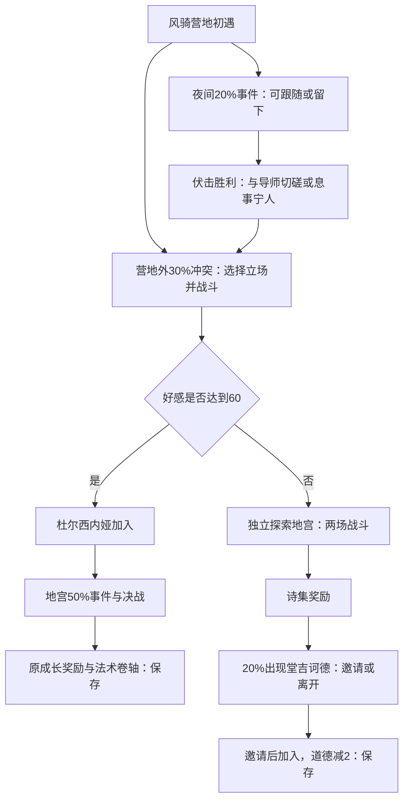

# 小说闭环交付

游戏的主循环是探索、收伙伴、培养搭配、挑战关卡、带着奖励继续探索。新手9项目标是一个教学流程，不是9条小说路线。先完成小而完整的路线，再逐条扩展。

| 单元 | 角色与目标 | 验收边界 |
| --- | --- | --- |
| 新手教学 | 格林、埃尔；装备、研习、商店、合作战斗与存读档 | 已有9目标浏览器闭环 |
| 第一条：白马／西班牙 | 杜尔西内娅、堂吉诃德；风骑营地与风车地宫 | 25段原剧情中的24段对白及3段跨线后续已覆盖；普通、困难两种难度的两条招募结局已原生实战验证，纯JOIN段保持原样 |
| 第二条计划：书剑／法国 | 米莱迪、达达尼昂；剑客救援与协作战 | 原包9段剧情，先列门槛；尚未作为完整英文路线验收 |

国家与小说对应沿用现有规划，这不是游戏强制顺序。卡住一条线可以培养、找其他伙伴再回来。本文的测试准备不改变玩家开局。

## 第一条：风骑者之旅 / Windrider's Trail

原《白马啸西风》保留25个稳定剧情编号、全部地图入口、分支、战斗、奖励和时间概率。主场景是风骑营地 Windrider Camp（哈萨克部落）与风车地宫 Windmill Warrens（高昌迷宫）。

推荐先走杜尔西内娅路线：

1. 完成新手准备，结伴埃尔。可以通过正常结伴练习、装备和研习提升队伍；首条小说的最后一战不是教学木人。
2. 去风骑营地和杜尔西内娅交谈。已有猎人或稻草人同行时，原来不同的好感变化照旧。
3. 在原夜间时段（亥、子、丑、寅、卯）继续相遇。出走事件仍有20%概率，不是进营地就必定触发。
4. 选择跟上她，打赢夜路伏击。面对导师时选 Keep the peace；原好感增加5。接受切磋仍走原战斗与好感减5分支。
5. 回营地。外部冲突仍按原30%概率出现；选择 Stand with Dulcinea 并获胜，原好感增加5。好感达到60才加入；没有达到就进入另一条线，不补好感或强制加入。
6. 带她前往风车地宫。原50%事件出现后，进行真实决战。卡关可以存档、培养或调整队伍，时限和敌人不改。
7. 获胜后，杜尔西内娅获得原30培养点、法术熟练+40、生命上限+500、能量上限+500；玩家获得原黑血神针秘籍，显示为 Bloodthorn Bolt Scroll。地图上保存，刷新后检查队友和卷轴。

另一结局：好感不足时不招募杜尔西内娅，去地宫经历两场原战斗，得到 Heroes' Almanac（河岳英灵集）。之后地宫内堂吉诃德出现仍有20%概率；邀请才执行原JOIN与道德-2。此分支缺少杜尔西内娅这名强力队员，测试中需要更多正常培养和手动攻击选择；不能称为与推荐路线相同难度。

测试观察到原自动策略在两人长战中可能反复施放增益、拖到原时限失败。本批未更改AI或时限，另一分支使用正常手动攻击验证；不声称全自动已经稳定。

图中的概率是原事件门槛，不是新增任务。对话改为简洁美式英文；堂吉诃德的鲁莽由误认敌人和寻宝执念表达，不照搬原角色辱骂村民的台词。导师的旧化名、真名与反转保留；原两个定义继续独立引用。女主跨线后续及两种回答也已改写，培养奖励不变。

## 进度提示与培养

完成新手目标后，首屏指引按真实剧情记录切换到初遇、夜访、营地冲突、招募或未招募分支、地宫和结局培养。世界地图的 Next stop 使用同一条路线。夜间时段、20%／30%／50%事件、当前信任与60门槛均有说明；邀请骑士后或拒绝邀请后的提示也分别处理。杜尔西内娅的初见提示简要关联堂吉诃德与风车，玩家不必先读过小说。

内容配置在 `chapter-guide.json`，构建时检查剧情编号、角色和地图引用。宿主的 `chapterJournal` 仅投影已经记录的剧情和信任；不执行事件条件、不抽概率、不推进时间。新手目标仍由原宿主判定；城镇内部与战场地形没有在本批重做。

队伍卡片直接显示待分配属性点、已穿装备数量、当前主专精及研习卷轴，并分别提供装备和修炼入口。**结伴练习只让队伍前两位参战**：想培养新加入的杜尔西内娅，需要把她上移到第二位。后排仍显示为参战队员，并不代表每场遭遇都会让她出场；具体出场名额由战斗决定。只在实际出场时结算卷轴经验，原规则保留。

困难测试是第一条小说的实战验证，不是整个游戏的困难通关或难度平衡验收。本次测试共238场，其中224场为练习、3场为教学尝试、11场为小说战斗尝试；小说战斗6胜5败，使用5次完整存档恢复后继续正常培养和补给。成功的推荐线决战前主角10级、埃尔7级；另一分支的最后一次准备为主角13级、埃尔9级。这些是本次培养与战术的结果，并非新增的等级门槛。

这说明困难模式目前需要较多准备，不能宣称首次游玩能在20分钟内走完。自动策略的长战增益循环也未在本批修改；测试会手动选择攻击、绝招、移动及可用恢复品。下一批平衡或AI优化应单独讨论，避免换皮时改变原数值与条件。

## 第二条：书剑／法国剑客线

建议接《书剑恩仇录》，因为它的原流程紧凑，包含“救援→招募→团队挑战→得到新剑术”，正好继续验证收伙伴和组合玩法。

1. 去 Rose Caravan（回族部落），完成原救援战并招募米莱迪（霍青桐，身份仍为候选），取得原三分剑术卷轴。
2. 前往六和塔，触发原50%救援事件，救出被囚剑客并取得原两份卷轴奖励。
3. 带米莱迪回营地，触发达达尼昂（陈家洛）的原加入与战斗，胜利后领取原柔云剑术卷轴及上限提升。

入口窗口必须保留：初次营地救援、塔中事件要求尚未完成 `mainStory_神秘剑客1`；最后阶段要求尚未完成 `mainStory_紧急1`。它们是原有条件，不会为了推荐次序而解除。法国线目前只是下一批计划及来源核对，不宣称已经完整改写或测试通过。

## 可复现检查

`test_windrider.py` 核对完整对白覆盖、跨线闭合、好感60门槛、时间／概率、奖励及第二条线的真实阶段限制。两种语言均经过原流程保护。

原生章节测试：使用 `dotnet run --project src/Game.Web.Runtime/Smoke/Smoke.csproj -- --white-horse <英文运行包> <隔离目录> normal`，末尾换成 `hard` 测困难。默认仍为普通。从对应难度新建人物开始，执行教学、交易、招募埃尔、真实结伴练习、装备／研习／分点、地图事件和战斗；另检查杜尔西内娅分点、真实装备、主专精、奖励法术研习和存读档。两个分支共用未编辑的真实导出存档，清单记录校验值。困难失利后只恢复校验一致的战前存档，正常培养补给后再战；失败也保留在报告中。禁止直接播放剧情、传送、改数值或强制胜利。

`white-horse-smoke.mjs` 从该正常成长存档在真实WebAssembly网页走推荐路线，检查英文对白／选项、真实战斗、加入、奖励、保存后刷新及375px伙伴面板；另导入原生测试完成的另一结局核对UI。后者不冒充另一分支也在网页里逐战打完。角色美术仍沿用当前素材，另批替换。

发布后使用 `white-horse-endings-smoke.mjs` 检查两个实际结局的公网加载、手机界面及浏览器保存／刷新；配合公开文件逐字节校验，不重复声称公网再从头打过两条路线。

本批 `windrider-training-smoke.mjs` 使用 `artifacts/windrider-training-normal/` 中有校验记录的完整存档，在实际浏览器检查6个阶段的导航、分支和读取指引不改变时钟／随机数。随后通过可见按钮完成杜尔西内娅换装、分配奖励点、学习奖励法术、调整出场顺序、实战获得研习经验并保存刷新；再正常前往市场购买另一份被动专精卷轴，验证学习、主运、实战成长和已学法术共存。覆盖375px手机宽度与英文残留检查；这仍不等于实际美国玩家的理解度测试。
